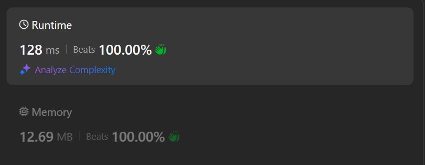

# Beat 100% | DP

**Author:** ajaysinghpanwar2002
**Votes:** 0
**Link:** [https://leetcode.com/problems/maximum-multiplication-score/solutions/5788830/](https://leetcode.com/problems/maximum-multiplication-score/solutions/5788830/)

---




# Code
```golang []
func maxScore(a []int, b []int) int64 {
	n := len(b)

	dp1 := make([]int, n)
	dp2 := make([]int, n)
	dp3 := make([]int, n)
	dp4 := make([]int, n)

	for i := 0; i < n; i++ {
		dp1[i] = math.MinInt64
		dp2[i] = math.MinInt64
		dp3[i] = math.MinInt64
		dp4[i] = math.MinInt64
	}

	dp1[0] = a[0] * b[0]
	for i := 1; i < n; i++ {
		dp1[i] = max(dp1[i-1], a[0]*b[i])
	}

	for i := 1; i < n; i++ {
		dp2[i] = max(dp2[i-1], dp1[i-1]+a[1]*b[i])
	}

	for i := 2; i < n; i++ {
		dp3[i] = max(dp3[i-1], dp2[i-1]+a[2]*b[i])
	}

	for i := 3; i < n; i++ {
		dp4[i] = max(dp4[i-1], dp3[i-1]+a[3]*b[i])
	}

	return int64(dp4[n-1])
}

func max(x, y int) int {
	if x > y {
		return x
	}
	return y
}

```