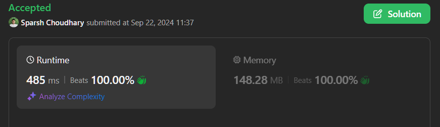

# 🔥BEATS 💯 % 🎯 |✨SUPER EASY BEGINNERS 👏

**Author:** CodeWithSparsh
**Votes:** 0
**Link:** [https://leetcode.com/problems/minimum-number-of-seconds-to-make-mountain-height-zero/solutions/5818911/](https://leetcode.com/problems/minimum-number-of-seconds-to-make-mountain-height-zero/solutions/5818911/)

---




---

# Intuition
The problem requires determining the minimum time needed for workers to reduce the height of a mountain to zero. Each worker has a specific time factor that affects how quickly they can reduce the mountain's height. Using a binary search approach allows us to efficiently find the minimum time required for the workers to complete the task.

# Approach
1. **Binary Search**: We perform a binary search on the time required, with the lower bound starting at 0 and the upper bound set to a very large number (e.g., \\(10^{18}\\)).
2. **Helper Function**: For each midpoint in our binary search, we use a helper function to check if the workers can complete the task within that time limit.
   - For each worker, calculate how much height they can reduce within the given time limit.
   - This is done using a while loop to find the maximum height each worker can contribute based on their speed and the time available.
3. **Aggregate Contribution**: Sum the contributions from all workers. If the total reduction meets or exceeds the mountain height, then the current time limit is feasible, and we adjust the binary search bounds accordingly.

# Complexity
- **Time complexity**:  
  The overall time complexity is **O(m * log(n))**, where \\(m\\) is the number of workers and \\(n\\) is the mountain height. The binary search runs in logarithmic time relative to the height, and for each midpoint, we check the contributions from each worker, which is linear.

- **Space complexity**:  
  The space complexity is **O(1)**, as we are using a constant amount of extra space for variables.

---

# Code Implementations


```dart []
class Solution {
  // Function to calculate minimum number of seconds
  int minNumberOfSeconds(int mountainHeight, List<int> workerTimes) {
    int left = 0;
    int right = 1e18.toInt(); // right is initialized to a large value
    int res = right;

    while (left <= right) {
      int mid = left + (right - left) ~/ 2; // Calculate the mid value

      if (canComplete(mid, mountainHeight, workerTimes)) {
        res = mid;
        right = mid - 1;
      } else {
        left = mid + 1;
      }
    }
    return res;
  }

  // Helper function to check if workers can complete the task in timeLimit
  bool canComplete(int timeLimit, int mountainHeight, List<int> workerTimes) {
    int totalReduction = 0;

    for (int t in workerTimes) {
      int low = 0;
      int high = mountainHeight;

      while (low <= high) {
        int mid = low + (high - low) ~/ 2;
        int timeRequired = t * (mid * (mid + 1)) ~/ 2;

        if (timeRequired <= timeLimit) {
          low = mid + 1;
        } else {
          high = mid - 1;
        }
      }

      totalReduction += high;
      if (totalReduction >= mountainHeight) return true;
    }
    return totalReduction >= mountainHeight;
  }
}
```


```java []
class Solution {
    public int minNumberOfSeconds(int mountainHeight, int[] workerTimes) {
        long left = 0;
        long right = (long)1e18; // right is initialized to a large value
        long res = right;

        while (left <= right) {
            long mid = left + (right - left) / 2; // Calculate the mid value

            if (canComplete(mid, mountainHeight, workerTimes)) {
                res = mid;
                right = mid - 1;
            } else {
                left = mid + 1;
            }
        }
        return (int)res;
    }

    private boolean canComplete(long timeLimit, int mountainHeight, int[] workerTimes) {
        long totalReduction = 0;

        for (int t : workerTimes) {
            long low = 0;
            long high = mountainHeight;

            while (low <= high) {
                long mid = low + (high - low) / 2;
                long timeRequired = t * (mid * (mid + 1)) / 2;

                if (timeRequired <= timeLimit) {
                    low = mid + 1;
                } else {
                    high = mid - 1;
                }
            }

            totalReduction += high;
            if (totalReduction >= mountainHeight) return true;
        }
        return totalReduction >= mountainHeight;
    }
}
```


```javascript []
function minNumberOfSeconds(mountainHeight, workerTimes) {
    let left = 0;
    let right = 1e18; // right is initialized to a large value
    let res = right;

    while (left <= right) {
        let mid = Math.floor(left + (right - left) / 2); // Calculate the mid value

        if (canComplete(mid, mountainHeight, workerTimes)) {
            res = mid;
            right = mid - 1;
        } else {
            left = mid + 1;
        }
    }
    return res;
}

function canComplete(timeLimit, mountainHeight, workerTimes) {
    let totalReduction = 0;

    for (let t of workerTimes) {
        let low = 0;
        let high = mountainHeight;

        while (low <= high) {
            let mid = Math.floor(low + (high - low) / 2);
            let timeRequired = t * (mid * (mid + 1)) / 2;

            if (timeRequired <= timeLimit) {
                low = mid + 1;
            } else {
                high = mid - 1;
            }
        }

        totalReduction += high;
        if (totalReduction >= mountainHeight) return true;
    }
    return totalReduction >= mountainHeight;
}
```


```python []
class Solution:
    def minNumberOfSeconds(self, mountainHeight: int, workerTimes: list[int]) -> int:
        left, right = 0, int(1e18)  # right is initialized to a large value
        res = right

        while left <= right:
            mid = left + (right - left) // 2  # Calculate the mid value

            if self.canComplete(mid, mountainHeight, workerTimes):
                res = mid
                right = mid - 1
            else:
                left = mid + 1
        return res

    def canComplete(self, timeLimit: int, mountainHeight: int, workerTimes: list[int]) -> bool:
        totalReduction = 0

        for t in workerTimes:
            low, high = 0, mountainHeight

            while low <= high:
                mid = low + (high - low) // 2
                timeRequired = t * (mid * (mid + 1)) // 2

                if timeRequired <= timeLimit:
                    low = mid + 1
                else:
                    high = mid - 1

            totalReduction += high
            if totalReduction >= mountainHeight:
                return True
        return totalReduction >= mountainHeight
```


```cpp []
#include <vector>
#include <algorithm>

class Solution {
public:
    long long minNumberOfSeconds(int mountainHeight, std::vector<int>& workerTimes) {
        long long left = 0;
        long long right = 1e18; // right is initialized to a large value
        long long res = right;

        while (left <= right) {
            long long mid = left + (right - left) / 2; // Calculate the mid value

            if (canComplete(mid, mountainHeight, workerTimes)) {
                res = mid;
                right = mid - 1;
            } else {
                left = mid + 1;
            }
        }
        return res;
    }

private:
    bool canComplete(long long timeLimit, int mountainHeight, std::vector<int>& workerTimes) {
        long long totalReduction = 0;

        for (int t : workerTimes) {
            long long low = 0;
            long long high = mountainHeight;

            while (low <= high) {
                long long mid = low + (high - low) / 2;
                long long timeRequired = t * (mid * (mid + 1)) / 2;

                if (timeRequired <= timeLimit) {
                    low = mid + 1;
                } else {
                    high = mid - 1;
                }
            }

            totalReduction += high;
            if (totalReduction >= mountainHeight) return true;
        }
        return totalReduction >= mountainHeight;
    }
};
```


```go []
package main

func minNumberOfSeconds(mountainHeight int, workerTimes []int) int64 {
    left, right := int64(0), int64(1e18) // right is initialized to a large value
    res := right

    for left <= right {
        mid := left + (right-left)/2 // Calculate the mid value

        if canComplete(mid, mountainHeight, workerTimes) {
            res = mid
            right = mid - 1
        } else {
            left = mid + 1
        }
    }
    return res
}

func canComplete(timeLimit int64, mountainHeight int, workerTimes []int) bool {
    totalReduction := int64(0)

    for _, t := range workerTimes {
        low

, high := int64(0), int64(mountainHeight)

        for low <= high {
            mid := low + (high-low)/2
            timeRequired := int64(t) * (mid * (mid + 1)) / 2

            if timeRequired <= timeLimit {
                low = mid + 1
            } else {
                high = mid - 1
            }
        }

        totalReduction += high
        if totalReduction >= int64(mountainHeight) {
            return true
        }
    }
    return totalReduction >= int64(mountainHeight)
}
```


```typescript []
function minNumberOfSeconds(mountainHeight: number, workerTimes: number[]): number {
    let left = 0;
    let right = 1e18; // right is initialized to a large value
    let res = right;

    while (left <= right) {
        let mid = Math.floor(left + (right - left) / 2); // Calculate the mid value

        if (canComplete(mid, mountainHeight, workerTimes)) {
            res = mid;
            right = mid - 1;
        } else {
            left = mid + 1;
        }
    }
    return res;
}

function canComplete(timeLimit: number, mountainHeight: number, workerTimes: number[]): boolean {
    let totalReduction = 0;

    for (let t of workerTimes) {
        let low = 0;
        let high = mountainHeight;

        while (low <= high) {
            let mid = Math.floor(low + (high - low) / 2);
            let timeRequired = t * (mid * (mid + 1)) / 2;

            if (timeRequired <= timeLimit) {
                low = mid + 1;
            } else {
                high = mid - 1;
            }
        }

        totalReduction += high;
        if (totalReduction >= mountainHeight) return true;
    }
    return totalReduction >= mountainHeight;
}
```

---

 {:style='width:250px'}

These implementations efficiently determine the minimum time needed for the workers to reduce the mountain height, utilizing binary search for optimal performance. Each solution follows the same logic, making it consistent across different programming languages.