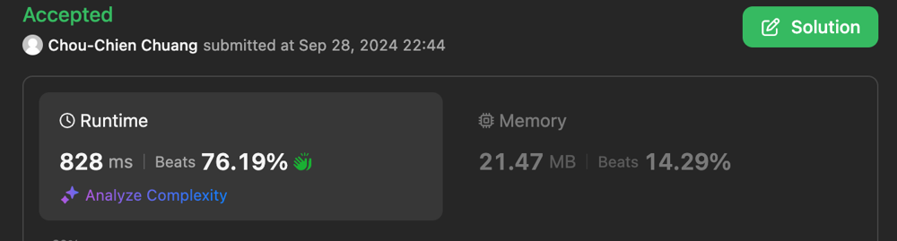

# Runtime 828ms solution

**Author:** ChouChien
**Votes:** 0
**Link:** [https://leetcode.com/problems/maximize-the-total-height-of-unique-towers/solutions/5859105/](https://leetcode.com/problems/maximize-the-total-height-of-unique-towers/solutions/5859105/)

---

# Complexity
- Time complexity: O(N logN)
<!-- Add your time complexity here, e.g. $$O(n)$$ -->

- Space complexity: O(n)
<!-- Add your space complexity here, e.g. $$O(n)$$ -->




# Code
```swift []
class Solution {
    func maximumTotalSum(_ maximumHeight: [Int]) -> Int {
        let n = maximumHeight.count
        let maximumHeight = maximumHeight.sorted()
        var result: [Int] = Array(repeating: 0, count: n)
        result[n-1] = maximumHeight[n-1]
        for i in (0 ..< n-1).reversed() {
            if maximumHeight[i] < result[i+1] {
                result[i] = maximumHeight[i]
            } else {
                result[i] = result[i+1]-1
            }
        }
        return result[0] <= 0 ? -1 : result.reduce(0, +)
    }
}
```