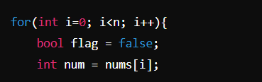
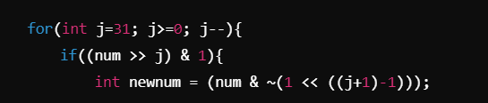
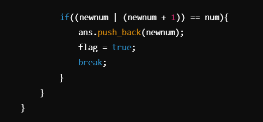

# Easy  linear O(n*31) solution ---->

**Author:** be_fighter
**Votes:** 1
**Link:** [https://leetcode.com/problems/construct-the-minimum-bitwise-array-i/solutions/5904091/](https://leetcode.com/problems/construct-the-minimum-bitwise-array-i/solutions/5904091/)

---

# Understanding the Problem:
1. For each number in the array nums, you want to generate a new number that is the "minimum" possible based on certain bitwise operations.

2. The exact property you're trying to maintain here is that if you modify a bit, you want the new number (newnum) to still be closely related to the original number num, specifically such that when you OR it with newnum + 1, it should give back the original number (num).

# In other words:

1. Key Insight: We are trying to find a way to unset one bit of the number while keeping a specific relationship with the original number intact.
#  Bitwise Thinking:
To develop this approach, let's think about how numbers work in binary:

1. Each bit in a number represents a power of 2.
2. By unsetting (turning off) a bit, you are effectively subtracting that power of 2 from the number.
3. The goal is to find a way to unset a bit and create a new number that behaves predictably when you apply the bitwise OR with (newnum + 1).
# Step-by-Step Approach:
1. Loop Through Each Number:
For every number in nums, perform the following:




2. You take each number (num) and initialize a flag to track whether you found a valid new number.



3. You iterate through all the bits of num, starting from the most significant bit (bit 31, for a 32-bit integer).
4. You check if the bit at position j is set (1), using (num >> j) & if it's set, this means you are allowed to try unsetting this bit.
newnum is created by unsetting the bit at position j using (num & ~(1 << ((j+1)-1))). This operation clears the bit at position j.




5. After unsetting the bit, you check if this newnum satisfies the condition (newnum | (newnum + 1)) == num.
6. This condition ensures that when you OR newnum with newnum + 1, you should get back the original number num. This helps maintain some structural similarity with the original number.
7. If the condition is satisfied, newnum is valid, and you store it in ans and set the flag to true, indicating success for this number.
You then break out of the loop since you have already found the "minimum" number for this element.

8. If no valid newnum is found (i.e., if flag remains false after trying all possible bit manipulations), you append -1 to the answer. This implies there\u2019s no valid number that satisfies the condition for that particular num.

# Return the Result:
1. Finally, after processing all numbers, the function returns the ans array, which contains the results of the bit manipulations for each number.

# Why This Approach?
1. Bitwise Manipulation: This approach leverages bitwise operations to explore different possibilities of "unsetting" bits in an attempt to minimize the number while maintaining a key property.
2. Efficiency: By iterating through the bits starting from the most significant, it quickly finds a valid solution for each number (if it exists), thus avoiding unnecessary computations.

# Complexity
- Time complexity:
O(N*31) as one outer loop and o(31) for traversing on bits

- Space complexity:
O(N)

# code
```C++ []
class Solution {
public:
    vector<int> minBitwiseArray(vector<int>& nums) {
        
        int n=nums.size();
        vector<int>ans;
        
        for(int i=0;i<n;i++){

            bool flag=false;
            int num=nums[i];
            for(int j=31;j>=0;j--){

                if((num>>j)&1){
                   int newnum=(num&~(1<<((j+1)-1)));
                  if((newnum|(newnum+1))==num){
                    ans.push_back(newnum);
                    flag=true;
                    break;
                }
                }
            }
            if(flag==false){
                ans.push_back(-1);
            }
        }
        return ans;
    }
};
```
```java []
import java.util.*;

class Solution {
    public List<Integer> minBitwiseArray(int[] nums) {
        List<Integer> ans = new ArrayList<>();
        int n = nums.length;

        for (int i = 0; i < n; i++) {
            boolean flag = false;
            int num = nums[i];

            for (int j = 31; j >= 0; j--) {
                if ((num >> j & 1) == 1) {
                    int newnum = (num & ~(1 << ((j + 1) - 1)));
                    if ((newnum | (newnum + 1)) == num) {
                        ans.add(newnum);
                        flag = true;
                        break;
                    }
                }
            }
            if (!flag) {
                ans.add(-1);
            }
        }
        return ans;
    }


```
```python []
class Solution:
    def minBitwiseArray(self, nums):
        ans = []
        n = len(nums)

        for num in nums:
            flag = False
            for j in range(31, -1, -1):
                if (num >> j) & 1:
                    newnum = (num & ~(1 << ((j + 1) - 1)))
                    if (newnum | (newnum + 1)) == num:
                        ans.append(newnum)
                        flag = True
                        break
            if not flag:
                ans.append(-1)
        
        return ans
```
```javascript []
class Solution {
    minBitwiseArray(nums) {
        let ans = [];
        let n = nums.length;

        for (let i = 0; i < n; i++) {
            let flag = false;
            let num = nums[i];

            for (let j = 31; j >= 0; j--) {
                if ((num >> j) & 1) {
                    let newnum = (num & ~(1 << ((j + 1) - 1)));
                    if ((newnum | (newnum + 1)) === num) {
                        ans.push(newnum);
                        flag = true;
                        break;
                    }
                }
            }
            if (!flag) {
                ans.push(-1);
            }
        }

        return ans;
    }
}
```

