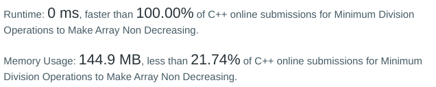

# [Super-fast 0 ms] Smallest prime divisor

**Author:** votrubac
**Votes:** 16
**Link:** [https://leetcode.com/problems/minimum-division-operations-to-make-array-non-decreasing/solutions/5940673/](https://leetcode.com/problems/minimum-division-operations-to-make-array-non-decreasing/solutions/5940673/)

---

The description says "divide it by its **greatest** proper divisor", and I missed that.

What it means is that we replace a number with its smallest prime divisor.

**C++**
To make it super-fast, we:
- Pre-populate the primes array.
- Memoize the minimal prime for a number and re-use for all test cases. 



```cpp
const int primes[] = {
    2, 3, 5, 7, 11, 13, 17, 19, 23, 29, 31, 37, 41, 43, 47, 53, 59, 61, 67, 71, 73, 79, 83, 89, 97,
    101, 103, 107, 109, 113, 127, 131, 137, 139, 149, 151, 157, 163, 167, 173, 179, 181, 191, 193, 197, 199,
    211, 223, 227, 229, 233, 239, 241, 251, 257, 263, 269, 271, 277, 281, 283, 293,
    307, 311, 313, 317, 331, 337, 347, 349, 353, 359, 367, 373, 379, 383, 389, 397,
    401, 409, 419, 421, 431, 433, 439, 443, 449, 457, 461, 463, 467, 479, 487, 491, 499,
    503, 509, 521, 523, 541, 547, 557, 563, 569, 571, 577, 587, 593, 599,
    601, 607, 613, 617, 619, 631, 641, 643, 647, 653, 659, 661, 673, 677, 683, 691,
    701, 709, 719, 727, 733, 739, 743, 751, 757, 761, 769, 773, 787, 797,
    809, 811, 821, 823, 827, 829, 839, 853, 857, 859, 863, 877, 881, 883, 887,
    907, 911, 919, 929, 937, 941, 947, 953, 967, 971, 977, 983, 991, 997                  
};
int dp[1000001] = {};
class Solution {
public:
int minOperations(vector<int>& nums) {
    int res = 0;
    for (int i = (int)nums.size() - 2; i >= 0; --i)
        if (nums[i] > nums[i + 1]) {
            ++res;
            if (dp[nums[i]] == 0) {
                dp[nums[i]] = nums[i];
                for (int p = 0; primes[p] * primes[p] <= nums[i]; ++p)
                    if (nums[i] % primes[p] == 0) {
                        dp[nums[i]] = primes[p];
                        break;
                    }
            }
            nums[i] = dp[nums[i]];
            if (nums[i] > nums[i + 1])
                return -1;            
        }
    return res;
}
```