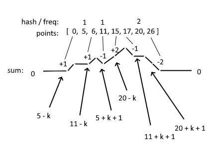

# c++ solution sweep line

**Author:** dilipsuthar60
**Votes:** 29
**Link:** [https://leetcode.com/problems/maximum-frequency-of-an-element-after-performing-operations-ii/solutions/6027151/](https://leetcode.com/problems/maximum-frequency-of-an-element-after-performing-operations-ii/solutions/6027151/)

---

Here, sum represents the total count of integers that can be adjusted to 'it' through either increasing or decreasing.

hash[it] denotes the direct occurrences of 'it.'

The expression sum - hash[it] gives the number of elements that can actually be increased or decreased.

You\u2019re allowed to perform only numOperations adjustments.

Thus, ans = max(ans, hash[it] + min(sum - hash[it], numOperations));



```
class Solution {
public:
    int maxFrequency(vector<int>& nums, int k, int numOperations) {
        map<int,int>mp;
        unordered_map<int,int>hash;
        set<int>points;
        for(auto &it:nums){
            hash[it]++;
            mp[it-k]++;
            mp[it+k+1]--;
            points.insert(it);
            points.insert(it-k);
            points.insert(it+k+1);
        }
        int ans=1;
        int sum=0;
        for(auto &it:points){
            sum+=mp[it];
            ans=max(ans,hash[it]+min(sum-hash[it],numOperations));
        }
        return ans;
    }
};
```