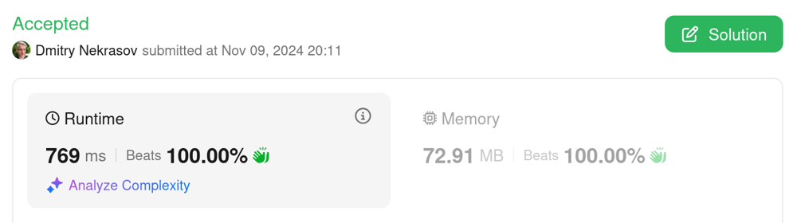

# [ C++ | Java | Kotlin ] Simple binary search solution, beats 100% 🚀

**Author:** DmitryNekrasov
**Votes:** 0
**Link:** [https://leetcode.com/problems/maximum-frequency-of-an-element-after-performing-operations-ii/solutions/6027260/](https://leetcode.com/problems/maximum-frequency-of-an-element-after-performing-operations-ii/solutions/6027260/)

---

# Complexity
- Time complexity: $$O(n * log(n))$$

- Space complexity: $$O(n)$$

# Code
```cpp []
class Solution {
private:
    static int solve(const vector<long long>& nums, int width, int numOperations, long long target) {
        int j = upperBound(nums, target - 1);
        int k = lowerBound(nums, target + 1);
        int j2 = upperBound(nums, target - 2 * width - 1);
        int k2 = lowerBound(nums, target + 2 * width + 1);
        return k - j + 1 + min(j - j2 + k2 - k, numOperations);
    }
    
    static int upperBound(const vector<long long>& nums, long long target) {
        int left = 0, right = nums.size();
        while (left < right) {
            int mid = left + (right - left) / 2;
            if (nums[mid] >= target) {
                right = mid;
            } else {
                left = mid + 1;
            }
        }
        return right;
    }
    
    static int lowerBound(const vector<long long>& nums, long long target) {
        int pos = upperBound(nums, target);
        return pos - (pos < nums.size() && nums[pos] == target ? 0 : 1);
    }
    
public:
    int maxFrequency(vector<int>& input, int width, int numOperations) {
        // Sort and convert to long long
        sort(input.begin(), input.end());
        vector<long long> nums;
        for (int x : input) {
            nums.push_back(2LL * x);
        }
        
        int ans = 0;
        for (long long num : nums) {
            int c1 = solve(nums, width, numOperations, num);
            int c2 = solve(nums, width, numOperations, num - 2 * width);
            int c3 = solve(nums, width, numOperations, num + 2 * width);
            ans = max(ans, max(c1, max(c2, c3)));
        }
        return ans;
    }
};
```
```java []
class Solution {
    private static int solve(long[] nums, int width, int numOperations, long target) {
        int j = upperBound(nums, target - 1);
        int k = lowerBound(nums, target + 1);
        int j2 = upperBound(nums, target - 2 * width - 1);
        int k2 = lowerBound(nums, target + 2 * width + 1);
        return k - j + 1 + Math.min(j - j2 + k2 - k, numOperations);
    }

    public int maxFrequency(int[] input, int width, int numOperations) {
        long[] nums = Arrays.stream(input).sorted().mapToLong(i -> i * 2L).toArray();
        int ans = 0;
        for (long num : nums) {
            int c1 = solve(nums, width, numOperations, num);
            int c2 = solve(nums, width, numOperations, num - 2 * width);
            int c3 = solve(nums, width, numOperations, num + 2 * width);
            ans = Math.max(ans, Math.max(c1, Math.max(c2, c3)));
        }
        return ans;
    }

    private static int upperBound(long[] nums, long target) {
        int left = 0, right = nums.length;
        while (left < right) {
            int mid = left + (right - left) / 2;
            if (nums[mid] >= target) {
                right = mid;
            } else {
                left = mid + 1;
            }
        }
        return right;
    }

    private static int lowerBound(long[] nums, long target) {
        int pos = upperBound(nums, target);
        return pos - (pos < nums.length && nums[pos] == target ? 0 : 1);
    }
}
```
```kotlin []
class Solution {
    fun maxFrequency(input: IntArray, width: Int, numOperations: Int): Int {
        val nums = input.sorted().map { it.toLong() * 2 }

        fun solve(target: Long): Int {
            val j = nums.upperBound(target - 1)
            val k = nums.lowerBound(target + 1)
            val j2 = nums.upperBound(target - 2 * width - 1)
            val k2 = nums.lowerBound(target + 2 * width + 1)
            return k - j + 1 + min(j - j2 + k2 - k, numOperations)
        }

        return nums.flatMap { listOf(solve(it), solve(it - 2 * width), solve(it + 2 * width)) }.max()
    }

    companion object {
        private fun List<Long>.upperBound(target: Long, left: Int = 0, right: Int = size): Int {
            if (left >= right) return right
            val mid = left + (right - left) / 2
            return if (this[mid] >= target) upperBound(target, left, mid) else upperBound(target, mid + 1, right)
        }

        private fun List<Long>.lowerBound(target: Long, left: Int = 0, right: Int = size) =
            upperBound(target, left, right).let { it - if (it < size && this[it] == target) 0 else 1 }
    }
}
```

