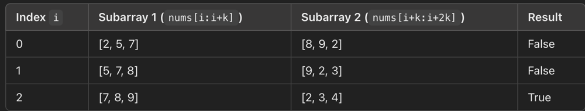

# With Dry Run Table | Easiest solution | PYTHON | JAVA | JS | CPP | 🌟 Beats 100.00% 👏

**Author:** deep94725kumar
**Votes:** 13
**Link:** [https://leetcode.com/problems/adjacent-increasing-subarrays-detection-i/solutions/6028629/](https://leetcode.com/problems/adjacent-increasing-subarrays-detection-i/solutions/6028629/)

---

# Intuition
<!-- Describe your first thoughts on how to solve this problem. -->
To determine if there are two adjacent subarrays of length k that are both strictly increasing, we need to check pairs of subarrays in the array. Specifically, we will look for two subarrays that start at different indices but are right next to each other. If both subarrays are strictly increasing, we can return true; otherwise, we return false.

---


# Approach
<!-- Describe your approach to solving the problem. -->
- Define a helper function, isStrictlyIncreasing, to check if a subarray of length k is strictly increasing.

- Loop through the array up to n - 2 * k (ensuring room for two adjacent subarrays).

- For each possible starting point i, check if both the subarray starting at i and the one starting at i + k are strictly increasing.

- If both conditions are met, return true. If no such pair is found, return false.


---

# DRY RUN TABLE
NUMS= [2,5,7,8,9,2,3,4,3,1]  K =3 




# Complexity
- Time complexity:
<!-- Add your time complexity here, e.g. $$O(n)$$ -->
O(n\xD7k), as we may check up to n\u22122k possible starting indices and each check requires O(k) operations.

- Space complexity:
<!-- Add your space complexity here, e.g. $$O(n)$$ -->
O(1), since only a few variables are used
```javascript []
function isStrictlyIncreasing(nums, start, k) {
    for (let i = start; i < start + k - 1; i++) {
        if (nums[i] >= nums[i + 1]) return false;
    }
    return true;
}

function hasIncreasingSubarrays(nums, k) {
    const n = nums.length;
    if (n < 2 * k) return false;

    for (let i = 0; i <= n - 2 * k; i++) {
        if (isStrictlyIncreasing(nums, i, k) && isStrictlyIncreasing(nums, i + k, k)) {
            return true;
        }
    }

    return false;
}
```
```python []
def isStrictlyIncreasing(nums, start, k):
    for i in range(start, start + k - 1):
        if nums[i] >= nums[i + 1]:
            return False
    return True

def hasIncreasingSubarrays(nums, k):
    n = len(nums)
    if n < 2 * k:
        return False

    for i in range(n - 2 * k + 1):
        if isStrictlyIncreasing(nums, i, k) and isStrictlyIncreasing(nums, i + k, k):
            return True

    return False
```
```cpp []
  
bool isStrictlyIncreasing(const vector<int>& nums, int start, int k) {
    for (int i = start; i < start + k - 1; i++) {
        if (nums[i] >= nums[i + 1]) return false;
    }
    return true;
}

bool hasIncreasingSubarrays(vector<int>& nums, int k) {
    int n = nums.size();
    if (n < 2 * k) return false; 

    for (int i = 0; i <= n - 2 * k; i++) {
        if (isStrictlyIncreasing(nums, i, k) && isStrictlyIncreasing(nums, i + k, k)) {
            return true;
        }
    }

    return false;
}
```

```JAVA []
  
public class Solution {
    public boolean isStrictlyIncreasing(List<Integer> nums, int start, int k) {
        for (int i = start; i < start + k - 1; i++) {
            if (nums.get(i) >= nums.get(i + 1)) return false;
        }
        return true;
    }

    public boolean hasIncreasingSubarrays(List<Integer> nums, int k) {
        int n = nums.size();
        if (n < 2 * k) return false;

        for (int i = 0; i <= n - 2 * k; i++) {
            if (isStrictlyIncreasing(nums, i, k) && isStrictlyIncreasing(nums, i + k, k)) {
                return true;
            }
        }

        return false;
    }
}

```
