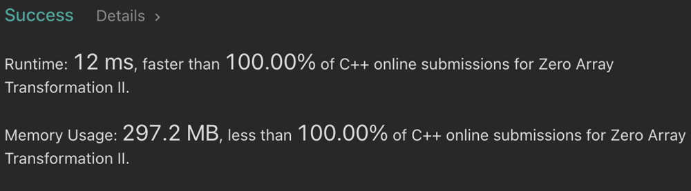

# 🚨 C++ || Faster 100% || Sweep line 10 lines

**Author:** t86
**Votes:** 1
**Link:** [https://leetcode.com/problems/zero-array-transformation-ii/solutions/6053594/](https://leetcode.com/problems/zero-array-transformation-ii/solutions/6053594/)

---

**Intuition**
- Extend [this](https://leetcode.com/problems/zero-array-transformation-i/discuss/6053483/C%2B%2B-oror-5-Lines-Sweep-line-oror-Faster-100) solution to include checking at every step.
 
**Code**
```c++
int minZeroArray(vector<int>& N, vector<vector<int>>& Q) {
    vector<int> compute(N.size() + 1, 0);
    auto check = [&]() {
        bool can = true;
        for (auto i = 0, now = 0; i < N.size(); i++) {
            now += compute[i];
            if (now < N[i]) { can = false; break; }
        }
        return can;
    };
    if (check()) return 0;
    for (auto i = 0; i < Q.size(); i++) {
        auto l = Q[i].front(), r = Q[i][1], val = Q[i].back();
        compute[l] += val, compute[r + 1] -= val;
        if (check()) return i + 1;
    }
    return -1;
}
```

**Complexity**
`Time`: O(q * n)
`Space`: O(n)

**For more solutions and concepts, check out this \uD83D\uDCD6 [BLOG](https://github.com/MuhtasimTanmoy/notebook)  and  \uD83C\uDFC6 [GITHUB REPOSITORY](https://github.com/MuhtasimTanmoy/playground) with over 2000+ solutions.**

