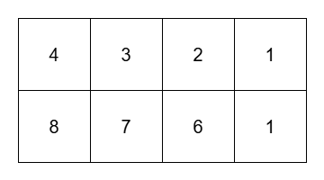

# [3359. Find Sorted Submatrices With Maximum Element at Most K](https://leetcode.com/problems/find-sorted-submatrices-with-maximum-element-at-most-k/)

| Category | Difficulty | Likes | Dislikes |
| :------: | :--------: | :---: | :------: |
| Algorithms | Hard | 7 | 3 |

**Tags:** [`array`](https://leetcode.com/tag/array), [`stack`](https://leetcode.com/tag/stack), [`matrix`](https://leetcode.com/tag/matrix), [`monotonic-stack`](https://leetcode.com/tag/monotonic-stack)

## Description

You are given a 2D matrix `grid` of size `m x n`. You are also given a **non-negative** integer `k`.

Return the number of **submatrices** of `grid` that satisfy the following conditions:

	- The maximum element in the submatrix **less than or equal to** `k`.

	- Each row in the submatrix is sorted in **non-increasing** order.

A submatrix `(x1, y1, x2, y2)` is a matrix that forms by choosing all cells `grid[x][y]` where `x1 <= x <= x2` and `y1 <= y <= y2`.

 

**Example 1:**

**Input:** grid = [[4,3,2,1],[8,7,6,1]], k = 3

**Output:** 8

**Explanation:**

****

The 8 submatrices are:

	- `[[1]]`

	- `[[1]]`

	- `[[2,1]]`

	- `[[3,2,1]]`

	- `[[1],[1]]`

	- `[[2]]`

	- `[[3]]`

	- `[[3,2]]`

**Example 2:**

**Input:** grid = [[1,1,1],[1,1,1],[1,1,1]], k = 1

**Output:** 36

**Explanation:**

There are 36 submatrices of grid. All submatrices have their maximum element equal to 1.

**Example 3:**

**Input:** grid = [[1]], k = 1

**Output:** 1

 

**Constraints:**

	- `1 <= m == grid.length <= 10^3`

	- `1 <= n == grid[i].length <= 10^3`

	- `1 <= grid[i][j] <= 10^9`

	- `1 <= k <= 10^9`

 

​​​​​​

---

**Links:** [Submissions](https://leetcode.com/problems/find-sorted-submatrices-with-maximum-element-at-most-k/) | [Solutions](https://leetcode.com/problems/find-sorted-submatrices-with-maximum-element-at-most-k/)
