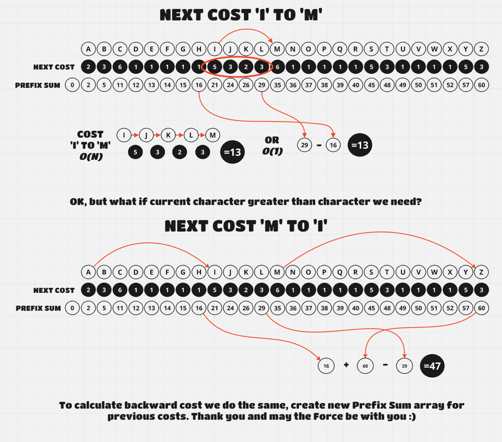
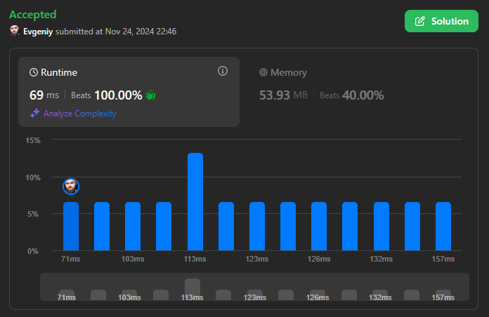
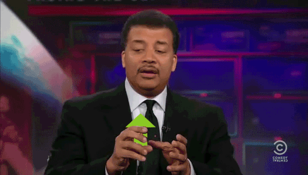

# [Swift, C++, Python3] Solution with diagram and explanation 100% faster

**Author:** evkobak
**Votes:** 2
**Link:** [https://leetcode.com/problems/shift-distance-between-two-strings/solutions/6080329/](https://leetcode.com/problems/shift-distance-between-two-strings/solutions/6080329/)

---

# Intuition
We can't calculate every character permutation; it's too long. We can create our prefix sum arrays (for nextCost and for previousCost) beforehand and then calculate the distance between `s[i]` and `t[i]` in *O(1)* time.

# Approach



After that, we just choose the minimum path cost from shifting forward or backward.


# Complexity
- Time complexity:
O(n)

- Space complexity:
O(n)




# C++ Code
```cpp []
class Solution {
public:
    long long shiftDistance(string s, string t, vector<int>& nextCost, vector<int>& previousCost) {
        vector<long long> dpNext = {0};
        vector<long long> dpPrev(previousCost.size()+1, 0);
        long long cost = 0;

        for (int i = 0; i < nextCost.size(); ++i)
        {
            dpNext.push_back(dpNext[i] + nextCost[i]);
            dpPrev[dpPrev.size()-i-2] = dpPrev[dpPrev.size()-i-1] + previousCost[previousCost.size()-i-1];
        }

        for (int i = 0; i < s.size(); ++i)
        {
            int index1 = s[i] - 'a';
            int index2 = t[i] - 'a';
            if (index1 < index2)
            {
                long long nextTotal = dpNext[index2] - dpNext[index1];
                long long prevTotal = dpPrev[0] - dpPrev[index1+1] + dpPrev[index2+1];
                cost += min(nextTotal, prevTotal);
            }
            else if (index1 > index2)
            {
                long long nextTotal = dpNext.back() - dpNext[index1] + dpNext[index2];
                long long prevTotal = dpPrev[index2+1] - dpPrev[index1+1];
                cost += min(nextTotal, prevTotal);
            }
        }

        return cost;
    }
};
```

# Swift Code 
```swift []
class Solution {
    func shiftDistance(_ s: String, _ t: String, _ nextCost: [Int], _ previousCost: [Int]) -> Int {
        var sChars = Array(s)
        var tChars = Array(t)
        var dpNext = [0]
        var dpPrev = [0]
        var cost = 0

        for i in 0 ..< nextCost.count {
            dpNext.append(dpNext[i] + nextCost[i])
            dpPrev.append(dpPrev[i] + previousCost[i])
        }

        for  i in 0 ..< s.count {
            let index1 = Int(sChars[i].asciiValue!) - 97
            let index2 = Int(tChars[i].asciiValue!) - 97

            if index1 < index2 {
                var nextTotal = dpNext[index2] - dpNext[index1]
                var prevTotal = dpPrev[index1+1] + dpPrev.last! - dpPrev[index2+1]
                cost += min(nextTotal, prevTotal)
            } else if index1 > index2 {
                var nextTotal = dpNext.last! - dpNext[index1] + dpNext[index2]
                var prevTotal = dpPrev[index1+1] - dpPrev[index2+1]
                cost += min(nextTotal, prevTotal)
            }
        }

        return cost
    }
}
```

# Python3 Code
```python3 []
class Solution:
    def shiftDistance(self, s: str, t: str, nextCost: List[int], previousCost: List[int]) -> int:
        dpNext = [0]
        dpPrev = [0]
        cost = 0

        for i in range(len(nextCost)):
            dpNext.append(dpNext[i] + nextCost[i])
            dpPrev.append(dpPrev[i] + previousCost[i])

        for i in range(len(s)):
            index1 = ord(s[i]) - 97
            index2 = ord(t[i]) - 97

            if index1 < index2:
                nextTotal = dpNext[index2] - dpNext[index1]
                prevTotal = dpPrev[index1+1] + dpPrev[-1] - dpPrev[index2+1]
                cost += min(nextTotal, prevTotal)
            elif index1 > index2:
                nextTotal = dpNext[-1] - dpNext[index1] + dpNext[index2]
                prevTotal = dpPrev[index1+1] - dpPrev[index2+1]
                cost += min(nextTotal, prevTotal)

        return cost
```

If you like it, please upvote :)


