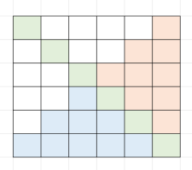

# Partition DP

**Author:** skharchenko87
**Votes:** 0
**Link:** [https://leetcode.com/problems/find-the-maximum-number-of-fruits-collected/solutions/6075740/](https://leetcode.com/problems/find-the-maximum-number-of-fruits-collected/solutions/6075740/)

---

# Intuition
<!-- Describe your first thoughts on how to solve this problem. -->
Each child can move only in his own area according to the condition of the number of steps

# Approach
<!-- Describe your approach to solving the problem. -->
Areas:


# Complexity
- Time complexity:
<!-- Add your time complexity here, e.g. $$O(n)$$ -->

- Space complexity:
<!-- Add your space complexity here, e.g. $$O(n)$$ -->

# Code
```golang []

func maxCollectedFruits(fruits [][]int) int {
	n := len(fruits)
	green, red, blue := 0, 0, 0
	for i := 0; i < n; i++ {
		green += fruits[i][i]
		fruits[i][i] = 0
	}

	for i := 0; i < n; i++ {
		for j := 0; j < n; j++ {
			if j < n-i-1 {
				fruits[i][j] = 0
			}
		}
	}
	//red
	for i := 1; i < n-1; i++ {
		for j := i + 1; j < n; j++ {
			var l, m, r int
			if j-1 >= 0 {
				l = fruits[i-1][j-1]
			}
			m = fruits[i-1][j]
			if j+1 < n {
				r = fruits[i-1][j+1]
			}
			fruits[i][j] += max(max(l, m), r)
		}
	}
	//blue
	for j := 1; j < n-1; j++ {
		for i := n - 1; i >= n-1-i; i-- {
			var u, m, d int
			if i-1 >= 0 {
				u = fruits[i-1][j-1]
			}
			m = fruits[i][j-1]
			if i+1 < n {
				d = fruits[i+1][j-1]
			}
			fruits[i][j] += max(max(u, m), d)
		}
	}

	//fmt.Println(fruits)
	red = fruits[n-2][n-1]
	blue = fruits[n-1][n-2]
	return green + red + blue
}
```