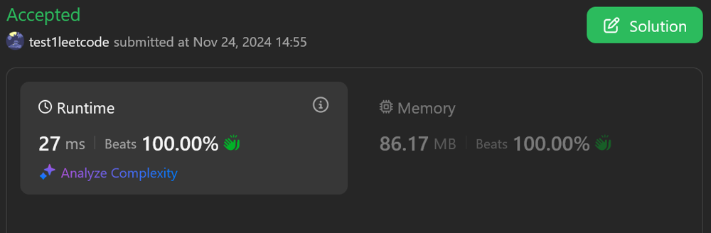
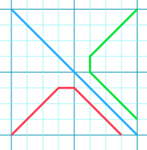
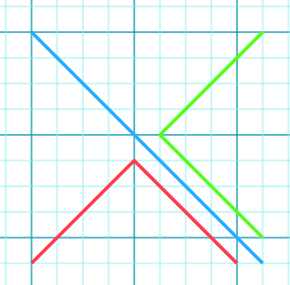

# No DP. just brute

**Author:** test1leetcode
**Votes:** 0
**Link:** [https://leetcode.com/problems/find-the-maximum-number-of-fruits-collected/solutions/6078615/](https://leetcode.com/problems/find-the-maximum-number-of-fruits-collected/solutions/6078615/)

---

# Intuition
<!-- Describe your first thoughts on how to solve this problem. -->


It is given kids tavel n-1 steps. This is the key.

For topleft kid to travel n-1 steps on n*n grid, there is only one way to reach bottom right. i.e. to travel from topleft to bottom right

For Bottom left kid, max deviation it can take is given in image (Red). kid can deviate max by this much only. All paths of kid lies inside this triangle , so calculate and store max along the way

Same for TopRight kid, max deviation it can take is given in iamge(Green). for this too calculate max fruits it can take bound by this max freedom.

Following diagram tells the range of paths of kids (line denotes max deviation they can take)

For n=9


For n=10



# Approach
<!-- Describe your approach to solving the problem. -->

# Complexity
- Time complexity:
<!-- Add your time complexity here, e.g. $$O(n)$$ -->

- Space complexity:
<!-- Add your space complexity here, e.g. $$O(n)$$ -->

# Code
```javascript []
/**
 * @param {number[][]} fruits
 * @return {number}
 */
var maxCollectedFruits = function(fruits) {
    let n = fruits.length;
    let totalsum = 0, half = Math.ceil( (n-1) / 2);
    //top left goes diagonically to bottom right
    for(let i=0; i<n; i++) {
        totalsum += fruits[i][i];
    }
    //bottom left triangle
    function updateFromLeftPaths(i,j) {
        let maxFromLeft = 0;
        if (i-1 >= n - j) {
            maxFromLeft = fruits[i-1][j - 1];
        }
        if (i >= n - j) {
            maxFromLeft = Math.max(maxFromLeft, fruits[i][j-1]);
        }
        if (i+1 >= n - j && i+1 < n) {
            maxFromLeft = Math.max(maxFromLeft, fruits[i+1][j-1]);
        }
        fruits[i][j] += maxFromLeft;
    }
    for(let j=1; j<=half - 1; j++) {
        for(let i=n - 1; i>= n - j - 1; i--) {
            updateFromLeftPaths(i,j);
        }
    }
    for(let j=half; j<=n - 2; j++) {
        for(let i=n - 1; i>= j + 1; i--) {
            updateFromLeftPaths(i,j);
        }
    }
    //fruits[n-1][n-2] has max for topLeftKid
    totalsum += fruits[n - 1][n - 2];

    //top right
    function updateFromTopPaths(i,j) {
        let maxFromTop = 0;
        if (j-1 >= n - i) {
            maxFromTop = fruits[i-1][j-1];
        }
        if (j >= n - i) {
            maxFromTop = Math.max(maxFromTop, fruits[i-1][j]);
        }
        if (j+1 >= n - i && j+1 < n) {
            maxFromTop = Math.max(maxFromTop, fruits[i-1][j+1]);
        }
        fruits[i][j] += maxFromTop;
    }
    for(let i=1; i<=half - 1; i++) {
        for(let j=n - 1; j>= n - i - 1; j--) {
            updateFromTopPaths(i,j);
        }
    }
    for(let i=half; i<=n - 2; i++) {
        for(let j=n - 1; j>= i + 1; j--) {
            updateFromTopPaths(i,j);
        }
    }
    //fruits[n-2][n-1] has totalfruits for topright kid
    totalsum += fruits[n - 2][n - 1];
    return totalsum;
};
```