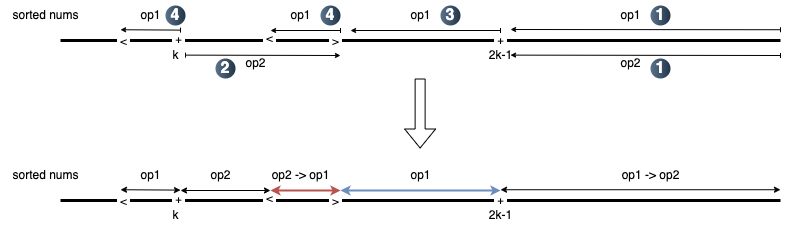

# O(N log N) Greedy

**Author:** zsq007
**Votes:** 16
**Link:** [https://leetcode.com/problems/minimum-array-sum/solutions/6078002/](https://leetcode.com/problems/minimum-array-sum/solutions/6078002/)

---

This solution hasn't been rigorously proven correct. If you find any corner cases that can break it, please leave a comment.

# Intuition
<!-- Describe your first thoughts on how to solve this problem. -->
To get the minimal sum, we aim to maximize the decrement for each operation.

Decrement for each operation:
`op1`: `num - (num+1)//2` = `num // 2`;
`op2`: `num - (num-k)` = `k`;
`op1 -> op2`: `num - ((num+1)//2-k)` = `num // 2 + k`;
`op2 -> op1`: `num - (num-k+1)//2` = `(num+k) // 2` (The root cause of the extra decrement in some corner cases, see Corner Case section below).

The maximal decrement we can get is using `op1->op2`, followed by `op2->op1`, and then either `op1` or `op2` alone, depending on `num`.

To maximize the decrement from `num//2`, we perform operations from larger to smaller numbers.

- **Phase 1**: For `num >= 2*k-1`, we can always get the maximum decrement with `op1->op2`.

- **Phase 2 & 3**: For `k <= num < 2*k-1`, we choose between `op2->op1`, `op1`, and `op2` depending on the availability of `op1` and `op2`. To gain a decrement of `k` (instead of `k//2`) from each `op2`, we try to minimze the overlap between `op1` and `op2` (i.e., `op2->op1`). Since `op1` should always be applied to larger numbers, we apply `op2` from the smaller end of this section.

- **Phase 4**: Finally, we sort the remaining numbers that haven't perform `op1`, and apply `op1` from largest to smallest.




# Corner Case
<!-- Describe your approach to solving the problem. -->

**For `op2->op1`, when `k` is odd, the parity of `num` may affact the decrement by 1.** 

This case occurs in the middle section (`k <= num < 2*k-1`). As shown in the firgure above, swapping even numbers in red and odd numbers in blue could result in a larger decrement.

Example: `nums = [6, 7]`, `k = 5`, `op1 = 2`, `op2 = 1`

Performing `op2` on `nums[0]` as per the algorithm above results in `nums = [1, 4]`, while performing `op2` on `nums[1]` yields a smaller sum, `nums = [3, 1]`.

To account for this, we collect even numbers in the red section using `candidates`, and count odd numbers in the blue section using `swapCnt`. Each swapping pair provides 1 additional decrement.


# Complexity
- Time complexity: $O(n \\log n)$ 
<!-- Add your time complexity here, e.g. $$O(n)$$ -->

- Space complexity: $O(1)$
<!-- Add your space complexity here, e.g. $$O(n)$$ -->

# Code
```python []
class Solution:
    def minArraySum(self, nums: List[int], k: int, op1: int, op2: int) -> int:
        n = len(nums)
        nums.sort()

        m1, m2 = bisect_left(nums, k), bisect_left(nums, 2*k-1)

        # Preparation for the corner case of swapping pairs
        candidates, swapCnt = set(), 0

        # Phase 1
        # Largest numbers, apply op1 then op2
        i = n-1
        while i >= m2 and op1 > 0:
            nums[i] = (nums[i]+1) // 2
            op1 -= 1
            if op2 > 0:
                nums[i] -= k
                op2 -= 1
            i -= 1

        # Phase 2
        # Apply op2 in the middle section, from left to right
        j = m1
        while j <= i and op2 > 0:
            if k % 2 == 1 and nums[j] % 2 == 0:
                # k odd and nums[j] even, could be swapped
                candidates.add(j)

            nums[j] -= k
            op2 -= 1
            j += 1

        # Phase 3
        # Apply op1 to the numbers in the middle section that haven't been applied op2
        while i >= j and op1 > 0:
            if k % 2 == 1 and nums[i] % 2 == 1:
                # k odd and nums[i] odd, could be swapped
                swapCnt += 1
            
            nums[i] = (nums[i]+1) // 2
            op1 -= 1
            i -= 1

        # Phase 4
        # Sort the remaining numbers and apply op1 greedily
        arr = sorted((nums[idx], idx) for idx in range(j))
        while op1 > 0:
            num, idx = arr.pop()
            nums[idx] = (num+1) // 2
            op1 -= 1

            if idx in candidates and swapCnt > 0:
                # Swapping pair
                swapCnt -= 1
                nums[idx] -= 1

        return sum(nums)
```
```C++ []
/* ------- Translated from Python code by ChatGPT ---------*/

class Solution {
public:
    int minArraySum(vector<int>& nums, int k, int op1, int op2) {
        int n = nums.size();
        sort(nums.begin(), nums.end());

        // Find the boundaries for the three sections
        auto m1 = lower_bound(nums.begin(), nums.end(), k) - nums.begin();
        auto m2 = lower_bound(nums.begin(), nums.end(), 2 * k - 1) - nums.begin();

        set<int> candidates; // To track indices of even numbers in the middle section
        int swapCnt = 0;

        // Phase 1
        // Largest numbers, apply op1 then op2
        int i = n - 1;
        while (i >= m2 && op1 > 0) {
            nums[i] = (nums[i] + 1) / 2;
            op1--;
            if (op2 > 0) {
                nums[i] -= k;
                op2--;
            }
            i--;
        }

        // Phase 2
        // Apply op2 in the middle section, from left to right
        int j = m1;
        while (j <= i && op2 > 0) {
            if (k % 2 == 1 && nums[j] % 2 == 0) {
                // k is odd and nums[j] is even, mark as a candidate for swapping
                candidates.insert(j);
            }
            nums[j] -= k;
            op2--;
            j++;
        }

        // Phase 3
        // Apply op1 to numbers in the middle section not already affected by op2
        while (i >= j && op1 > 0) {
            if (k % 2 == 1 && nums[i] % 2 == 1) {
                // k is odd and nums[i] is odd, increase swap count
                swapCnt++;
            }
            nums[i] = (nums[i] + 1) / 2;
            op1--;
            i--;
        }

        // Phase 4
        // Sort remaining untouched numbers and apply op1 greedily
        vector<pair<int, int>> arr;
        for (int idx = 0; idx < j; idx++) {
            arr.emplace_back(nums[idx], idx);
        }
        sort(arr.begin(), arr.end()); // Sort in descending order

        while (op1 > 0 && !arr.empty()) {
            auto [num, idx] = arr.back();
            arr.pop_back();
            nums[idx] = (num + 1) / 2;
            op1--;

            if (candidates.count(idx) && swapCnt > 0) {
                // Handle the swap case
                swapCnt--;
                nums[idx] -= 1;
            }
        }

        // Return the sum of the modified nums
        return accumulate(nums.begin(), nums.end(), 0);
    }
};
```
```Java []
/* ------- Translated from Python code by ChatGPT ---------*/

class Solution {
    public int minArraySum(int[] nums, int k, int op1, int op2) {
        int n = nums.length;
        Arrays.sort(nums);

        // Find the boundaries for the three sections
        int m1 = lowerBound(nums, k);
        int m2 = lowerBound(nums, 2 * k - 1);

        Set<Integer> candidates = new HashSet<>();
        int swapCnt = 0;

        // Phase 1
        // Largest numbers, apply op1 then op2
        int i = n - 1;
        while (i >= m2 && op1 > 0) {
            nums[i] = (nums[i] + 1) / 2;
            op1--;
            if (op2 > 0) {
                nums[i] -= k;
                op2--;
            }
            i--;
        }

        // Phase 2
        // Apply op2 in the middle section, from left to right
        int j = m1;
        while (j <= i && op2 > 0) {
            if (k % 2 == 1 && nums[j] % 2 == 0) {
                // k is odd and nums[j] is even, mark as a candidate for swapping
                candidates.add(j);
            }
            nums[j] -= k;
            op2--;
            j++;
        }

        // Phase 3
        // Apply op1 to numbers in the middle section not already affected by op2
        while (i >= j && op1 > 0) {
            if (k % 2 == 1 && nums[i] % 2 == 1) {
                // k is odd and nums[i] is odd, increase swap count
                swapCnt++;
            }
            nums[i] = (nums[i] + 1) / 2;
            op1--;
            i--;
        }

        // Phase 4
        // Sort remaining untouched numbers and apply op1 greedily
        List<int[]> arr = new ArrayList<>();
        for (int idx = 0; idx < j; idx++) {
            arr.add(new int[]{nums[idx], idx});
        }
        arr.sort((a, b) -> Integer.compare(a[0], b[0])); // Sort by value descending

        while (op1 > 0 && !arr.isEmpty()) {
            int[] numIdx = arr.remove(arr.size() - 1);
            int num = numIdx[0], idx = numIdx[1];
            nums[idx] = (num + 1) / 2;
            op1--;

            if (candidates.contains(idx) && swapCnt > 0) {
                // Handle the swap case
                swapCnt--;
                nums[idx] -= 1;
            }
        }

        // Calculate the sum of the modified nums
        int sum = 0;
        for (int num : nums) {
            sum += num;
        }
        return sum;
    }

    // Helper function to find the lower bound
    private int lowerBound(int[] nums, int target) {
        int low = 0, high = nums.length;
        while (low < high) {
            int mid = low + (high - low) / 2;
            if (nums[mid] < target) {
                low = mid + 1;
            } else {
                high = mid;
            }
        }
        return low;
    }
}
```
```Python [O(1) Space]
class Solution:
    def minArraySum(self, nums: List[int], k: int, op1: int, op2: int) -> int:
        n = len(nums)
        nums.sort()

        m1, m2 = bisect_left(nums, k), bisect_left(nums, 2*k-1)

        candCnt = 0

        # Phase 1
        i = n-1
        while i >= m2:
            if op1 > 0:
                nums[i] = (nums[i]+1) // 2
                op1 -= 1
            if op2 > 0:
                nums[i] -= k
                op2 -= 1
            i -= 1

        # Phase 3
        while i >= m1 + op2:
            if op1 > 0:
                if k % 2 == 1 and nums[i] % 2 == 1:
                    candCnt += 1
                nums[i] = (nums[i]+1) // 2
                op1 -= 1
            i -= 1

        # Phase 4 & 2
        j = m1-1
        while op1 > 0:
            if j == -1 or i >= m1 and nums[i]-k >= nums[j]:
                # Phase 2
                if op2 > 0:
                    if k % 2 == 1 and nums[i] % 2 == 0 and candCnt > 0:
                        nums[i] -= 1
                        candCnt -= 1
                    nums[i] -= k
                    op2 -= 1
                nums[i] = (nums[i]+1) // 2
                i -= 1
            else:
                nums[j] = (nums[j]+1) // 2
                j -= 1
            op1 -= 1

        # Phase 2
        while i >= m1 and op2 > 0:
            nums[i] -= k
            op2 -= 1
            i -= 1

        return sum(nums)
```