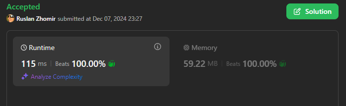

# ✅ 100% Beats | O(n!) / O(n) | ✔️ Optimized Brute Force Solution with Permutations und Recursion ✔️

**Author:** RuslanJF
**Votes:** 0
**Link:** [https://leetcode.com/problems/minimum-time-to-break-locks-i/solutions/6124164/](https://leetcode.com/problems/minimum-time-to-break-locks-i/solutions/6124164/)

---




# Intuition
The problem requires finding the minimum time to break all the locks with the sword's energy dynamics. Initially, one might think of simulating the process for each lock in the order given, but this might not be optimal because the order in which locks are broken can affect the total time due to the increasing factor `X`. The key intuition here is to consider permutations of breaking locks because:

- Breaking locks in different orders could lead to different total times due to the changes in `X` after each lock break.
- The energy increase per minute is influenced by `X`, which grows, suggesting that breaking higher energy locks later could be more efficient.

# Approach
1. **Sorting**: First, sort the strength array in ascending order. This is based on the intuition that it might be beneficial to break weaker locks first when `X` is smaller, allowing for quicker energy accumulation for tougher locks later.
1. **Permutation**: 
    - Use a recursive function `permute` to generate permutations of the locks. 
    - For each permutation:
        - Calculate the time to break the current lock with the current `X` factor (`Math.ceil(next / x)` rounds up since you need at least the strength value).
        - Update `X` by `K` after breaking each lock.
        - If it's not the last lock, continue with the remaining locks in a new permutation.
1. **Optimization**: 
    - Keep track of the `fastest` time. If the current time for a permutation exceeds `fastest`, stop exploring that branch to prune unnecessary computations.
1. **Base Case**: When only one lock remains (`isLastLock`), we've found a valid permutation, so update `fastest` if this time is less than the current `fastest`.

# Complexity
- **Time Complexity**: 
    - The worst-case scenario involves generating all permutations of the locks, which is factorial in nature. Given `n` locks, this would be $$O(n!)$$
    - However, due to the early termination when exceeding `fastest`, this might not be reached in practice for many inputs, somewhat reducing the complexity in average cases.  
    
    Thus, the theoretical time complexity is:

    > $$O(n!)$$

    (but AI of LeetCode gave me $$O(n!*n)$$, so if someone can explain it, please share in comments)

- Space complexity:
    - The space used for recursion stack in the permutation generation is $$O(n)$$ in depth, plus the space for storing permutations which again could be up to $$O(n!)$$ in the worst case for storing all permutations at some point.
    - However, since permutations are generated on-the-fly and only one permutation at a time is fully expanded, the practical space usage is closer to $$O(n)$$ for the recursion stack and the sorted strength array.

    Therefore, the space complexity is:

    > $$O(n)$$

# Code
```typescript []
function findMinimumTime(strength: number[], K: number): number {
    let fastest = Infinity;

    function permute(taken: number[], x: number, time: number, available: number[]):void {
        const isLastLock = available.length === 1;
        available.forEach((next,i) => {
            const nextTime = time + Math.ceil(next/x);
            if(nextTime >= fastest) {
                return;
            } 
            if(!isLastLock) {
                permute([...taken, next], x + K, nextTime, available.filter((a, j) => i !== j));
            } else {
                fastest = nextTime;
            }
        });

    }

    permute([], 1, 0, [...strength].sort((a,b) => a - b));

    return fastest;
};
```