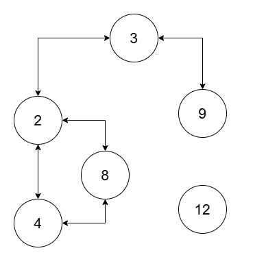

# [3378. Count Connected Components in LCM Graph](https://leetcode.com/problems/count-connected-components-in-lcm-graph/)

| Category | Difficulty | Likes | Dislikes |
| :------: | :--------: | :---: | :------: |
| Algorithms | Hard | 80 | 2 |

**Tags:** [`array`](https://leetcode.com/tag/array), [`hash-table`](https://leetcode.com/tag/hash-table), [`math`](https://leetcode.com/tag/math), [`union-find`](https://leetcode.com/tag/union-find), [`number-theory`](https://leetcode.com/tag/number-theory)

## Description

You are given an array of integers `nums` of size `n` and a **positive** integer `threshold`.

There is a graph consisting of `n` nodes with the `i^th` node having a value of `nums[i]`. Two nodes `i` and `j` in the graph are connected via an **undirected** edge if `lcm(nums[i], nums[j]) <= threshold`.

Return the number of **connected components** in this graph.

A **connected component** is a subgraph of a graph in which there exists a path between any two vertices, and no vertex of the subgraph shares an edge with a vertex outside of the subgraph.

The term `lcm(a, b)` denotes the **least common multiple** of `a` and `b`.

 

**Example 1:**

**Input:** nums = [2,4,8,3,9], threshold = 5

**Output:** 4

**Explanation:** 

 

The four connected components are `(2, 4)`, `(3)`, `(8)`, `(9)`.

**Example 2:**

**Input:** nums = [2,4,8,3,9,12], threshold = 10

**Output:** 2

**Explanation:** 

The two connected components are `(2, 3, 4, 8, 9)`, and `(12)`.

 

**Constraints:**

	- `1 <= nums.length <= 10^5`

	- `1 <= nums[i] <= 10^9`

	- All elements of `nums` are unique.

	- `1 <= threshold <= 2 * 10^5`

---

**Links:** [Submissions](https://leetcode.com/problems/count-connected-components-in-lcm-graph/) | [Solutions](https://leetcode.com/problems/count-connected-components-in-lcm-graph/)
