# DSU Solution with Images and Explanation in CPP

**Author:** brickcommander
**Votes:** 15
**Link:** [https://leetcode.com/problems/count-connected-components-in-lcm-graph/solutions/6128698/](https://leetcode.com/problems/count-connected-components-in-lcm-graph/solutions/6128698/)

---

# Approach
<!-- Describe your approach to solving the problem. -->
1. Create a Disjoint Set Union of size = threshold
2. Iterate for each element of nums and join every multiple of nums[i] with nums[i]
## Why Iterate on multiples of nums[i]?
 Well, lets say we have two element A and B, where LCM(A,B) <= threshold and we know that lcm will also a multiple of both A and B. So, when we iterate on multiples of A and join A with it's  multiples; and then we iterate on multiples of B and join B with it's multiples. Now, since lcm is a multiple of both A and B. we will end up joining A and B in a single component.
### Example: 
A=2, B=3 and lcm=6. In first iteration we will join 2 with 6 because 6 is a multiple of 2. In second iteration we will join 3 with 6 because 3 is multiple of 6. here you can see that we ended of joining 2 and 3 together through their lcm(6). so now 2, 3 and 6 are a single component now.

3. Iterate again on each element of nums[i] and put the parent of each elements in a set
4. All unique parents is equal to the number of components in the graph + all the elements which are greater than threshold (edge case)
# Example: 
*(threshold=10; not 12)
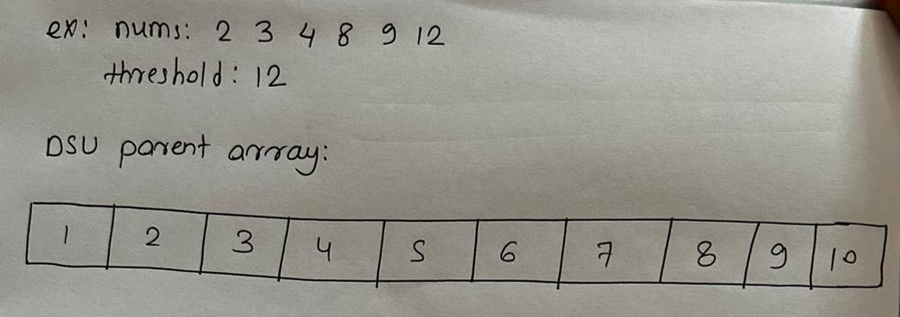
For i=0, Iterating on each mulitple of nums[0] and joining nums[0]with all multiples of nums[0]
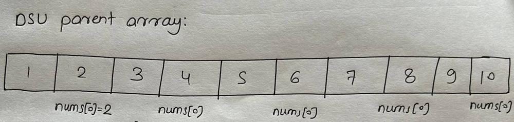
DSU Graph after 1st iteration
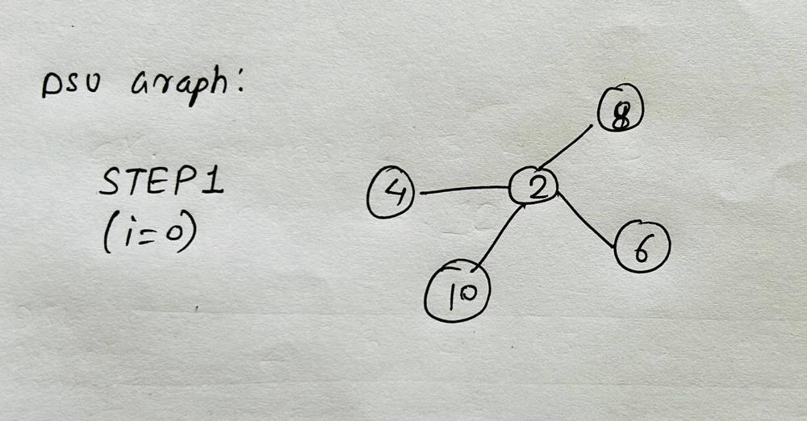
For i=1, Iterating on each mulitple of nums[1] and joining nums[1] with all multiples of nums[1]
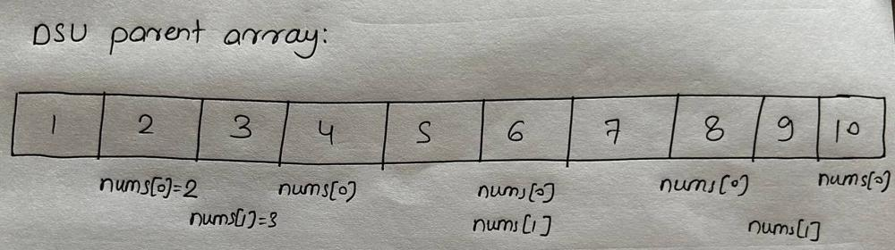
DSU Graph after 2nd iteration
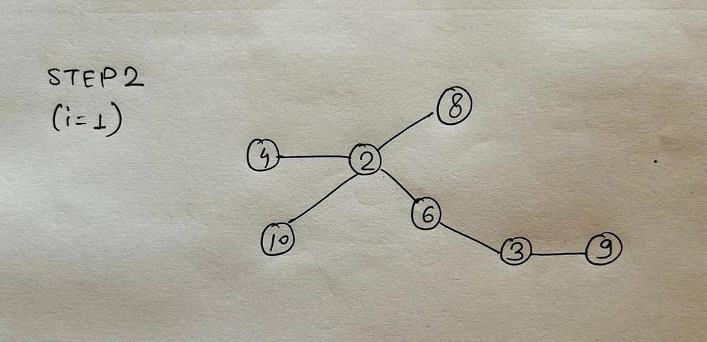
For i=2, Iterating on each mulitple of nums[2] and joining nums[2] with all multiples of nums[2]
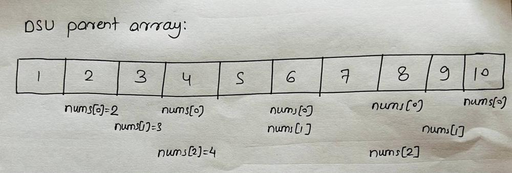
DSU Graph after 3rd iteration
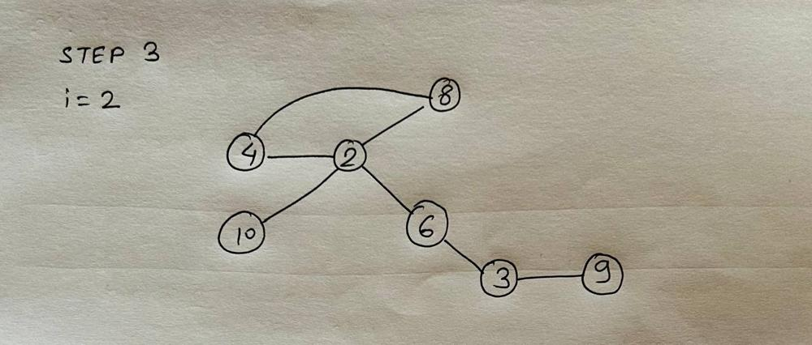
For i=3, Iterating on each mulitple of nums[3] and joining nums[3] with all multiples of nums[3]
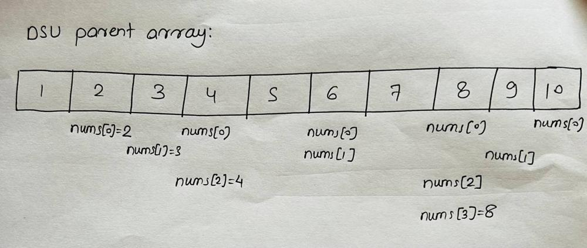
DSU Graph after 4th iteration (remains same as STEP 3, because no new elements were joined)
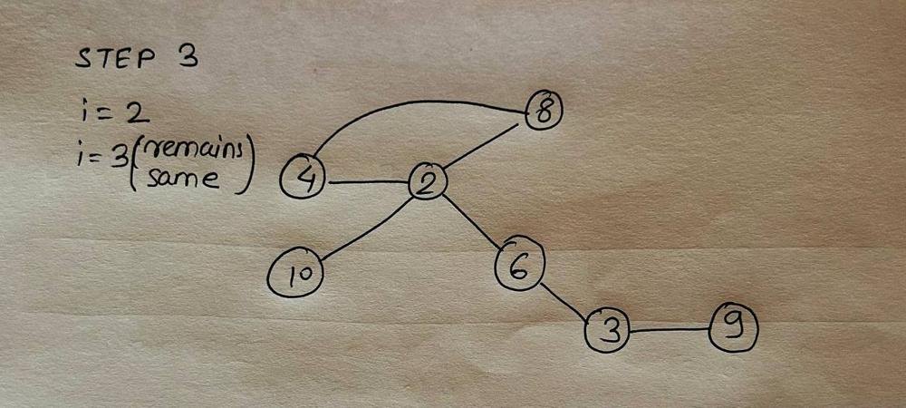
For i=4, Iterating on each mulitple of nums[4] and joining nums[4] with all multiples of nums[4]
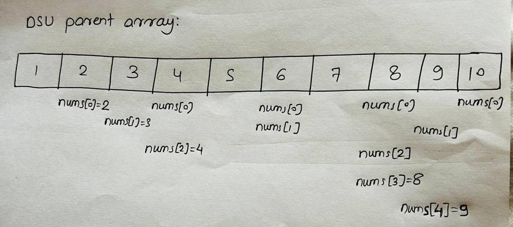
DSU Graph after 5th iteration (remains same as STEP 3, because no new elements were joined)
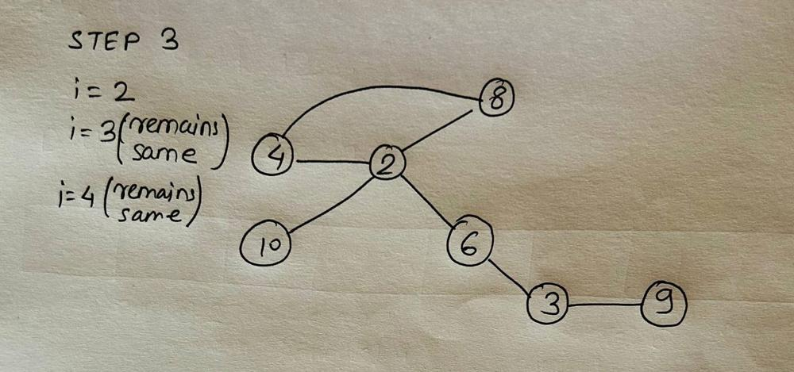


# Complexity
- Time complexity: Since the elements in nums are unique. So, worst case would be when all the elements in the nums array are like this 2, 3, 4, 5, 6, ... k. So, we can say that in worst case the complexity of algorithm would be:
$$th/1 + th/2 + th/3 + th/4 + th/5 + ... + th/k = th * log(th) $$ (because the max value of k could be th)
$$O(max(n, th * log(th)))$$
**Here th is threshold**
Reference: [Sum of Harmonic Series](https://en.wikipedia.org/wiki/Harmonic_series_(mathematics)#Partial_sums)

- Space complexity:
$$O(max(n, th))$$

# Code
```cpp []
class Solution {
    class DSU {
        vector<int> parent;
        public:
        DSU(int n) : parent(n+1, -1) {}
        int findParent(int x) {
            if(parent[x] == -1) return x;
            return parent[x] = findParent(parent[x]);
        }
        bool join(int x, int y) {
            int X = findParent(x);
            int Y = findParent(y);
            if(X==Y) return false;
            parent[X] = Y;
            return true;
        }
    };
public:
    int countComponents(vector<int>& nums, int threshold) {
        DSU dsu(threshold);
        int n = nums.size();
        int ans = 0;

        // Worst case Time Complexity of this loop is th/1 + th/2 + th/3 + th/4 + .. + th/k
        // Here th is threshold and k is max value of nums such that k <= threshold
        for(int i=0; i<nums.size(); i++) {
            if(nums[i] <= threshold) {
                // iterating on all multiple of nums[i]
                for(int j=nums[i]; j <= threshold; j+=nums[i]) {
                    // joining nums[i] with its multiple
                    dsu.join(nums[i], j);
                }
            }
        }

        set<int> st; // contains the parents of each nums[i]
        for(int i=0; i<nums.size(); i++) {
            if(nums[i] > threshold) ans++; // this number itself is a component
            else st.insert(dsu.findParent(nums[i]));
        }

        ans += st.size(); // number of unique parents = number of components
        // Please upvote if liked else downvote if didn't like the solution
        return ans;
    }
};
```