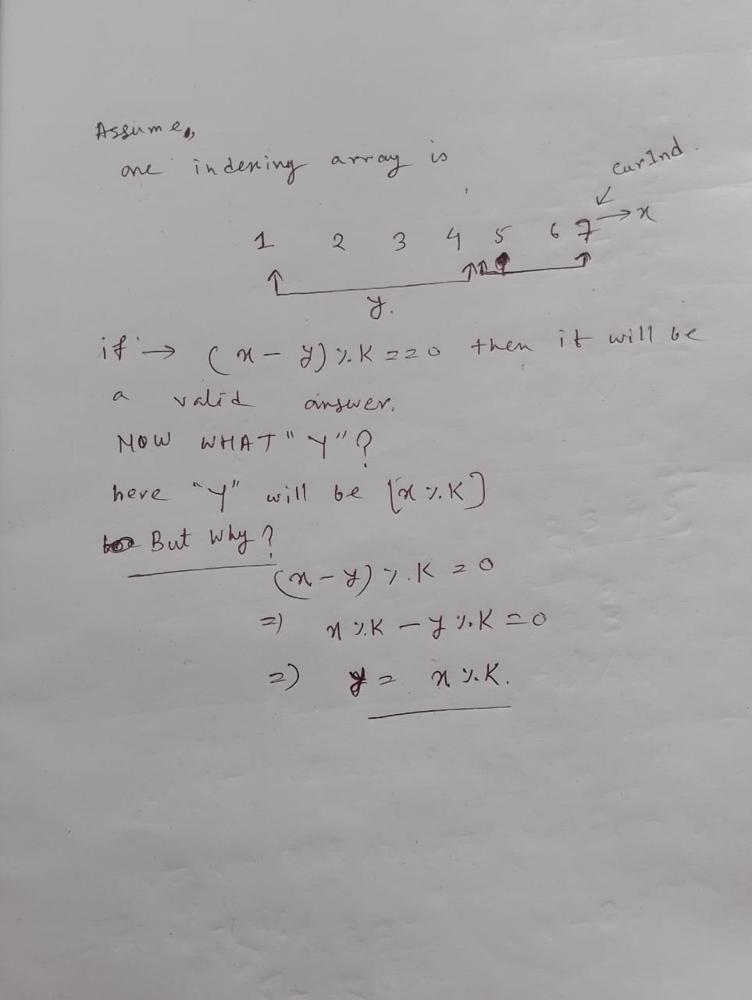

# Prefix Sum Easy , Striver DSA Sheet

**Author:** Najir581
**Votes:** 9
**Link:** [https://leetcode.com/problems/maximum-subarray-sum-with-length-divisible-by-k/solutions/6124654/](https://leetcode.com/problems/maximum-subarray-sum-with-length-divisible-by-k/solutions/6124654/)

---

# Intuition
Only one intution 


 But We want only the optimal one .. 
Here the optimal answer is to find the minimum prefix sum , by which sm-min_prefix_sum will be maximum . 
# Approach
<!-- Describe your approach to solving the problem. -->

# Complexity
- Time complexity:
                 $$O(n log(n))$$ 

- Space complexity:
 $$O(n)$$ 

# Code
```cpp []

class Solution {
public:
    long long maxSubarraySum(vector<int>& v, int k) {
        map<int, long long> m;
        long long ans = -1e18;
        long long sm = 0;
        for (int i = 0; i < v.size(); i++) {
            sm += v[i];
            int curSZ = i + 1;
            if (curSZ % k == 0)
                ans = max(ans, sm);
            int y = (curSZ % k);
            if (m.find(y) != m.end()) {
                ans = max(ans, sm - m[y]);
                m[y] = min(m[y], sm);
            } else
                m[y] = sm;
        }
        return ans;
    }
};
```
---


# Solution II (more optimized)

# Approach
Use an k sized vector for storing the minimum prefix sum

# Complexity
- Time complexity:
                 $$O(n)$$ 

- Space complexity:
 $$O(n)$$ 

# Code
```cpp []

class Solution {
public:
    long long maxSubarraySum(vector<int>& v, int k) {
        vector<long long> m(k + 1, 1e18); 
        long long ans = -1e18;
        long long sm = 0;
        int x, y;
        for (int i = 0; i < v.size(); i++) {
            sm += v[i];
            x = i + 1;
            y = (x % k);
            if (y == 0)
                ans = max(ans, sm);
            ans = max(ans, sm - m[y]);
            m[y] = min(m[y], sm);
        }
        return ans;
    }
};
```
                              # UPVOTE  ^ ^
