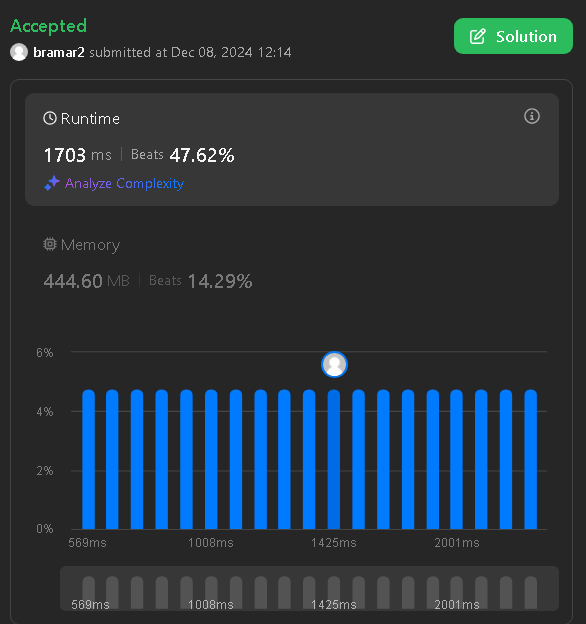

# C++ O(Nsqrt(N)log(N)) Mo's Algorithm + Offline Queries

**Author:** bramar2
**Votes:** 4
**Link:** [https://leetcode.com/problems/maximum-area-rectangle-with-point-constraints-ii/solutions/6124742/](https://leetcode.com/problems/maximum-area-rectangle-with-point-constraints-ii/solutions/6124742/)

---

.
# Complexity
- Time complexity: $O(n\\sqrt{n}*log(n))$

- Space complexity: $O(n)$

**Why is this $O(n\\sqrt{n}*log(n))$ and not $O(n^2\\sqrt{n}*log(n))?$**
- In Mo's Algorithm, it is proven that the complexity is quite efficient and it boils to $O((n+q)F\\sqrt{n})$. For proof, there is one at cp-algorithms on "Sqrt Decomposition" article.
- In this case, $O(F)$ is the complexity of **each** add() and remove(). But we don't know **each**, we only know **all** which is $O(n)$ so it becomes $O((n+q)*(\\sqrt{n})+n)$. Basically, $F$ can be taken out entirely because we know that the upper bound for **all points** is $O(n)$. After noticing $Q=O(n)$, then the time complexity becomes $O(n\\sqrt{n}*log(n))$. That $log(n)$ factor is from the `multiset.upper_bound()`.
- The time complexity is actually comparable to $O(n*log^2(n))$ because segment tree/fenwick tree have a much higher hidden constant than this. Still somehow beats **42.86%** (1703ms).

# Code
```cpp []
#include <bits/stdc++.h>
using namespace std;

// tweak for performance
int block_size = 512;

struct Query {
	int lx, rx, ly, ry;
	long long area;
	Query(int _lx, int _rx, int _ly, int _ry, long long _area) : lx(_lx), rx(_rx), ly(_ly), ry(_ry), area(_area) {}
	bool operator<(Query other) const {
        return make_pair(lx / block_size, rx) <
               make_pair(other.lx / block_size, other.rx);
    }
};

class Solution {
public:
    long long maxRectangleArea(vector<int>& xCoord, vector<int>& yCoord) {
        long long ans = -1;
        int n = xCoord.size();
        // Coordinate compression
        unordered_map<int, int> toCompressed, toOriginal;
        {
        	set<int> p;
        	p.insert(xCoord.begin(), xCoord.end());
        	p.insert(yCoord.begin(), yCoord.end());
        	int lst = 0;
        	for(int a : p) {
        		toCompressed[a] = lst;
        		toOriginal[lst] = a;
        		++lst;
        	}
        	for(int& x : xCoord) x = toCompressed[x];
        	for(int& y : yCoord) y = toCompressed[y];
        }
    	unordered_map<int, vector<int>> byX, byY;

    	for(int i = 0; i < n; i++) {
    		byX[xCoord[i]].push_back(yCoord[i]);
    		byY[yCoord[i]].push_back(xCoord[i]);
    	}
    	for(auto& p : byX) sort(p.second.begin(), p.second.end());
    	for(auto& p : byY) sort(p.second.begin(), p.second.end());

    	vector<Query> queries;
    	for(int i = 0; i < n; i++) {
    		auto ax = xCoord[i], ay = yCoord[i];


    		auto it = upper_bound(byY[ay].begin(), byY[ay].end(), ax);
    		if(it == byY[ay].end()) continue;
    		auto rx = *it, ry = ay; // this is bottom right point

    		it = upper_bound(byX[ax].begin(), byX[ax].end(), ay);
    		if(it == byX[ax].end()) continue;
    		auto tx = ax, ty = *it; // this is top left point

    		// check existence of top right point
    		auto itR = upper_bound(byX[rx].begin(), byX[rx].end(), ry);
    		auto itT = upper_bound(byY[ty].begin(), byY[ty].end(), tx);
    		if(itR == byX[rx].end() || itT == byY[ty].end()) continue;
    		if(*itR != ty || *itT != rx) continue;

    		// dx/dy = down x/y,
    		// ux/uy = up x/y
    		// we +1 and -1 so we only get the inside (excluding border)
    		int dx = ax+1, dy = ay+1;
    		int ux = rx-1, uy = ty-1;
    		long long area = 1LL * (toOriginal[ty]-toOriginal[ay]) * (toOriginal[rx]-toOriginal[ax]);
    		if(dx <= ux && dy <= uy) {
    			// check if any point is in [dx, dy] [ux, uy] rectangle
    			// if yes, then this isnt valid
    			queries.emplace_back(dx, ux, dy, uy, area);
    		}else {
    			ans = max(ans, area);
    		}
    	}

    	sort(queries.begin(), queries.end());

    	// Mo's algorithm at play
        // Copied from CP-A
    	int cur_l = 0;
	    int cur_r = -1;
	    multiset<int> ms;
	    for(Query q : queries) {
	        while(cur_l > q.lx) {
	            cur_l--;
	            ms.insert(byX[cur_l].begin(), byX[cur_l].end());
	        }
	        while(cur_r < q.rx) {
	            cur_r++;
	            ms.insert(byX[cur_r].begin(), byX[cur_r].end());
	        }
	        while(cur_l < q.lx) {
	        	for(auto b : byX[cur_l]) ms.erase(ms.find(b));
	            cur_l++;
	        }
	        while(cur_r > q.rx) {
                for(auto b : byX[cur_r]) ms.erase(ms.find(b));
	            cur_r--;
	        }
	        if(auto it = ms.lower_bound(q.ly); it != ms.end()) {
	        	if(*it <= q.ry) continue; // there is a point that lies inside
	        }
	    	ans = max(ans, q.area);
	    }
    	return ans;
    }
};
```