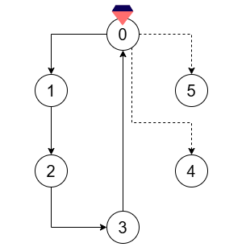
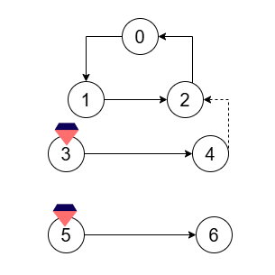

# [3383. Minimum Runes to Add to Cast Spell](https://leetcode.com/problems/minimum-runes-to-add-to-cast-spell/)

| Category | Difficulty | Likes | Dislikes |
| :------: | :--------: | :---: | :------: |
| Algorithms | Hard | 9 | 2 |

**Tags:** [`array`](https://leetcode.com/tag/array), [`depth-first-search`](https://leetcode.com/tag/depth-first-search), [`breadth-first-search`](https://leetcode.com/tag/breadth-first-search), [`union-find`](https://leetcode.com/tag/union-find), [`graph`](https://leetcode.com/tag/graph), [`topological-sort`](https://leetcode.com/tag/topological-sort)

## Description

Alice has just graduated from wizard school, and wishes to cast a magic spell to celebrate. The magic spell contains certain **focus points** where magic needs to be concentrated, and some of these focus points contain **magic crystals** which serve as the spell's energy source. Focus points can be linked through **directed runes**, which channel magic flow from one focus point to another.

You are given a integer `n` denoting the *number* of focus points and an array of integers `crystals` where `crystals[i]` indicates a focus point which holds a magic crystal. You are also given two integer arrays `flowFrom` and `flowTo`, which represent the existing **directed runes**. The `i^th` rune allows magic to freely flow from focus point `flowFrom[i]` to focus point `flowTo[i]`.

You need to find the number of directed runes Alice must add to her spell, such that *each* focus point either:

	- **Contains** a magic crystal.

	- **Receives** magic flow *from* another focus point.

Return the **minimum** number of directed runes that she should add.

 

**Example 1:**

**Input:** n = 6, crystals = [0], flowFrom = [0,1,2,3], flowTo = [1,2,3,0]

**Output:** 2

**Explanation:** 

Add two directed runes:

	- From focus point 0 to focus point 4.

	- From focus point 0 to focus point 5.

**Example 2:**

**Input:** n = 7, crystals = [3,5], flowFrom = [0,1,2,3,5], flowTo = [1,2,0,4,6]

**Output:** 1

**Explanation:** 

Add a directed rune from focus point 4 to focus point 2.

 

**Constraints:**

	- `2 <= n <= 10^5`

	- `1 <= crystals.length <= n`

	- `0 <= crystals[i] <= n - 1`

	- `1 <= flowFrom.length == flowTo.length <= min(2 * 10^5, (n * (n - 1)) / 2)`

	- `0 <= flowFrom[i], flowTo[i] <= n - 1`

	- `flowFrom[i] != flowTo[i]`

	- All pre-existing directed runes are **distinct**.

---

**Links:** [Submissions](https://leetcode.com/problems/minimum-runes-to-add-to-cast-spell/) | [Solutions](https://leetcode.com/problems/minimum-runes-to-add-to-cast-spell/)
