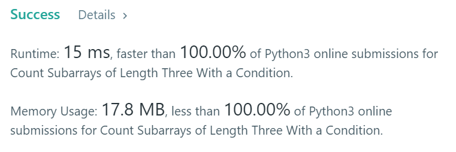

# [ Python ] ✅✅ Simple Python Solution | 100 % Faster✌👍

**Author:** ASHOK_KUMAR_MEGHVANSHI
**Votes:** 0
**Link:** [https://leetcode.com/problems/count-subarrays-of-length-three-with-a-condition/solutions/6171634/](https://leetcode.com/problems/count-subarrays-of-length-three-with-a-condition/solutions/6171634/)

---

# If You like the Solution, Please UpVote! \uD83D\uDD3C\uD83D\uDE4F
# Runtime: 15 ms, faster than 100.00% of Python3 online submissions for Count Subarrays of Length Three With a Condition.
# Memory Usage: 17.8 MB, less than 100.00% of Python3 online submissions for Count Subarrays of Length Three With a Condition.

	class Solution:
		def countSubarrays(self, nums: List[int]) -> int:

			result = 0

			for index in range(len(nums) - 2):

				subarray = nums[index : index + 3]

				if (subarray[0] + subarray[2]) == (subarray[1] / 2):

					result = result + 1

			return result
			
	Time Complexity : O(N)
	Space Complexity : O(1)
# Thank You \uD83E\uDD73\u270C\uD83D\uDC4D