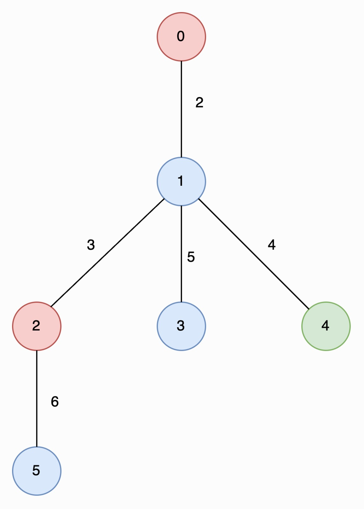

# [3425. Longest Special Path](https://leetcode.com/problems/longest-special-path/)

| Category | Difficulty | Likes | Dislikes |
| :------: | :--------: | :---: | :------: |
| Algorithms | Hard | 122 | 16 |

**Tags:** [`array`](https://leetcode.com/tag/array), [`hash-table`](https://leetcode.com/tag/hash-table), [`tree`](https://leetcode.com/tag/tree), [`depth-first-search`](https://leetcode.com/tag/depth-first-search), [`prefix-sum`](https://leetcode.com/tag/prefix-sum)

## Description

You are given an undirected tree rooted at node `0` with `n` nodes numbered from `0` to `n - 1`, represented by a 2D array `edges` of length `n - 1`, where `edges[i] = [u_i, v_i, length_i]` indicates an edge between nodes `u_i` and `v_i` with length `length_i`. You are also given an integer array `nums`, where `nums[i]` represents the value at node `i`.

A special path is defined as a downward path from an ancestor node to a descendant node such that all the values of the nodes in that path are unique.

**Note** that a path may start and end at the same node.

Return an array result of size 2, where `result[0]` is the length of the **longest** special path, and `result[1]` is the minimum number of nodes in all possible **longest** special paths.

 

**Example 1:**

**Input:** edges = [[0,1,2],[1,2,3],[1,3,5],[1,4,4],[2,5,6]], nums = [2,1,2,1,3,1]

**Output:** [6,2]

**Explanation:**

In the image below, nodes are colored by their corresponding values in `nums`

The longest special paths are `2 -> 5` and `0 -> 1 -> 4`, both having a length of 6. The minimum number of nodes across all longest special paths is 2.

**Example 2:**

**Input:** edges = [[1,0,8]], nums = [2,2]

**Output:** [0,1]

**Explanation:**

The longest special paths are `0` and `1`, both having a length of 0. The minimum number of nodes across all longest special paths is 1.

 

**Constraints:**

	- `2 <= n <= 5 * 10^4`

	- `edges.length == n - 1`

	- `edges[i].length == 3`

	- `0 <= u_i, v_i < n`

	- `1 <= length_i <= 10^3`

	- `nums.length == n`

	- `0 <= nums[i] <= 5 * 10^4`

	- The input is generated such that `edges` represents a valid tree.

---

**Links:** [Submissions](https://leetcode.com/problems/longest-special-path/) | [Solutions](https://leetcode.com/problems/longest-special-path/)
