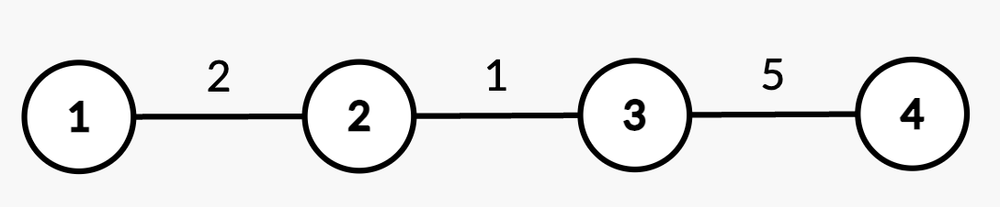

# [3515. Shortest Path in a Weighted Tree](https://leetcode.com/problems/shortest-path-in-a-weighted-tree/)

| Category | Difficulty | Likes | Dislikes |
| :------: | :--------: | :---: | :------: |
| Algorithms | Hard | 61 | 2 |

**Tags:** [`array`](https://leetcode.com/tag/array), [`tree`](https://leetcode.com/tag/tree), [`depth-first-search`](https://leetcode.com/tag/depth-first-search), [`binary-indexed-tree`](https://leetcode.com/tag/binary-indexed-tree), [`segment-tree`](https://leetcode.com/tag/segment-tree)

**Companies:** `juspay`

## Description

You are given an integer `n` and an undirected, weighted tree rooted at node 1 with `n` nodes numbered from 1 to `n`. This is represented by a 2D array `edges` of length `n - 1`, where `edges[i] = [u_i, v_i, w_i]` indicates an undirected edge from node `u_i` to `v_i` with weight `w_i`.

You are also given a 2D integer array `queries` of length `q`, where each `queries[i]` is either:

	- `[1, u, v, w']` &ndash; **Update** the weight of the edge between nodes `u` and `v` to `w'`, where `(u, v)` is guaranteed to be an edge present in `edges`.

	- `[2, x]` &ndash; **Compute** the **shortest** path distance from the root node 1 to node `x`.

Return an integer array `answer`, where `answer[i]` is the **shortest** path distance from node 1 to `x` for the `i^th` query of `[2, x]`.

 

**Example 1:**

**Input:** n = 2, edges = [[1,2,7]], queries = [[2,2],[1,1,2,4],[2,2]]

**Output:** [7,4]

**Explanation:**

	- Query `[2,2]`: The shortest path from root node 1 to node 2 is 7.

	- Query `[1,1,2,4]`: The weight of edge `(1,2)` changes from 7 to 4.

	- Query `[2,2]`: The shortest path from root node 1 to node 2 is 4.

**Example 2:**

**Input:** n = 3, edges = [[1,2,2],[1,3,4]], queries = [[2,1],[2,3],[1,1,3,7],[2,2],[2,3]]

**Output:** [0,4,2,7]

**Explanation:**

	- Query `[2,1]`: The shortest path from root node 1 to node 1 is 0.

	- Query `[2,3]`: The shortest path from root node 1 to node 3 is 4.

	- Query `[1,1,3,7]`: The weight of edge `(1,3)` changes from 4 to 7.

	- Query `[2,2]`: The shortest path from root node 1 to node 2 is 2.

	- Query `[2,3]`: The shortest path from root node 1 to node 3 is 7.

**Example 3:**

**Input:** n = 4, edges = [[1,2,2],[2,3,1],[3,4,5]], queries = [[2,4],[2,3],[1,2,3,3],[2,2],[2,3]]

**Output:** [8,3,2,5]

**Explanation:**

	- Query `[2,4]`: The shortest path from root node 1 to node 4 consists of edges `(1,2)`, `(2,3)`, and `(3,4)` with weights `2 + 1 + 5 = 8`.

	- Query `[2,3]`: The shortest path from root node 1 to node 3 consists of edges `(1,2)` and `(2,3)` with weights `2 + 1 = 3`.

	- Query `[1,2,3,3]`: The weight of edge `(2,3)` changes from 1 to 3.

	- Query `[2,2]`: The shortest path from root node 1 to node 2 is 2.

	- Query `[2,3]`: The shortest path from root node 1 to node 3 consists of edges `(1,2)` and `(2,3)` with updated weights `2 + 3 = 5`.

 

**Constraints:**

	- `1 `queries[i] == [1, u, v, w']` or,

		- `queries[i] == [2, x]`

		- `1 (u, v) is always an edge from edges.

		- `1

---

**Links:** [Submissions](https://leetcode.com/problems/shortest-path-in-a-weighted-tree/) | [Solutions](https://leetcode.com/problems/shortest-path-in-a-weighted-tree/)
