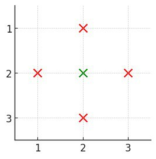
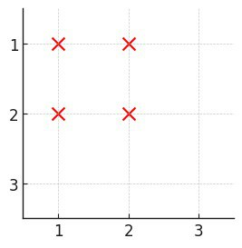

# [3531. Count Covered Buildings](https://leetcode.com/problems/count-covered-buildings/)

| Category | Difficulty | Likes | Dislikes |
| :------: | :--------: | :---: | :------: |
| Algorithms | Medium | 411 | 23 |

**Tags:** [`array`](https://leetcode.com/tag/array), [`hash-table`](https://leetcode.com/tag/hash-table), [`sorting`](https://leetcode.com/tag/sorting)

**Companies:** `google`, `amazon`

## Description

You are given a positive integer `n`, representing an `n x n` city. You are also given a 2D grid `buildings`, where `buildings[i] = [x, y]` denotes a **unique** building located at coordinates `[x, y]`.

A building is **covered** if there is at least one building in all **four** directions: left, right, above, and below.

Return the number of **covered** buildings.

 

**Example 1:**

**Input:** n = 3, buildings = [[1,2],[2,2],[3,2],[2,1],[2,3]]

**Output:** 1

**Explanation:**

	- Only building `[2,2]` is covered as it has at least one building:

	
		above (`[1,2]`)

		- below (`[3,2]`)

		- left (`[2,1]`)

		- right (`[2,3]`)

	
	
	- Thus, the count of covered buildings is 1.

**Example 2:**

**Input:** n = 3, buildings = [[1,1],[1,2],[2,1],[2,2]]

**Output:** 0

**Explanation:**

	- No building has at least one building in all four directions.

**Example 3:**

**Input:** n = 5, buildings = [[1,3],[3,2],[3,3],[3,5],[5,3]]

**Output:** 1

**Explanation:**

	- Only building `[3,3]` is covered as it has at least one building:

	
		above (`[1,3]`)

		- below (`[5,3]`)

		- left (`[3,2]`)

		- right (`[3,5]`)

	
	
	- Thus, the count of covered buildings is 1.

 

**Constraints:**

	- `2 <= n <= 10^5`

	- `1 <= buildings.length <= 10^5 `

	- `buildings[i] = [x, y]`

	- `1 <= x, y <= n`

	- All coordinates of `buildings` are **unique**.

---

**Links:** [Submissions](https://leetcode.com/problems/count-covered-buildings/) | [Solutions](https://leetcode.com/problems/count-covered-buildings/)
