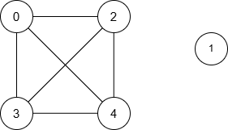

# [3534. Path Existence Queries in a Graph II](https://leetcode.com/problems/path-existence-queries-in-a-graph-ii/)

| Category | Difficulty | Likes | Dislikes |
| :------: | :--------: | :---: | :------: |
| Algorithms | Hard | 49 | 1 |

**Tags:** [`array`](https://leetcode.com/tag/array), [`two-pointers`](https://leetcode.com/tag/two-pointers), [`binary-search`](https://leetcode.com/tag/binary-search), [`dynamic-programming`](https://leetcode.com/tag/dynamic-programming), [`greedy`](https://leetcode.com/tag/greedy), [`bit-manipulation`](https://leetcode.com/tag/bit-manipulation), [`graph`](https://leetcode.com/tag/graph), [`sorting`](https://leetcode.com/tag/sorting)

**Companies:** `google`

## Description

You are given an integer `n` representing the number of nodes in a graph, labeled from 0 to `n - 1`.

You are also given an integer array `nums` of length `n` and an integer `maxDiff`.

An **undirected **edge exists between nodes `i` and `j` if the **absolute** difference between `nums[i]` and `nums[j]` is **at most** `maxDiff` (i.e., `|nums[i] - nums[j]| . If no path exists between the two nodes, return -1 for that query.

Return an array `answer`, where `answer[i]` is the result of the `i^th` query.

**Note:** The edges between the nodes are unweighted.

 

**Example 1:**

**Input:** n = 5, nums = [1,8,3,4,2], maxDiff = 3, queries = [[0,3],[2,4]]

**Output:** [1,1]

**Explanation:**

The resulting graph is:

	
		
			Query
			Shortest Path
			Minimum Distance
		
		
			[0, 3]
			0 &rarr; 3
			1
		
		
			[2, 4]
			2 &rarr; 4
			1
		
	

Thus, the output is `[1, 1]`.

**Example 2:**

**Input:** n = 5, nums = [5,3,1,9,10], maxDiff = 2, queries = [[0,1],[0,2],[2,3],[4,3]]

**Output:** [1,2,-1,1]

**Explanation:**

The resulting graph is:

	
		
			Query
			Shortest Path
			Minimum Distance
		
		
			[0, 1]
			0 &rarr; 1
			1
		
		
			[0, 2]
			0 &rarr; 1 &rarr; 2
			2
		
		
			[2, 3]
			None
			-1
		
		
			[4, 3]
			3 &rarr; 4
			1
		
	

Thus, the output is `[1, 2, -1, 1]`.

**Example 3:**

**Input:** n = 3, nums = [3,6,1], maxDiff = 1, queries = [[0,0],[0,1],[1,2]]

**Output:** [0,-1,-1]

**Explanation:**

There are no edges between any two nodes because:

	- Nodes 0 and 1: `|nums[0] - nums[1]| = |3 - 6| = 3 > 1`

	- Nodes 0 and 2: `|nums[0] - nums[2]| = |3 - 1| = 2 > 1`

	- Nodes 1 and 2: `|nums[1] - nums[2]| = |6 - 1| = 5 > 1`

Thus, no node can reach any other node, and the output is `[0, -1, -1]`.

 

**Constraints:**

	- `1 <= n == nums.length <= 10^5`

	- `0 <= nums[i] <= 10^5`

	- `0 <= maxDiff <= 10^5`

	- `1 <= queries.length <= 10^5`

	- `queries[i] == [u_i, v_i]`

	- `0 <= u_i, v_i < n`

---

**Links:** [Submissions](https://leetcode.com/problems/path-existence-queries-in-a-graph-ii/) | [Solutions](https://leetcode.com/problems/path-existence-queries-in-a-graph-ii/)
