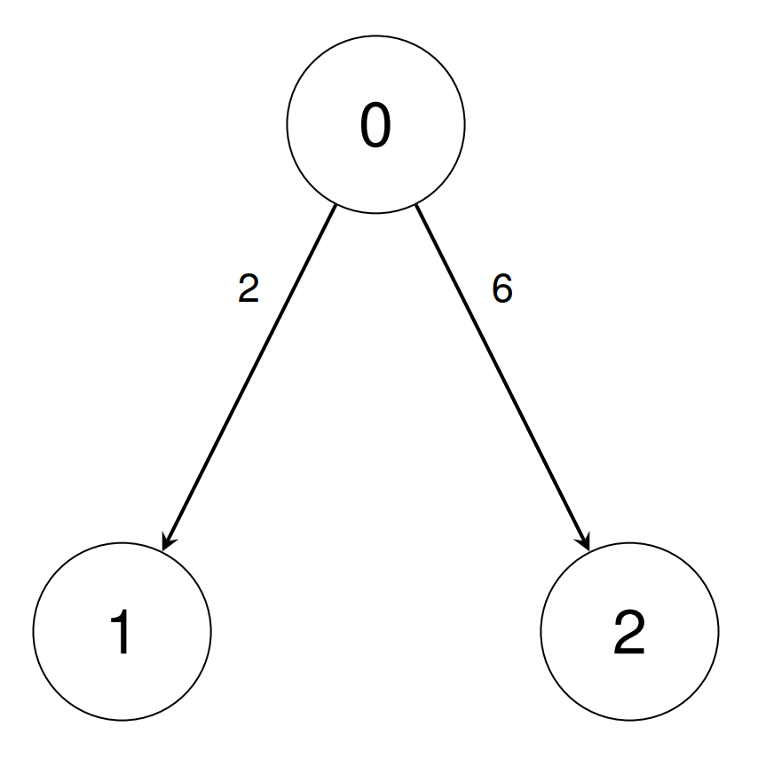
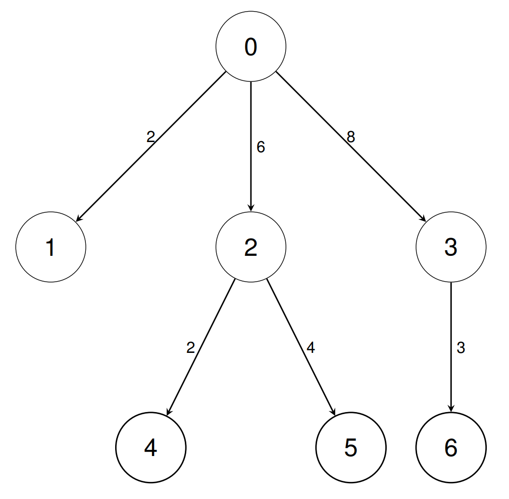

# [3535. Unit Conversion II](https://leetcode.com/problems/unit-conversion-ii/)

| Category | Difficulty | Likes | Dislikes |
| :------: | :--------: | :---: | :------: |
| Algorithms | Medium | 4 | 7 |

**Tags:** [`array`](https://leetcode.com/tag/array), [`math`](https://leetcode.com/tag/math), [`depth-first-search`](https://leetcode.com/tag/depth-first-search), [`breadth-first-search`](https://leetcode.com/tag/breadth-first-search), [`graph`](https://leetcode.com/tag/graph)

## Description

There are `n` types of units indexed from `0` to `n - 1`.

You are given a 2D integer array `conversions` of length `n - 1`, where `conversions[i] = [sourceUnit_i, targetUnit_i, conversionFactor_i]`. This indicates that a single unit of type `sourceUnit_i` is equivalent to `conversionFactor_i` units of type `targetUnit_i`.

You are also given a 2D integer array `queries` of length `q`, where `queries[i] = [unitA_i, unitB_i]`.

Return an array answer of length `q` where `answer[i]` is the number of units of type `unitB_i` equivalent to 1 unit of type `unitA_i`, and can be represented as `p/q` where `p` and `q` are coprime. Return each `answer[i]` as `pq^-1` **modulo** `10^9 + 7`, where `q^-1` represents the multiplicative inverse of `q` modulo `10^9 + 7`.

 

**Example 1:**

**Input:** conversions = [[0,1,2],[0,2,6]], queries = [[1,2],[1,0]]

**Output:** [3,500000004]

**Explanation:**

	- In the first query, we can convert unit 1 into 3 units of type 2 using the inverse of `conversions[0]`, then `conversions[1]`.

	- In the second query, we can convert unit 1 into 1/2 units of type 0 using the inverse of `conversions[0]`. We return 500000004 since it is the multiplicative inverse of 2.

**Example 2:**

**Input:** conversions = [[0,1,2],[0,2,6],[0,3,8],[2,4,2],[2,5,4],[3,6,3]], queries = [[1,2],[0,4],[6,5],[4,6],[6,1]]

**Output:** [3,12,1,2,83333334]

**Explanation:**

	- In the first query, we can convert unit 1 into 3 units of type 2 using the inverse of `conversions[0]`, then `conversions[1]`.

	- In the second query, we can convert unit 0 into 12 units of type 4 using `conversions[1]`, then `conversions[3]`.

	- In the third query, we can convert unit 6 into 1 unit of type 5 using the inverse of `conversions[5]`, the inverse of `conversions[2]`, `conversions[1]`, then `conversions[4]`.

	- In the fourth query, we can convert unit 4 into 2 units of type 6 using the inverse of `conversions[3]`, the inverse of `conversions[1]`, `conversions[2]`, then `conversions[5]`.

	- In the fifth query, we can convert unit 6 into 1/12 units of type 1 using the inverse of `conversions[5]`, the inverse of `conversions[2]`, then `conversions[0]`. We return 83333334 since it is the multiplicative inverse of 12.

 

**Constraints:**

	- `2 <= n <= 10^5`

	- `conversions.length == n - 1`

	- `0 <= sourceUnit_i, targetUnit_i < n`

	- `1 <= conversionFactor_i <= 10^9`

	- `1 <= q <= 10^5`

	- `queries.length == q`

	- `0 <= unitA_i, unitB_i < n`

	- It is guaranteed that unit 0 can be **uniquely** converted into any other unit through a combination of forward or backward conversions.

---

**Links:** [Submissions](https://leetcode.com/problems/unit-conversion-ii/) | [Solutions](https://leetcode.com/problems/unit-conversion-ii/)
