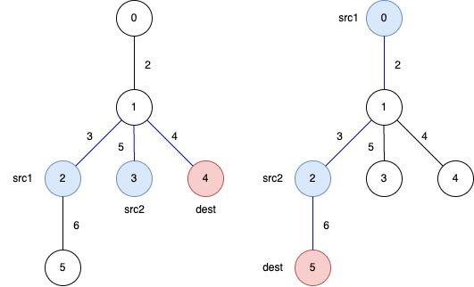
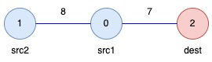

# [3553. Minimum Weighted Subgraph With the Required Paths II](https://leetcode.com/problems/minimum-weighted-subgraph-with-the-required-paths-ii/)

| Category | Difficulty | Likes | Dislikes |
| :------: | :--------: | :---: | :------: |
| Algorithms | Hard | 46 | 4 |

**Tags:** [`array`](https://leetcode.com/tag/array), [`tree`](https://leetcode.com/tag/tree), [`depth-first-search`](https://leetcode.com/tag/depth-first-search)

## Description

You are given an **undirected weighted** tree with n nodes, numbered from 0 to n - 1. It is represented by a 2D integer array edges of length n - 1, where edges[i] = [ui, vi, wi] indicates that there is an edge between nodes ui and vi with weight wi.​

Additionally, you are given a 2D integer array queries, where queries[j] = [src1j, src2j, destj].

Return an array answer of length equal to queries.length, where answer[j] is the **minimum total weight** of a subtree such that it is possible to reach destj from both src1j and src2j using edges in this subtree.

A **subtree** here is any connected subset of nodes and edges of the original tree forming a valid tree.

 

**Example 1:**

**Input:** edges = [[0,1,2],[1,2,3],[1,3,5],[1,4,4],[2,5,6]], queries = [[2,3,4],[0,2,5]]

**Output:** [12,11]

**Explanation:**

The blue edges represent one of the subtrees that yield the optimal answer.

	
	
`answer[0]`: The total weight of the selected subtree that ensures a path from `src1 = 2` and `src2 = 3` to `dest = 4` is `3 + 5 + 4 = 12`.

	
	
	
`answer[1]`: The total weight of the selected subtree that ensures a path from `src1 = 0` and `src2 = 2` to `dest = 5` is `2 + 3 + 6 = 11`.

	

**Example 2:**

**Input:** edges = [[1,0,8],[0,2,7]], queries = [[0,1,2]]

**Output:** [15]

**Explanation:**

	- `answer[0]`: The total weight of the selected subtree that ensures a path from `src1 = 0` and `src2 = 1` to `dest = 2` is `8 + 7 = 15`.

 

**Constraints:**

	`3 
	`edges.length == n - 1`
	`edges[i].length == 3`
	`0 
	`1 
	`1 
	`queries[j].length == 3`
	`0 
	- `src1_j`, `src2_j`, and `dest_j` are pairwise distinct.

	- The input is generated such that `edges` represents a valid tree.

---

**Links:** [Submissions](https://leetcode.com/problems/minimum-weighted-subgraph-with-the-required-paths-ii/) | [Solutions](https://leetcode.com/problems/minimum-weighted-subgraph-with-the-required-paths-ii/)
