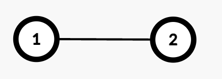

# [3559. Number of Ways to Assign Edge Weights II](https://leetcode.com/problems/number-of-ways-to-assign-edge-weights-ii/)

| Category | Difficulty | Likes | Dislikes |
| :------: | :--------: | :---: | :------: |
| Algorithms | Hard | 54 | 1 |

**Tags:** [`array`](https://leetcode.com/tag/array), [`math`](https://leetcode.com/tag/math), [`dynamic-programming`](https://leetcode.com/tag/dynamic-programming), [`bit-manipulation`](https://leetcode.com/tag/bit-manipulation), [`tree`](https://leetcode.com/tag/tree), [`depth-first-search`](https://leetcode.com/tag/depth-first-search)

## Description

There is an undirected tree with `n` nodes labeled from 1 to `n`, rooted at node 1. The tree is represented by a 2D integer array `edges` of length `n - 1`, where `edges[i] = [u_i, v_i]` indicates that there is an edge between nodes `u_i` and `v_i`.

Initially, all edges have a weight of 0. You must assign each edge a weight of either **1** or **2**.

The **cost** of a path between any two nodes `u` and `v` is the total weight of all edges in the path connecting them.

You are given a 2D integer array `queries`. For each `queries[i] = [u_i, v_i]`, determine the number of ways to assign weights to edges **in the path** such that the cost of the path between `u_i` and `v_i` is **odd**.

Return an array `answer`, where `answer[i]` is the number of valid assignments for `queries[i]`.

Since the answer may be large, apply **modulo** `10^9 + 7` to each `answer[i]`.

**Note:** For each query, disregard all edges **not** in the path between node `u_i` and `v_i`.

 

**Example 1:**

**Input:** edges = [[1,2]], queries = [[1,1],[1,2]]

**Output:** [0,1]

**Explanation:**

	- Query `[1,1]`: The path from Node 1 to itself consists of no edges, so the cost is 0. Thus, the number of valid assignments is 0.

	- Query `[1,2]`: The path from Node 1 to Node 2 consists of one edge (`1 &rarr; 2`). Assigning weight 1 makes the cost odd, while 2 makes it even. Thus, the number of valid assignments is 1.

**Example 2:**

**Input:** edges = [[1,2],[1,3],[3,4],[3,5]], queries = [[1,4],[3,4],[2,5]]

**Output:** [2,1,4]

**Explanation:**

	- Query `[1,4]`: The path from Node 1 to Node 4 consists of two edges (`1 &rarr; 3` and `3 &rarr; 4`). Assigning weights (1,2) or (2,1) results in an odd cost. Thus, the number of valid assignments is 2.

	- Query `[3,4]`: The path from Node 3 to Node 4 consists of one edge (`3 &rarr; 4`). Assigning weight 1 makes the cost odd, while 2 makes it even. Thus, the number of valid assignments is 1.

	- Query `[2,5]`: The path from Node 2 to Node 5 consists of three edges (`2 &rarr; 1, 1 &rarr; 3`, and `3 &rarr; 5`). Assigning (1,2,2), (2,1,2), (2,2,1), or (1,1,1) makes the cost odd. Thus, the number of valid assignments is 4.

 

**Constraints:**

	- `2 <= n <= 10^5`

	- `edges.length == n - 1`

	- `edges[i] == [u_i, v_i]`

	- `1 <= queries.length <= 10^5`

	- `queries[i] == [u_i, v_i]`

	- `1 <= u_i, v_i <= n`

	- `edges` represents a valid tree.

---

**Links:** [Submissions](https://leetcode.com/problems/number-of-ways-to-assign-edge-weights-ii/) | [Solutions](https://leetcode.com/problems/number-of-ways-to-assign-edge-weights-ii/)
