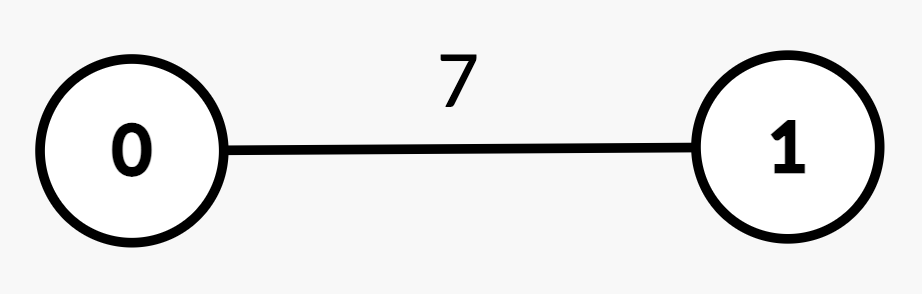

# [3585. Find Weighted Median Node in Tree](https://leetcode.com/problems/find-weighted-median-node-in-tree/)

| Category | Difficulty | Likes | Dislikes |
| :------: | :--------: | :---: | :------: |
| Algorithms | Hard | 67 | 5 |

**Tags:** [`array`](https://leetcode.com/tag/array), [`binary-search`](https://leetcode.com/tag/binary-search), [`dynamic-programming`](https://leetcode.com/tag/dynamic-programming), [`tree`](https://leetcode.com/tag/tree), [`depth-first-search`](https://leetcode.com/tag/depth-first-search)

**Companies:** `google`

## Description

You are given an integer `n` and an **undirected, weighted** tree rooted at node 0 with `n` nodes numbered from 0 to `n - 1`. This is represented by a 2D array `edges` of length `n - 1`, where `edges[i] = [u_i, v_i, w_i]` indicates an edge from node `u_i` to `v_i` with weight `w_i`.

The **weighted median node** is defined as the **first** node `x` on the path from `u_i` to `v_i` such that the sum of edge weights from `u_i` to `x` is **greater than or equal to half** of the total path weight.

You are given a 2D integer array `queries`. For each `queries[j] = [u_j, v_j]`, determine the weighted median node along the path from `u_j` to `v_j`.

Return an array `ans`, where `ans[j]` is the node index of the weighted median for `queries[j]`.

 

**Example 1:**

**Input:** n = 2, edges = [[0,1,7]], queries = [[1,0],[0,1]]

**Output:** [0,1]

**Explanation:**

	
		
			Query
			Path
			Edge

			Weights
			Total

			Path

			Weight
			Half
			Explanation
			Answer
		
	
	
		
			`[1, 0]`
			`1 &rarr; 0`
			`[7]`
			7
			3.5
			Sum from `1 &rarr; 0 = 7 >= 3.5`, median is node 0.
			0
		
		
			`[0, 1]`
			`0 &rarr; 1`
			`[7]`
			7
			3.5
			Sum from `0 &rarr; 1 = 7 >= 3.5`, median is node 1.
			1
		
	

**Example 2:**

**Input:** n = 3, edges = [[0,1,2],[2,0,4]], queries = [[0,1],[2,0],[1,2]]

**Output:** [1,0,2]

**E****xplanation:**

	
		
			Query
			Path
			Edge

			Weights
			Total

			Path

			Weight
			Half
			Explanation
			Answer
		
	
	
		
			`[0, 1]`
			`0 &rarr; 1`
			`[2]`
			2
			1
			Sum from `0 &rarr; 1 = 2 >= 1`, median is node 1.
			1
		
		
			`[2, 0]`
			`2 &rarr; 0`
			`[4]`
			4
			2
			Sum from `2 &rarr; 0 = 4 >= 2`, median is node 0.
			0
		
		
			`[1, 2]`
			`1 &rarr; 0 &rarr; 2`
			`[2, 4]`
			6
			3
			Sum from `1 &rarr; 0 = 2 = 3`, median is node 2.
			2
		
	

**Example 3:**

**Input:** n = 5, edges = [[0,1,2],[0,2,5],[1,3,1],[2,4,3]], queries = [[3,4],[1,2]]

**Output:** [2,2]

**Explanation:**

	
		
			Query
			Path
			Edge

			Weights
			Total

			Path

			Weight
			Half
			Explanation
			Answer
		
	
	
		
			`[3, 4]`
			`3 &rarr; 1 &rarr; 0 &rarr; 2 &rarr; 4`
			`[1, 2, 5, 3]`
			11
			5.5
			Sum from `3 &rarr; 1 = 1 = 5.5`, median is node 2.
			2
		
		
			`[1, 2]`
			`1 &rarr; 0 &rarr; 2`
			`[2, 5]`
			7
			3.5
			
			
Sum from `1 &rarr; 0 = 2 = 3.5`, median is node 2.

			
			2
		
	

 

**Constraints:**

	- `2 <= n <= 10^5`

	- `edges.length == n - 1`

	- `edges[i] == [u_i, v_i, w_i]`

	- `0 <= u_i, v_i < n`

	- `1 <= w_i <= 10^9`

	- `1 <= queries.length <= 10^5`

	- `queries[j] == [u_j, v_j]`

	- `0 <= u_j, v_j < n`

	- The input is generated such that `edges` represents a valid tree.

---

**Links:** [Submissions](https://leetcode.com/problems/find-weighted-median-node-in-tree/) | [Solutions](https://leetcode.com/problems/find-weighted-median-node-in-tree/)
