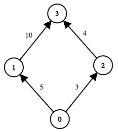
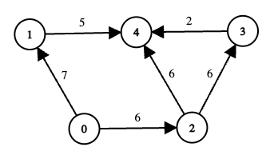

# [3620. Network Recovery Pathways](https://leetcode.com/problems/network-recovery-pathways/)

| Category | Difficulty | Likes | Dislikes |
| :------: | :--------: | :---: | :------: |
| Algorithms | Hard | 132 | 12 |

**Tags:** [`array`](https://leetcode.com/tag/array), [`binary-search`](https://leetcode.com/tag/binary-search), [`dynamic-programming`](https://leetcode.com/tag/dynamic-programming), [`graph`](https://leetcode.com/tag/graph), [`topological-sort`](https://leetcode.com/tag/topological-sort), [`heap-priority-queue`](https://leetcode.com/tag/heap-priority-queue), [`shortest-path`](https://leetcode.com/tag/shortest-path)

## Description

You are given a directed acyclic graph of `n` nodes numbered from 0 to `n &minus; 1`. This is represented by a 2D array edges of length `m`, where edges[i] = [ui, vi, costi] indicates a one‑way communication from node ui to node vi with a recovery cost of costi.

Some nodes may be offline. You are given a boolean array online where online[i] = true means node i is online. Nodes 0 and `n &minus; 1` are always online.

A path from 0 to `n &minus; 1` is **valid** if:

	- All intermediate nodes on the path are online.

	The total recovery cost of all edges on the path does not exceed `k`.

For each valid path, define its **score** as the minimum edge‑cost along that path.

Return the **maximum** path score (i.e., the largest **minimum**-edge cost) among all valid paths. If no valid path exists, return -1.

 

**Example 1:**

**Input:** edges = [[0,1,5],[1,3,10],[0,2,3],[2,3,4]], online = [true,true,true,true], k = 10

**Output:** 3

**Explanation:**

	
	
The graph has two possible routes from node 0 to node 3:

	
		
		
Path `0 &rarr; 1 &rarr; 3`

		
			
			
Total cost = `5 + 10 = 15`, which exceeds k (`15 > 10`), so this path is invalid.

			
		
		
		
		
Path `0 &rarr; 2 &rarr; 3`

		
			
			
Total cost = `3 + 4 = 7 
			
			
The minimum edge‐cost along this path is `min(3, 4) = 3`.

			
		
		
	
	
	
	
There are no other valid paths. Hence, the maximum among all valid path‐scores is 3.

	

**Example 2:**

**Input:** edges = [[0,1,7],[1,4,5],[0,2,6],[2,3,6],[3,4,2],[2,4,6]], online = [true,true,true,false,true], k = 12

**Output:** 6

**Explanation:**

	
	
Node 3 is offline, so any path passing through 3 is invalid.

	
	
	
Consider the remaining routes from 0 to 4:

	
		
		
Path `0 &rarr; 1 &rarr; 4`

		
			
			
Total cost = `7 + 5 = 12 
			
			
The minimum edge‐cost along this path is `min(7, 5) = 5`.

			
		
		
		
		
Path `0 &rarr; 2 &rarr; 3 &rarr; 4`

		
			
			
Node 3 is offline, so this path is invalid regardless of cost.

			
		
		
		
		
Path `0 &rarr; 2 &rarr; 4`

		
			
			
Total cost = `6 + 6 = 12 
			
			
The minimum edge‐cost along this path is `min(6, 6) = 6`.

			
		
		
	
	
	
	
Among the two valid paths, their scores are 5 and 6. Therefore, the answer is 6.

	

 

**Constraints:**

	n == online.length
	2 4
	0 `min(10^5, n * (n - 1) / 2)`
	edges[i] = [ui, vi, costi]
	0 i, vi 
	ui != vi
	0 i 9
	0 13
	online[i] is either true or false, and both online[0] and online[n &minus; 1] are true.
	The given graph is a directed acyclic graph.

---

**Links:** [Submissions](https://leetcode.com/problems/network-recovery-pathways/) | [Solutions](https://leetcode.com/problems/network-recovery-pathways/)
