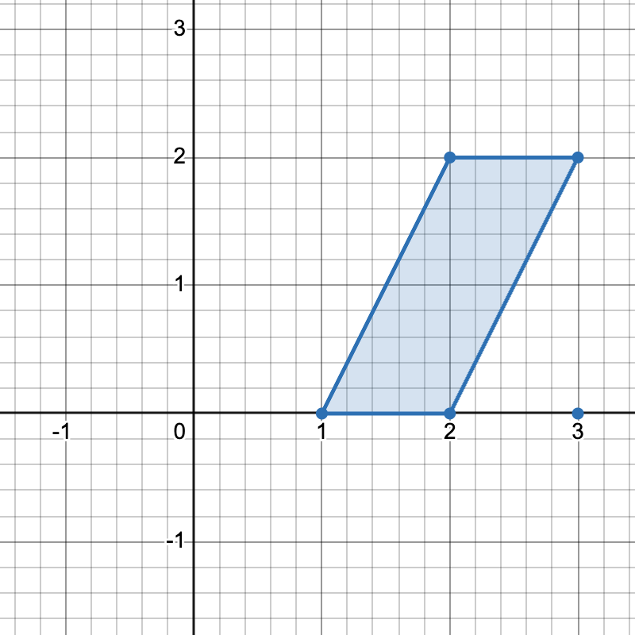
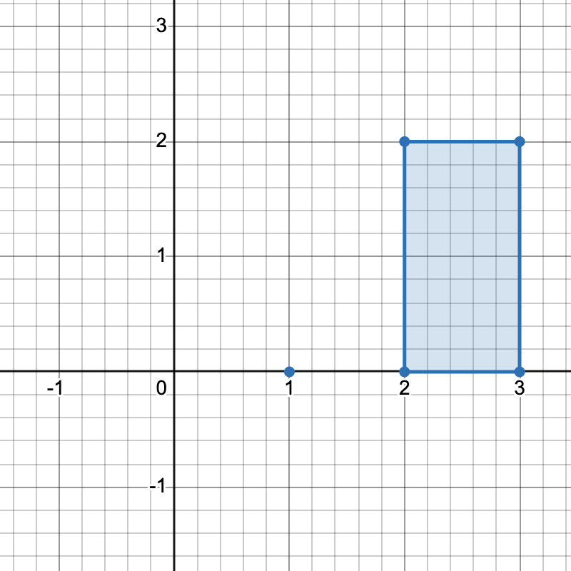
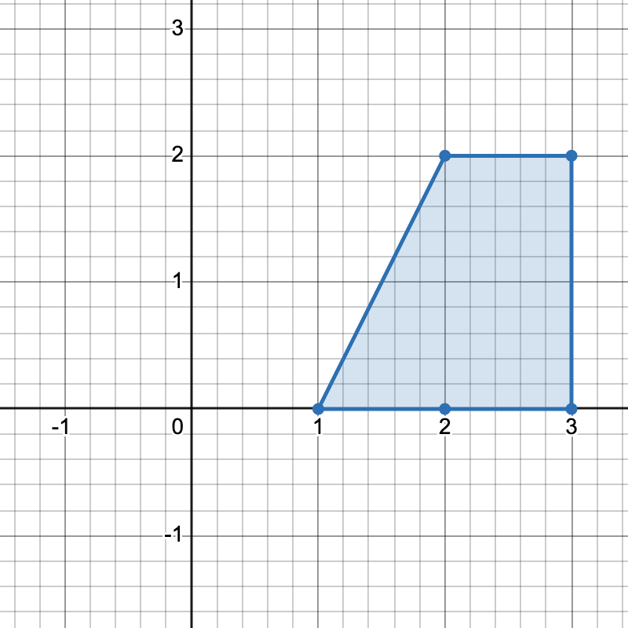

# [3623. Count Number of Trapezoids I](https://leetcode.com/problems/count-number-of-trapezoids-i/)

| Category | Difficulty | Likes | Dislikes |
| :------: | :--------: | :---: | :------: |
| Algorithms | Medium | 380 | 48 |

**Tags:** [`array`](https://leetcode.com/tag/array), [`hash-table`](https://leetcode.com/tag/hash-table), [`math`](https://leetcode.com/tag/math), [`geometry`](https://leetcode.com/tag/geometry)

## Description

You are given a 2D integer array `points`, where `points[i] = [x_i, y_i]` represents the coordinates of the `i^th` point on the Cartesian plane.

A **horizontal** **trapezoid** is a convex quadrilateral with **at least one pair** of horizontal sides (i.e. parallel to the x-axis). Two lines are parallel if and only if they have the same slope.

Return the  number of unique ***horizontal* *trapezoids*** that can be formed by choosing any four distinct points from `points`.

Since the answer may be very large, return it **modulo** `10^9 + 7`.

 

**Example 1:**

**Input:** points = [[1,0],[2,0],[3,0],[2,2],[3,2]]

**Output:** 3

**Explanation:**

  

There are three distinct ways to pick four points that form a horizontal trapezoid:

	Using points [1,0], [2,0], [3,2], and [2,2].
	Using points [2,0], [3,0], [3,2], and [2,2].
	Using points [1,0], [3,0], [3,2], and [2,2].

**Example 2:**

**Input:** points = [[0,0],[1,0],[0,1],[2,1]]

**Output:** 1

**Explanation:**

There is only one horizontal trapezoid that can be formed.

 

**Constraints:**

	- `4 <= points.length <= 10^5`

	- `&ndash;10^8 <= x_i, y_i <= 10^8`

	- All points are pairwise distinct.

---

**Links:** [Submissions](https://leetcode.com/problems/count-number-of-trapezoids-i/) | [Solutions](https://leetcode.com/problems/count-number-of-trapezoids-i/)
