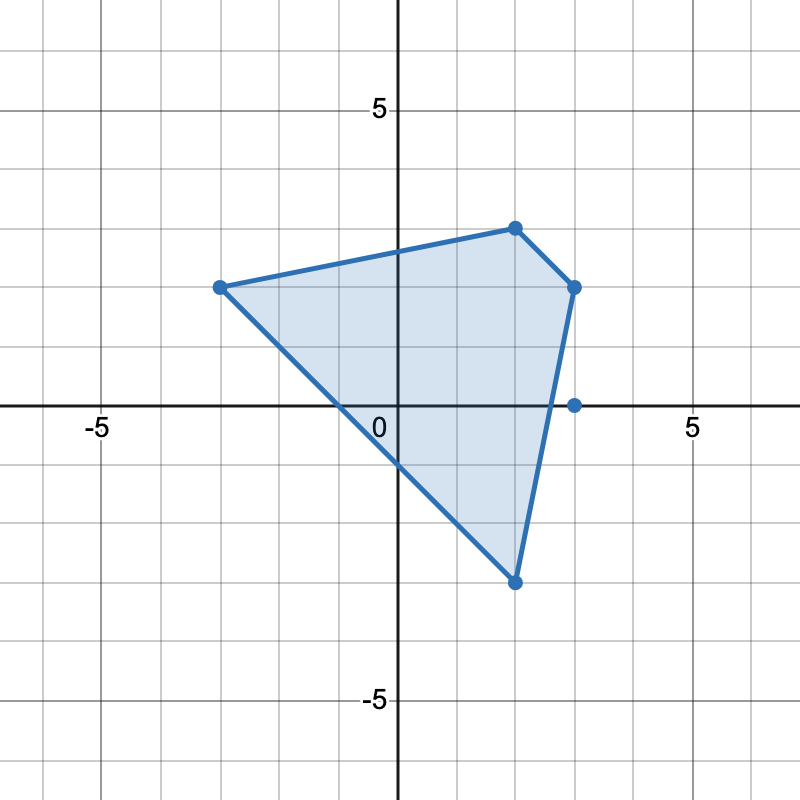
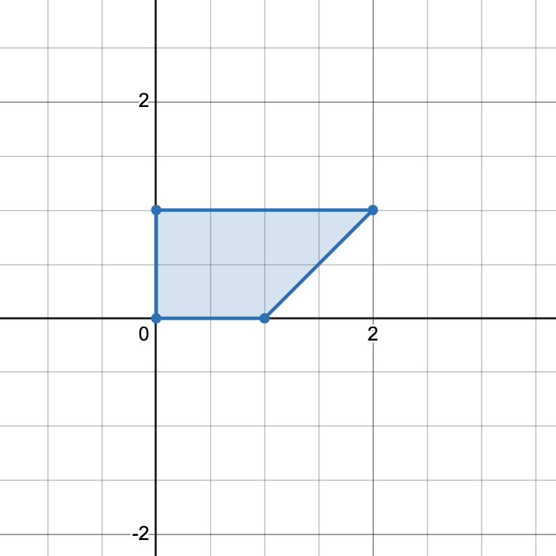

# [3625. Count Number of Trapezoids II](https://leetcode.com/problems/count-number-of-trapezoids-ii/)

| Category | Difficulty | Likes | Dislikes |
| :------: | :--------: | :---: | :------: |
| Algorithms | Hard | 254 | 95 |

**Tags:** [`array`](https://leetcode.com/tag/array), [`hash-table`](https://leetcode.com/tag/hash-table), [`math`](https://leetcode.com/tag/math), [`geometry`](https://leetcode.com/tag/geometry)

**Companies:** `facebook`, `google`

## Description

You are given a 2D integer array `points` where `points[i] = [x_i, y_i]` represents the coordinates of the `i^th` point on the Cartesian plane.

Return the number of unique *trapezoids* that can be formed by choosing any four distinct points from `points`.

A **trapezoid** is a convex quadrilateral with **at least one pair** of parallel sides. Two lines are parallel if and only if they have the same slope.

 

**Example 1:**

**Input:** points = [[-3,2],[3,0],[2,3],[3,2],[2,-3]]

**Output:** 2

**Explanation:**

 

There are two distinct ways to pick four points that form a trapezoid:

	- The points `[-3,2], [2,3], [3,2], [2,-3]` form one trapezoid.

	- The points `[2,3], [3,2], [3,0], [2,-3]` form another trapezoid.

**Example 2:**

**Input:** points = [[0,0],[1,0],[0,1],[2,1]]

**Output:** 1

**Explanation:**

There is only one trapezoid which can be formed.

 

**Constraints:**

	- `4 <= points.length <= 500`

	- `&ndash;1000 <= x_i, y_i <= 1000`

	- All points are pairwise distinct.

---

**Links:** [Submissions](https://leetcode.com/problems/count-number-of-trapezoids-ii/) | [Solutions](https://leetcode.com/problems/count-number-of-trapezoids-ii/)
