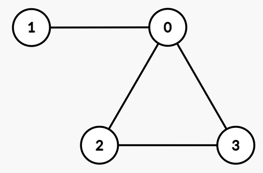

# [3656. Determine if a Simple Graph Exists](https://leetcode.com/problems/determine-if-a-simple-graph-exists/)

| Category | Difficulty | Likes | Dislikes |
| :------: | :--------: | :---: | :------: |
| Algorithms | Medium | 7 | 3 |

**Tags:** [`array`](https://leetcode.com/tag/array), [`binary-search`](https://leetcode.com/tag/binary-search), [`graph`](https://leetcode.com/tag/graph), [`sorting`](https://leetcode.com/tag/sorting), [`prefix-sum`](https://leetcode.com/tag/prefix-sum)

## Description

You are given an integer array `degrees`, where `degrees[i]` represents the desired degree of the `i^th` vertex.

Your task is to determine if there exists an **undirected simple** graph with **exactly** these vertex degrees.

A **simple** graph has no self-loops or parallel edges between the same pair of vertices.

Return `true` if such a graph exists, otherwise return `false`.

 

**Example 1:**

**Input:** degrees = [3,1,2,2]

**Output:** true

**Explanation:**

​​​​​​​

One possible undirected simple graph is:

	- Edges: `(0, 1), (0, 2), (0, 3), (2, 3)`

	- Degrees: `deg(0) = 3`, `deg(1) = 1`, `deg(2) = 2`, `deg(3) = 2`.

**Example 2:**

**Input:** degrees = [1,3,3,1]

**Output:** false

**Explanation:**​​​​​​​

	- `degrees[1] = 3` and `degrees[2] = 3` means they must be connected to all other vertices.

	- This requires `degrees[0]` and `degrees[3]` to be at least 2, but both are equal to 1, which contradicts the requirement.

	- Thus, the answer is `false`.

 

**Constraints:**

	- `1 <= n == degrees.length <= 10^​​​​​​​5`

	- `0 <= degrees[i] <= n - 1`

---

**Links:** [Submissions](https://leetcode.com/problems/determine-if-a-simple-graph-exists/) | [Solutions](https://leetcode.com/problems/determine-if-a-simple-graph-exists/)
