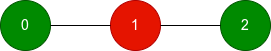
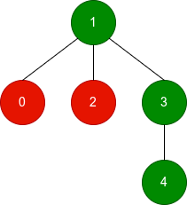

# [3772. Maximum Subgraph Score in a Tree](https://leetcode.com/problems/maximum-subgraph-score-in-a-tree/)

| Category | Difficulty | Likes | Dislikes |
| :------: | :--------: | :---: | :------: |
| Algorithms | Hard | 38 | 1 |

**Tags:** [`array`](https://leetcode.com/tag/array), [`dynamic-programming`](https://leetcode.com/tag/dynamic-programming), [`tree`](https://leetcode.com/tag/tree), [`depth-first-search`](https://leetcode.com/tag/depth-first-search)

**Companies:** `microsoft`

## Description

You are given an **undirected tree** with `n` nodes, numbered from 0 to `n - 1`. It is represented by a 2D integer array `edges`​​​​​​​ of length `n - 1`, where `edges[i] = [a_i, b_i]` indicates that there is an edge between nodes `a_i` and `b_i` in the tree.

You are also given an integer array `good` of length `n`, where `good[i]` is 1 if the `i^th` node is good, and 0 if it is bad.

Define the **score** of a **subgraph** as the number of good nodes minus the number of bad nodes in that subgraph.

For each node `i`, find the **maximum** possible score among all **connected subgraphs** that contain node `i`.

Return an array of `n` integers where the `i^th` element is the **maximum** score for node `i`.

A **subgraph** is a graph whose vertices and edges are subsets of the original graph.

A **connected subgraph** is a subgraph in which every pair of its vertices is reachable from one another using only its edges.

 

**Example 1:**

**Input:** n = 3, edges = [[0,1],[1,2]], good = [1,0,1]

**Output:** [1,1,1]

**Explanation:**

	- Green nodes are good and red nodes are bad.

	- For each node, the best connected subgraph containing it is the whole tree, which has 2 good nodes and 1 bad node, resulting in a score of 1.

	- Other connected subgraphs containing a node may have the same score.

**Example 2:**

**Input:** n = 5, edges = [[1,0],[1,2],[1,3],[3,4]], good = [0,1,0,1,1]

**Output:** [2,3,2,3,3]

**Explanation:**

	- Node 0: The best connected subgraph consists of nodes `0, 1, 3, 4`, which has 3 good nodes and 1 bad node, resulting in a score of `3 - 1 = 2`.

	- Nodes 1, 3, and 4: The best connected subgraph consists of nodes `1, 3, 4`, which has 3 good nodes, resulting in a score of 3.

	- Node 2: The best connected subgraph consists of nodes `1, 2, 3, 4`, which has 3 good nodes and 1 bad node, resulting in a score of `3 - 1 = 2`.

**Example 3:**

**Input:** n = 2, edges = [[0,1]], good = [0,0]

**Output:** [-1,-1]

**Explanation:**

For each node, including the other node only adds another bad node, so the best score for both nodes is -1.

 

**Constraints:**

	- `2 <= n <= 10^5`

	- `edges.length == n - 1`

	- `edges[i] = [a_i, b_i]`

	- `0 <= a_i, b_i < n`

	- `good.length == n`

	- `0 <= good[i] <= 1`

	- The input is generated such that `edges` represents a valid tree.

---

**Links:** [Submissions](https://leetcode.com/problems/maximum-subgraph-score-in-a-tree/) | [Solutions](https://leetcode.com/problems/maximum-subgraph-score-in-a-tree/)
