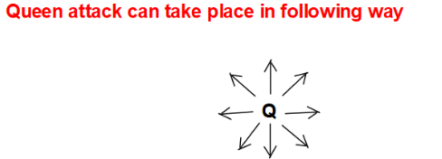
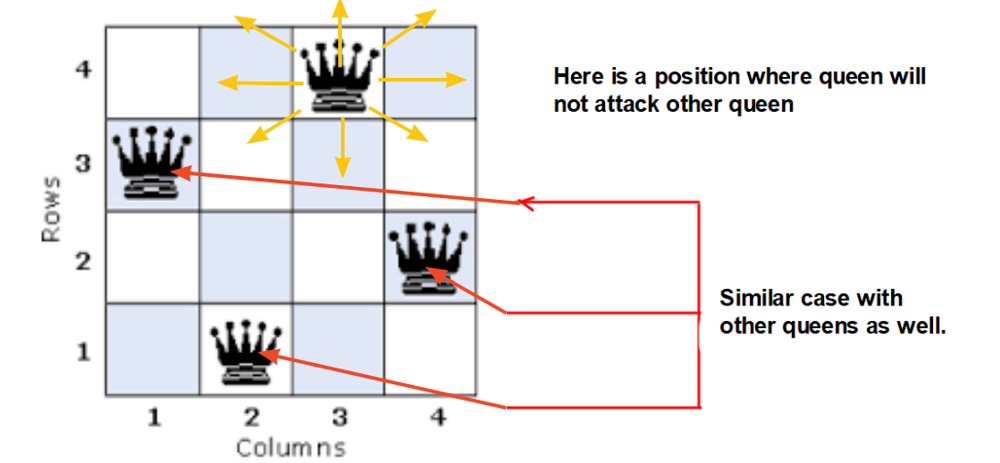
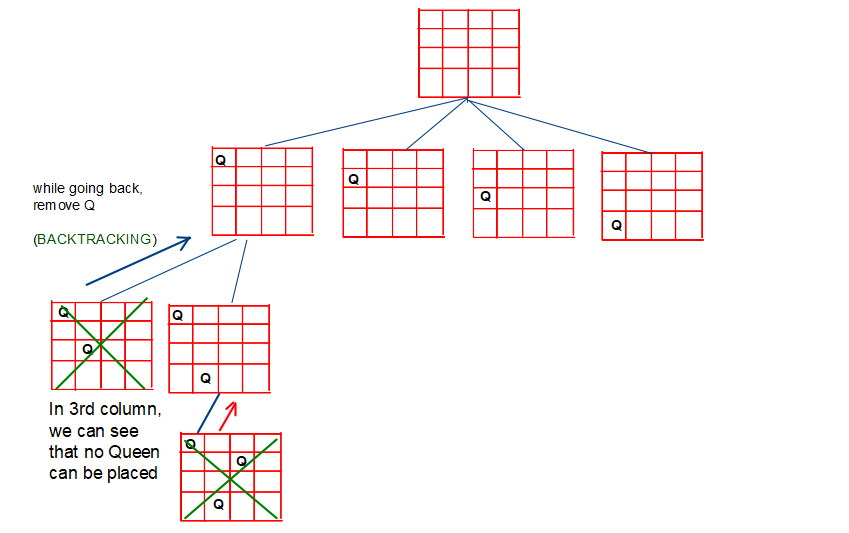
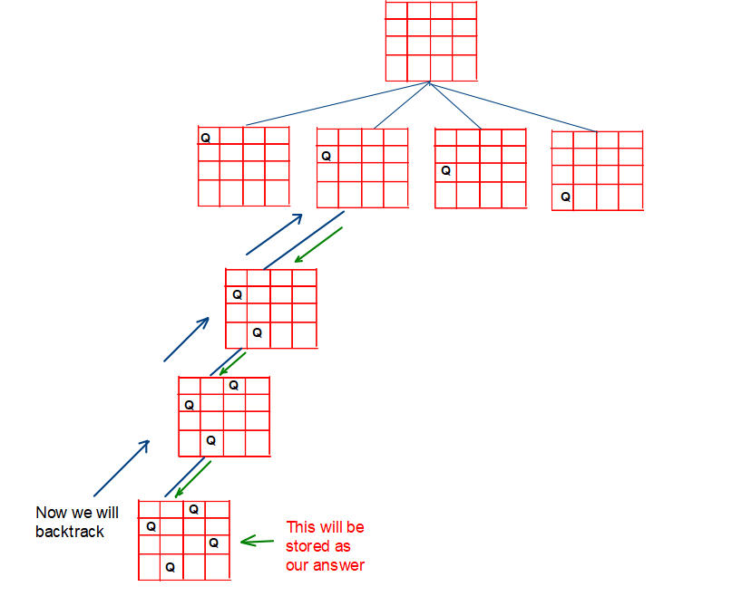
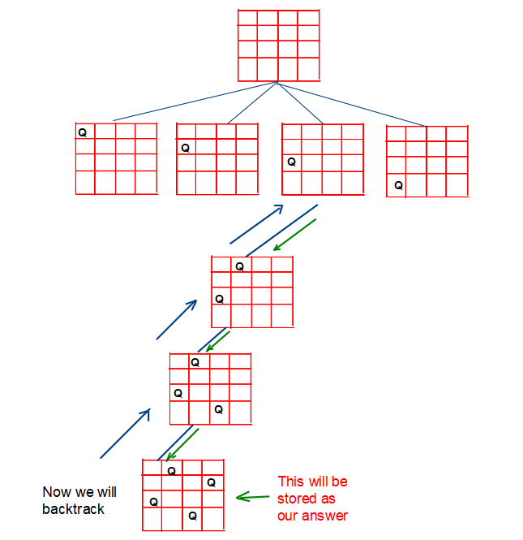
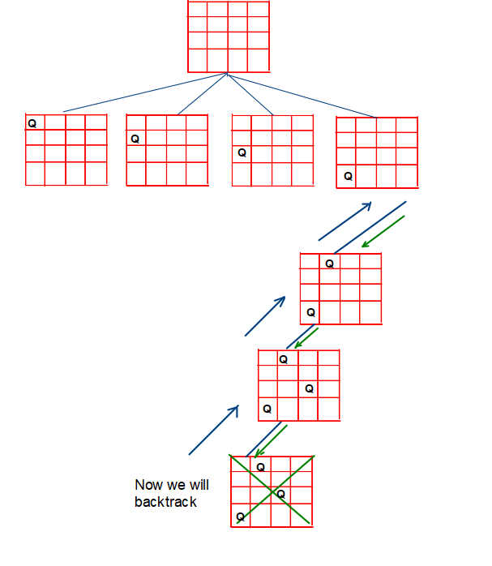
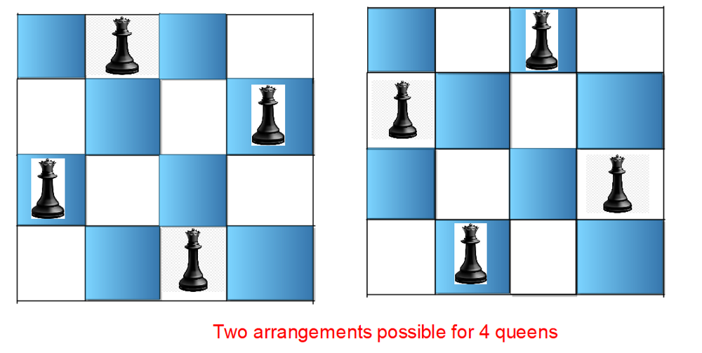

# [Java/C++] N-Queens 1 && 2 || Almost Same Solution

**Author:** hi-malik
**Votes:** 56
**Link:** [https://leetcode.com/problems/n-queens-ii/solutions/2111857/](https://leetcode.com/problems/n-queens-ii/solutions/2111857/)

---

**Rules For N-Queens in a chess Board :-**
1. Every Row should Have 1 queen


2. Every Column should have 1 quuen
3. No 2 queens can attack each other



```
N-Quuens I
```

**Problem Statement:** The n-queens is the problem of placing n queens on n \xD7 n chessboard such that no two queens can attack each other. Given an integer n, return all distinct solutions to the n -queens puzzle. Each solution contains a distinct boards configuration of the queen\u2019s placement, where \u2018Q\u2019 and \u2018.\u2019 indicate queen and empty space respectively.

**Intuition:** Using the concept of Backtracking, we will place Queen at different positions of the chessboard and find the right arrangement where all the n queens can be placed on the n*n grid.




**Approach:**

**Ist position:** This is the position where we can see no possible arrangement is found where all queens can be placed since, at the 3rd column, the Queen will be killed at all possible positions of row.



**2nd position:** One of the correct possible arrangements is found. So we will store it as our answer.



**3rd position:** One of the correct possible arrangements is found. So we will store it as our answer.



**4th position:** This is the position where we can see no possible arrangement is found where all queens can be placed since, at the 4th column, the Queen will be killed at all possible positions of row.



<iframe src="https://leetcode.com/playground/MgCvV5hU/shared" frameBorder="0" width="1400" height="1000"></iframe>


ANALYSIS :-
* **Time Complexity:** Exponential in nature, since we are trying out all ways. To be precise it goes as O(N! * N) nearly.

* **Space Complexity:** O(N^2)
```
N-Quuens II
```

This Problem is Almost Similar to N-Queens what extra we have to done over here is, Instead of printing the position we have to **count** the no. of ways in which Queens can be arranged on N-By-N chess 



<iframe src="https://leetcode.com/playground/H7a7hggm/shared" frameBorder="0" width="1200" height="800"></iframe>

ANALYSIS :-
* **Time Complexity:** O(N! * N)

* **Space Complexity:** O(N^2)