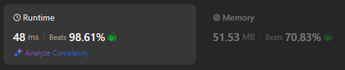

# 🕒Very Fast, Simple Recursive Solution🕒 (Beats 99%) | TypeScript

**Author:** BurtTheAlert
**Votes:** 2
**Link:** [https://leetcode.com/problems/n-queens-ii/solutions/5837982/](https://leetcode.com/problems/n-queens-ii/solutions/5837982/)

---

# Intuition
We solve the problem recursively by identifying a compact way to store the result so far.

# Approach




Since there has to be exactly one queen on every row, we can store any intermediate result (as well as a final result) in a 1-dimensional array of length n, by representing each row on the chessboard by an element in the array, and the value of the element representing the index (column) of the queen on the row.

We start out with an empty array, and then recursively go one row at a time and try placing a queen on each square on the row. If the position is legal so far, we recurse onto the next row. When we reach the $(n+1)$th row, we recognise that we have a valid solution and increment our solution counter.

# Code
```typescript []
function totalNQueens(n: number): number {
    return solve(n, 0, []);
}

function solve(n: number, row: number, queens: number[]): number {
    if (row === n) return 1;

    let solutions = 0;
    for (let i=0; i<n; ++i) {
        let ok = true;
        for (let j=0; j<queens.length; ++j) {
            if (queens[j] === i) ok = false;
            if (row - j === Math.abs(queens[j] - i)) ok = false;
            if (!ok) break;
        }
        if (ok) solutions += solve(n, row + 1, queens.concat([i]));
    }

    return solutions;
}
```