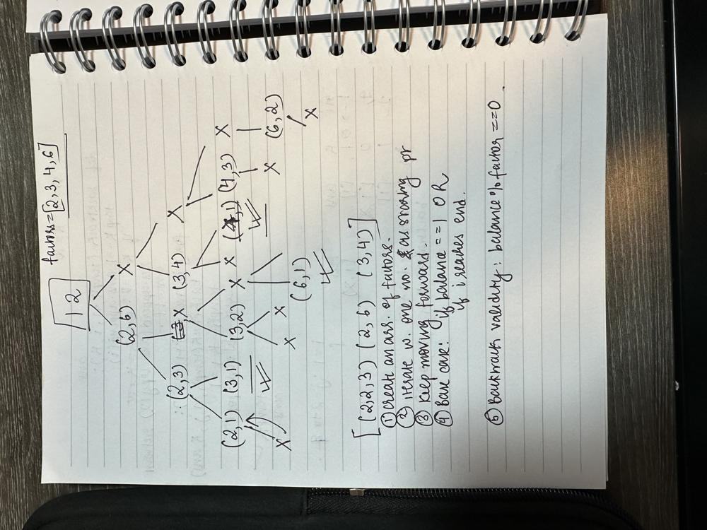
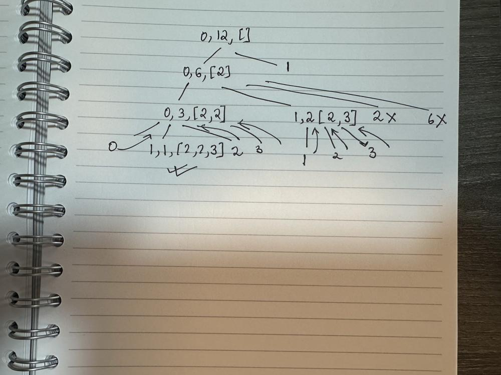

# Python3 easy to understand code

**Author:** leetkido
**Votes:** 5
**Link:** [https://leetcode.com/problems/factor-combinations/solutions/4215366/](https://leetcode.com/problems/factor-combinations/solutions/4215366/)

---

# Intuition
Tried keeping the approach similar to combinations and combinations - IV question.

# Approach
At every point we decide if to take something or not take it (this will be our starting point). if we decide to ditch a value at an index, we are never allowed to take it again if we go down that respective path.






# Code
```
class Solution:
    def getFactors(self, n: int) -> List[List[int]]:
        factors = []
        for i in range(2,n//2 + 1):
            if n%i == 0: factors.append(i)

        result = []
        def backTrack(i,balance,ans):
            if i == len(factors):return
            if balance == 1:
                if len(ans)>1: result.append(ans.copy())
                return
            
            for x in range(i,len(factors)):
                value = factors[x]
                if balance%value == 0:
                    backTrack(x,balance//value,ans+[value])
        backTrack(0, n, [])
        return(result)
```