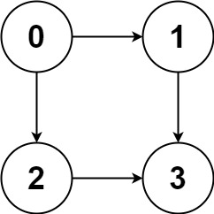
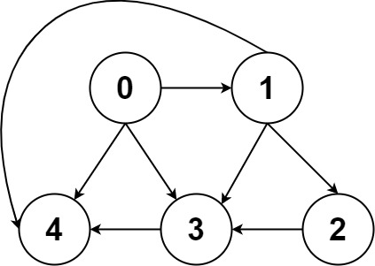

# [797. All Paths From Source to Target](https://leetcode.com/problems/all-paths-from-source-to-target/)

| Category | Difficulty | Likes | Dislikes |
| :------: | :--------: | :---: | :------: |
| Algorithms | Medium | 7575 | 151 |

**Tags:** [`backtracking`](https://leetcode.com/tag/backtracking), [`depth-first-search`](https://leetcode.com/tag/depth-first-search), [`breadth-first-search`](https://leetcode.com/tag/breadth-first-search), [`graph`](https://leetcode.com/tag/graph)

**Companies:** `bloomberg`, `amazon`, `microsoft`, `facebook`, `apple`

## Description

Given a directed acyclic graph (**DAG**) of `n` nodes labeled from `0` to `n - 1`, find all possible paths from node `0` to node `n - 1` and return them in **any order**.

The graph is given as follows: `graph[i]` is a list of all nodes you can visit from node `i` (i.e., there is a directed edge from node `i` to node `graph[i][j]`).

 

**Example 1:**


```

Input: graph = [[1,2],[3],[3],[]]
Output: [[0,1,3],[0,2,3]]
Explanation: There are two paths: 0 -&gt; 1 -&gt; 3 and 0 -&gt; 2 -&gt; 3.

```

**Example 2:**


```

Input: graph = [[4,3,1],[3,2,4],[3],[4],[]]
Output: [[0,4],[0,3,4],[0,1,3,4],[0,1,2,3,4],[0,1,4]]

```

 

**Constraints:**

	- `n == graph.length`

	- `2 <= n <= 15`

	- `0 <= graph[i][j] < n`

	- `graph[i][j] != i` (i.e., there will be no self-loops).

	- All the elements of `graph[i]` are **unique**.

	- The input graph is **guaranteed** to be a **DAG**.

---

**Links:** [Submissions](https://leetcode.com/problems/all-paths-from-source-to-target/) | [Solutions](https://leetcode.com/problems/all-paths-from-source-to-target/)
