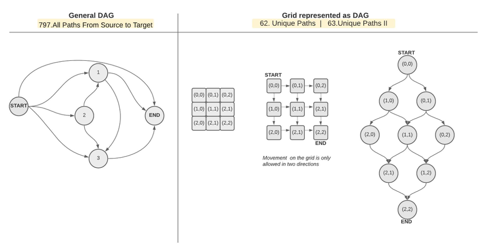
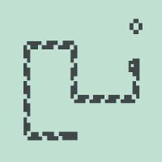
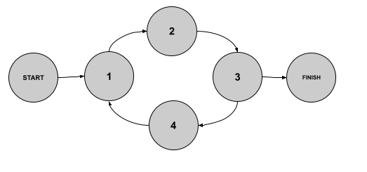
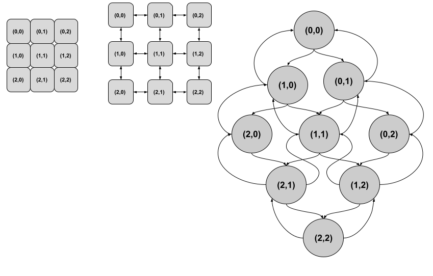
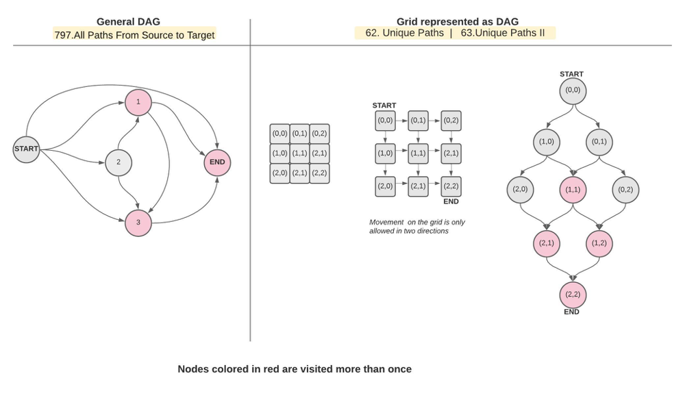
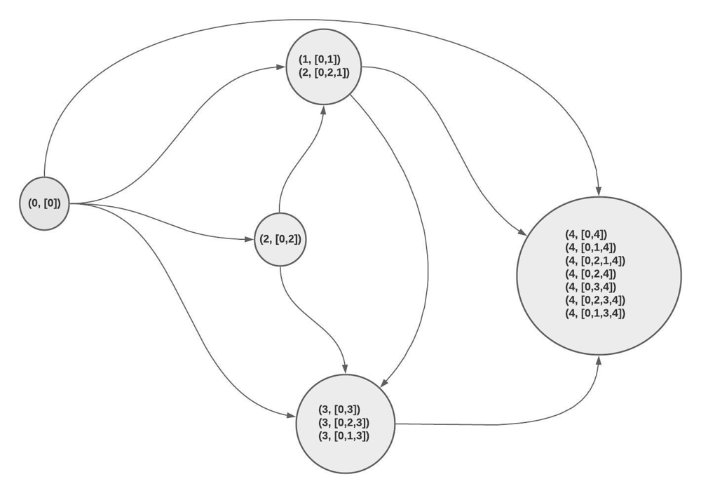
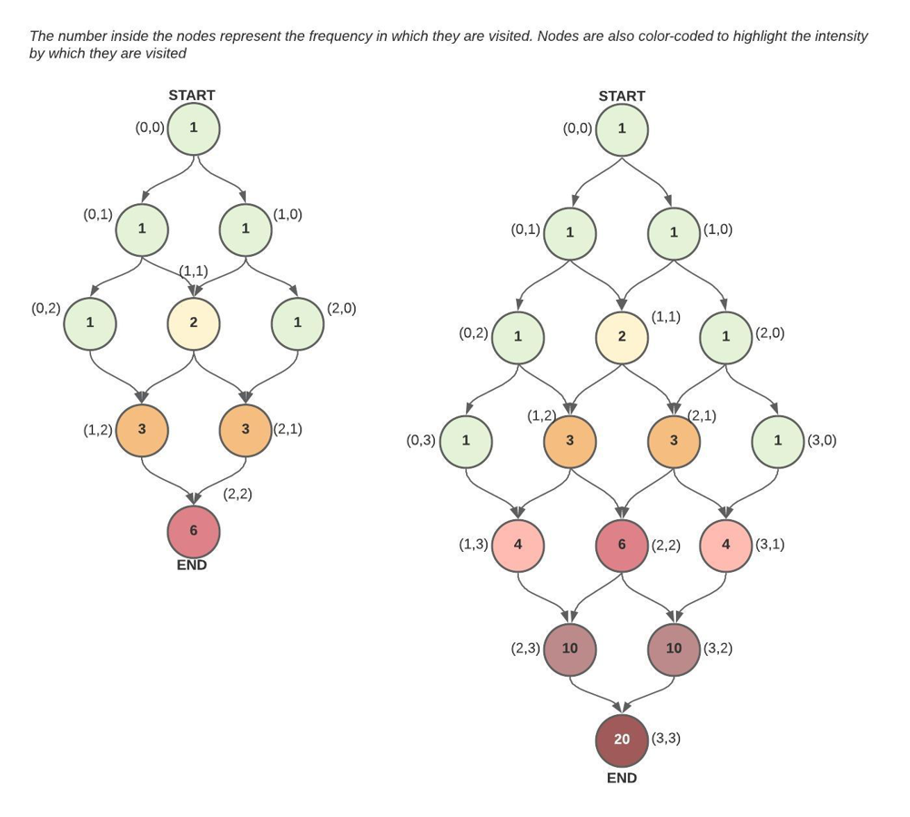
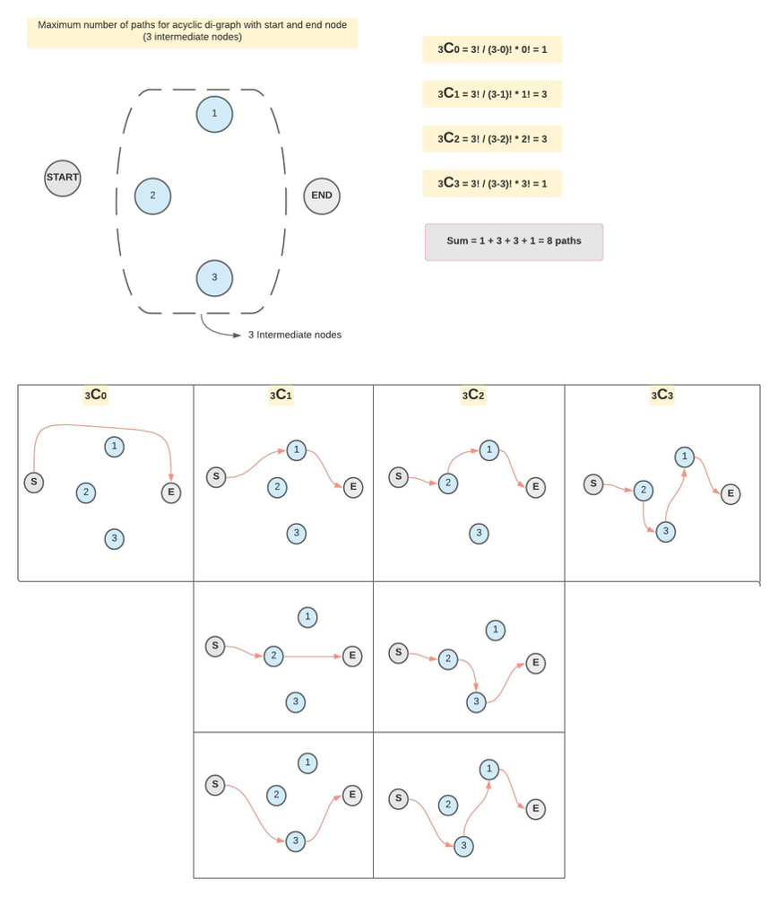
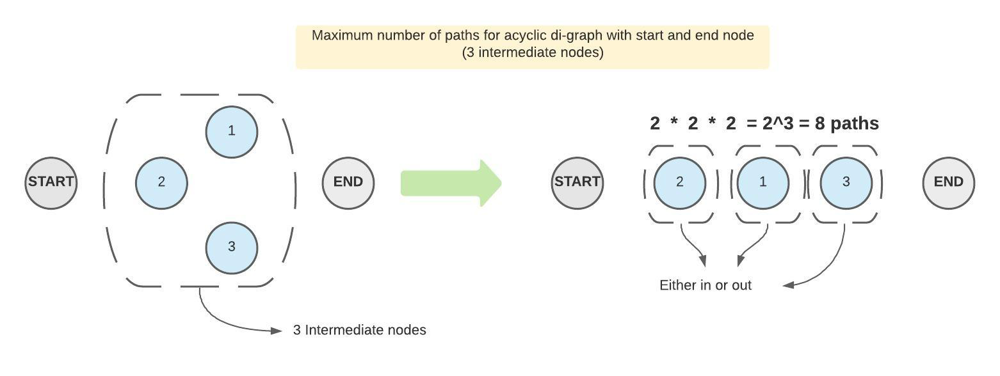

# [Python] Iterative DFS with detailed time complexity & visuals

**Author:** Hieroglyphs
**Votes:** 669
**Link:** [https://leetcode.com/problems/all-paths-from-source-to-target/solutions/986429/](https://leetcode.com/problems/all-paths-from-source-to-target/solutions/986429/)

---

### Iterative DFS Approach - No backtracking

- This approach uses brute-force DFS to generate all possible paths from cell (0,0) to cell (n-1, m-1). The approach in the solution tab talks about backtracking where in fact **backtracking is NOT required at all in this problem** as we need to generate all possible paths. This means all paths are part of the answer. There are no "wrong" paths that we might need to prune or backtrack from.


- The DFS solution to this problem is very simialr to the DFS I used to solve : `63. Unique Paths II, 62. Unique Paths`
with one exception. The DAG in this problem is a general DAG (Directed Acyclic Graph) whereas the DAG we traverse in problems (62 and 63) is a grid-DAG. That's just my way of saying it's a DAG that represents a grid. See picture below for a visual illustration of the difference between these two.



* As you can see, while the grid DAG has a well-defined sturcture, the general-case DAG is unpredictable. This difference though will have no impact on the DFS algorithm and will only materlize in the time complexity of the algorithm. **More on that later.**

- **When do we actually need backtracking ?**
	- Backtracking would be required if the input graph was **NOT** a DAG.  A graph that is acyclic requires backtracking when traversed because our DFS path might circle back and hit itself. Visually, this scenario is very similar to the retro snake game where the snake needs to avoid hiting its growing tail. A snake could hit its own tail only when its movement can form a cycle. (aka. cyclic graph). Therefore, if the graph is guaranteed not to have cycles, we do not need to bother with backtracking.
	
		

	
		**A cyclic graph can take many forms.**
	
		- *A general cyclic graph*
			

		- *A grid cyclic graph:* i.e. a grid in which movement is allowed in all four directions (left, down, right, up) -  `79. Word Search`
			


	

* **A couple of notes about the algorithm:**
  
	- Since the graph is a DAG, we are not worried that we might get stuck in a loop as we traverse it (no cycles/loops), thus the visited set that normally accompanies graph traversal algortihms is not needed.

	- Moreover, a visited set would actualy ruin the algorithm for us and we need to get rid of it, because in this particular problem we need to generate all paths, and for that we might visit some nodes more than once. Those are the nodes that are common among multiple paths. See nodes colored in red below.  **So not only that we don't need a visited set, we actually must NOT use one.**



**Algorithm:**
- Use an explicit stack
- As we traverse the DAG, store the node along with the path leading to it. See sketch below.



**Code:**
```
def allPathsSourceTarget(graph):
        
        #edges cases:
        if not graph:
            return []
        
        # build di-graph
        d = {}
        for i in range(len(graph)):
            d[i] = graph[i] # one-way link
        
        # apply DFS on DAG
        n = len(graph)
        stack = [(0, [0])] # - store noth the (node, and the path leading to it)
        res = []
        while stack:
            node, path = stack.pop()
            # check leaf
            if node == n - 1:
                res.append(path)
            # traverse rest
            for nei in d[node]:
                stack.append((nei, path+[nei]))
        return res
    
```

**Time Complexity Analysis**

Before we delve into analyzing the time complexity for this solution, let's revisit a few simple algorithms with well-defined time complexities:

* When iterating over an array in linear time, we all know our time complexity is `O(N)` becaue we visit each node once and there is` N nodes` in total.

```
# O(N) Time Complexity
for i in range(len(array)):
	# do something
```

* Simiarly when we run a DFS algorithm on a graph while maintaining a visited set we are guaranteed every node is visited only once and thus our time complexity is also linear to the number of vertices/nodes `O(E+V)`

```
# O(E+V) Time Complexity
stack = []
while stack: # - O(V),  V = number of verticies/nodes 
	node = stack.pop() 
	visited.add(node)
	for nei in d[node]: # - O(E), E = max number of edges a node has
		if nei not in visited:
			stack.append(nei)
```

* On the other hand, when iterating twice over an array in a nested-loop fashion, we know the cost is `O(N^2)` because each node is visited `N times`. And since we have a total of `N nodes`, which makes the overall cost `N^2`

```
# O(N^2) Time Complexity
for i in range(len(array)):
	for j in range(len(array)):
		# do something
```

*  Now back to our algorithm. The time complexity of our algorithm as you may have noticed, is not as straight forward.  The time complexity of this solution can be tricky due to the fact that some nodes will be visited a lot more frequently than others **depending on the DAG's shape**. This inconsistency in the cost of visiting each node requires more detailed analysis. From the few examples above we notice that time complexity **really boils down to how many times we are visiting each node/item** in our data-strcuture. Perhaps an initial good guess is that our time complexity is somewhere between `O(N)` and `O(N^2)` since some nodes are visited once while others more than once. Another observation we could make is that the leaf/end node is the one with the highest frequency of visits. And if we look closer, we see that the number of visits made to the leaf/end node **must in fact be equal to the number of paths from (start -> end) since all paths eventually lead to it.** Hence we can safely say the leaf/end node is visited K times where K is the number of all paths from start node to end node. 
.


**DAG - Grid example**
* Now, what we covered above is true for both the grid-DAG and the general-case DAG, but let's first double-down on the grid-DAG:



* Notice that depending on the grid's dimensions:

	* `K` can be less than `N` (as in the 3x3 grid) `N=9` > `k=6`  
	* but can also be more than `N` (4x4 gird) `N=16` < `k=20`
	* `k ` = the number of paths (number of visits to the leaf/end node)

* Turns out `k` or the number of paths, can be calculated exactly in Grid-DAG example **using combinatorics:**
	* In order to reach the (n,m) node, we need to make a total of (m-1) + (n-1) movements:
		* (m-1) to the right
		* (n-1) to to the cell below
			* `n` = choosing from = a total of `(m-1) + (n-1) = (m+n-2)`
			* k = choosing/flipping 
			* `nPk = n!/(n-k)! * k!`
			* `nPk = (m+n-2)!/(m-1)! * (n-1)!`
			* `nPk = (2n-2)!/(n-1)! * (n-1)!` for a square grid

* Hence overall time complexity (worst case) = `O(E + K*V)` = `O(2 + K*V) `, E = 2 (each node has only two edges)
* Average case = `O(2 + K*V)` where K is the average cost to visit a node 
	* `(k = cost to visit all nodes / number of nodes)`

**DAG General-case**

* The advantage we had in the grid DAG is that we knew what our DAG looked like. We knew the size of the graph and we used that to deduce how many paths are going to be there. In the general-case DAG however, we know nothing about the shape, size of our input DAG. Due to the ambigious nature of the input, time-complexity analysis gets even more trickier. Turns out the **best we can do is come up with an upper limit**on the number of paths in the DAG.

**Maximum number of paths for acyclic di-graph with start and end node**
We can arrive at an upper limit in one of two ways:

**1- Finding the Number of Subsets of a Set**
Let's start with stating the obvious: Every path from start to end must contain the start and end nodes and can include anywhere from zero to N-2 intermediate nodes. In other words, its a given that the start and end nodes are included in the path, so we play around with the remaining (N-2) nodes. In set theory lingo that translates to the following: 

- For a DAG that has N-2 intermediate nodes.
	`C(N-2, 0) + C(N-2, 1) + C(N-2, 2) + C(N-2, 3) + ....... + C(N-2, N-2)`

For simplicity, let `n = N-2`

C(n, 0) = How many ways we can choose zero intermediate nodes between start and end = n!/(n-k)! * k! = n!/(n! * 0!) = 1
C(n, 1) = How many ways we can choose 1 intermediate nodes between start and end ... 
etc ...

Below is a visual illustration of the possible paths for a sample DAG:




* Why did we use combinations nCk and not Permutations nPk?
	* We should count a group of nodes (only once) and not count every permutation of the same group/combination.
	* In other words, I should not count : `Start -> A -> B -> End` and `Start -> B -> A -> End` as two different paths, because in reality, the actual DAG is one of these two solutions (not both).
	
**2- Children and chairs**
Another way to find the upper limit mathematically is as follows:
For each one of the intermediate nodes (excluding start and end node) there is one of two options: Either be part of the path, or no. This can be expressed as follows: If we have 3 intermediate nodes, we can treat them as chairs.
[2] * [2] * [2] = 2^3 = 8 paths




K = number of paths = `2^(N-2)`
Time comlexity = `E + k*V = E + 2^(N-2)*V`,