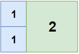
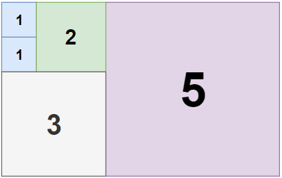
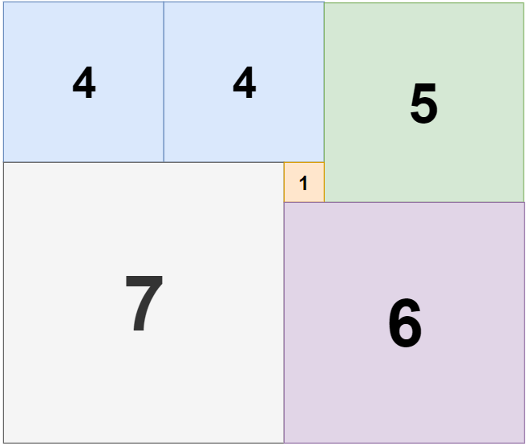

# [1240. Tiling a Rectangle with the Fewest Squares](https://leetcode.com/problems/tiling-a-rectangle-with-the-fewest-squares/)

| Category | Difficulty | Likes | Dislikes |
| :------: | :--------: | :---: | :------: |
| Algorithms | Hard | 716 | 581 |

**Tags:** [`backtracking`](https://leetcode.com/tag/backtracking)

**Companies:** `google`, `amazon`

## Description

Given a rectangle of size `n` x `m`, return *the minimum number of integer-sided squares that tile the rectangle*.

 

**Example 1:**



```

Input: n = 2, m = 3
Output: 3
Explanation: 3 squares are necessary to cover the rectangle.
2 (squares of 1x1)
1 (square of 2x2)
```

**Example 2:**



```

Input: n = 5, m = 8
Output: 5

```

**Example 3:**



```

Input: n = 11, m = 13
Output: 6

```

 

**Constraints:**

	- `1 <= n, m <= 13`

---

**Links:** [Submissions](https://leetcode.com/problems/tiling-a-rectangle-with-the-fewest-squares/) | [Solutions](https://leetcode.com/problems/tiling-a-rectangle-with-the-fewest-squares/)
