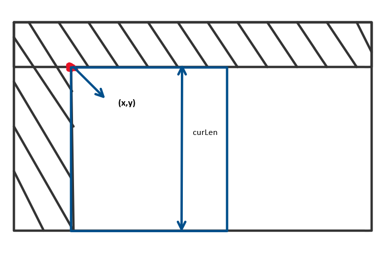
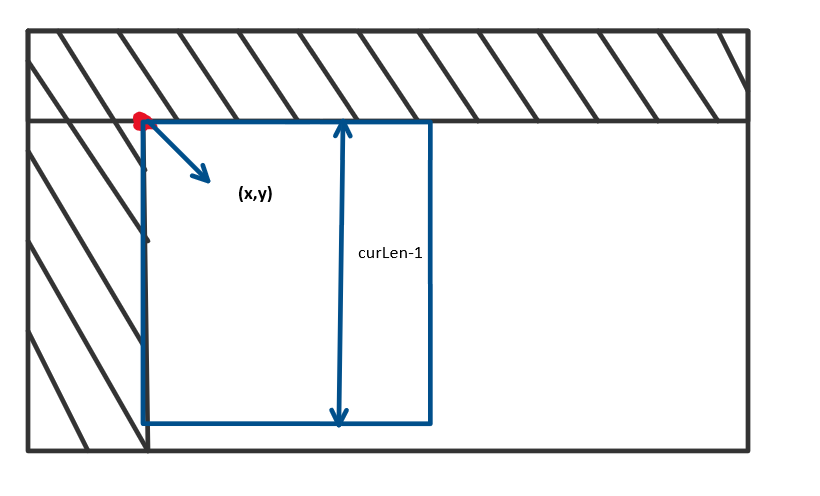

# 6ms clean Java backtrack solution with detailed explanation

**Author:** weicfd
**Votes:** 34
**Link:** [https://leetcode.com/problems/tiling-a-rectangle-with-the-fewest-squares/solutions/417654/](https://leetcode.com/problems/tiling-a-rectangle-with-the-fewest-squares/solutions/417654/)

---

### Intuition: 
Always find the **leftmost and topmost** position to cut a new square, until no such position found.


As illustrated as the graph, during any state in the backtrack, we found out a postion called **(x, y)**, then use **findWidth** to find out what the max width can a square can be cut, continue the backtrack for the next level. When the backtrack into the next position complete, the **curLen** will be **curLen - 1** and backtrack again until **curLen** is 1.


### Optimization:
**Pruning**: If now we already have 10 squares during the backtracking, but due to the previous update, we know that the square can be cut by only 9 squares in total, we stop the current backtracking.
```
 if (size > ret) return; 
```

### Implementation: 
```
class Solution {
    int ret; // store the final result
    int m, n; // m is the height, and n is the width
	
	// Note: original signature is changed from n,m to m,n
    public int tilingRectangle(int m, int n) { 
        this.m = m;
        this.n = n;
        this.ret = m * n; // initilize the result as m*n if cut rectangle to be all 1*1 squares
        int[][] mat = new int[m][n]; // record the status of every location, 0 means not covered, 1 means covered
        backtrack(mat, 0); // start backtracking
        return ret;
    }
    
	// the size means how many squares cut now
    public void backtrack(int[][] mat, int size) {
        if (size > ret) return; // if we already have more squares than the min result, no need to go forward
        
		// find out the leftmost and topmost postion where is not covered yet
        int x = -1, y = -1;
        for(int i = 0; i < m; i++) {
            for(int j = 0; j < n; j++) {
                if (mat[i][j] == 0) {
                    x = i;
                    y = j;
                    break;
                }
            }
            if (x != -1 && y != -1) break;
        }
		// if not found, we know that all positions are covered
        if (x == -1 && y == -1) {
		    // update the result
            ret = Math.min(size, ret);
        }
        else {
            int len = findWidth(x, y, mat); // find the maximum width to cut the square
            while(len >= 1) {
                cover(x, y, len, mat, 1); // cover the current square
                backtrack(mat, size + 1);
                cover(x, y, len, mat, 0); // uncover the previous result
                len--; // decrement the square width by 1
            }
        }
    }
    
    public int findWidth(int x, int y, int[][] mat) {
        int len = 1;
        while(x + len < m && y + len < n) {
            boolean flag = true; // flag means the len is reachable
            for (int i = 0; i <= len; i++) {
			    // check the right i-th column and the bottom i-th row away from (x, y) 
                if (mat[x + i][y + len] == 1 || mat[x + len][y + i] == 1) {
                    flag = false;
                    break;
                }
            }
            if (!flag) break;
            len++;
        }
        return len;
    }
    
    public void cover(int x, int y, int len, int[][] mat, int val) {
        for (int i = x; i < x + len; i++) {
            for (int j = y; j < y + len; j++) {
                mat[i][j] = val;
            }
        }
    }
}
```