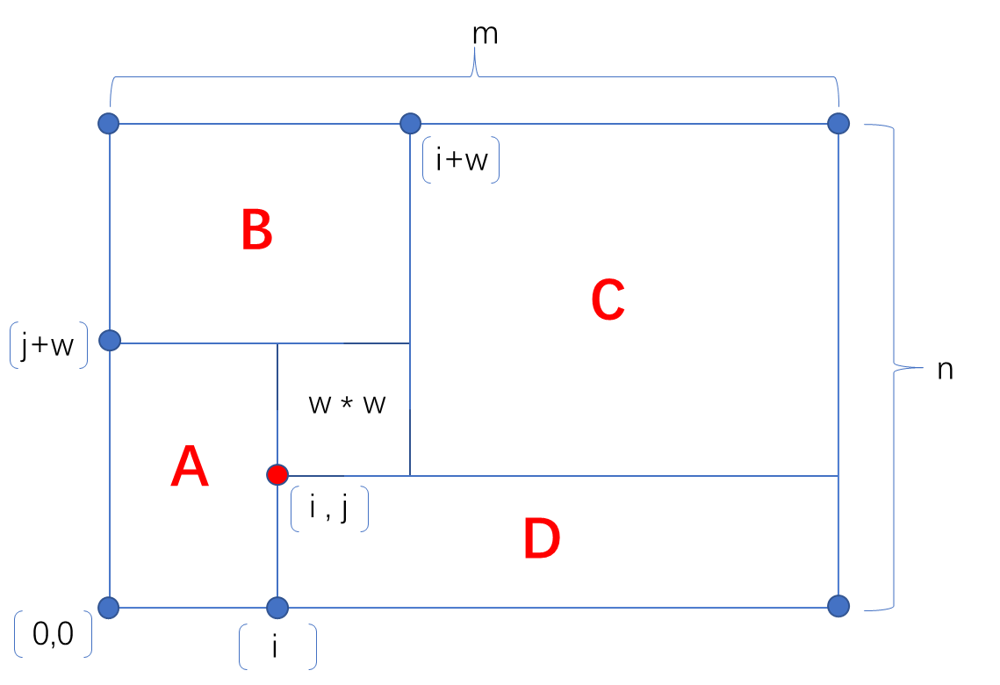

# JavaScript | No special case | 72ms | Comments in detail and image to explain everything

**Author:** HHH-HHH
**Votes:** 8
**Link:** [https://leetcode.com/problems/tiling-a-rectangle-with-the-fewest-squares/solutions/1777304/](https://leetcode.com/problems/tiling-a-rectangle-with-the-fewest-squares/solutions/1777304/)

---

Thanks to [@siddharth33](https://leetcode.com/problems/tiling-a-rectangle-with-the-fewest-squares/discuss/744019/JavaScript-Solution-Correct-logic-with-no-corner-cases-Simple-DP). That's the best answer I have ever seen. For better understanding to myself for reviewing it in future, in case I forget it.



In each w * w square, we assume there are four rectangles around it. The coordinate of the square w * w is marked as [i , j], and 0 <= i <= m - w, 0 <= j <= n - w. n is the shorter edge which has n < m; According to the assumption we have now, we can calculate the height and width of the four rectangles as rectangle = [height, width]
A = [j + w, i];
B = [n - j - w, i + w];
C = [n - j, m - i - w];
D = [j, m - i];

So now, we can do the loop to search the square from width = 1
```
for (let w = 1; w <= n; w++) {
	for (let i = 0; i <= m - w; i++) {
		for (let j = 0; j <= n - w; j++) {
			ans = Math.min(ans, 
				tilingHelper(j + w, i, memo) + 
				tilingHelper(n - j - w, i + w, memo) + 
				tilingHelper(n - j, m - i - w, memo) + 
				tilingHelper(j, m - i, memo) + 1
				);
		}
	}
}
```
I won't attach my full script here to show my respect to the original author. You can refer to the link here:  [@siddharth33](https://leetcode.com/problems/tiling-a-rectangle-with-the-fewest-squares/discuss/744019/JavaScript-Solution-Correct-logic-with-no-corner-cases-Simple-DP). 

