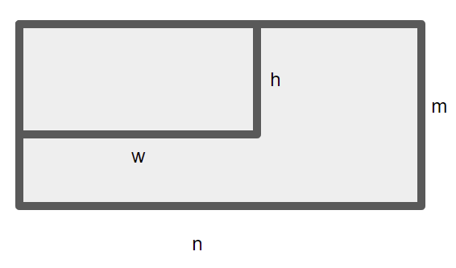
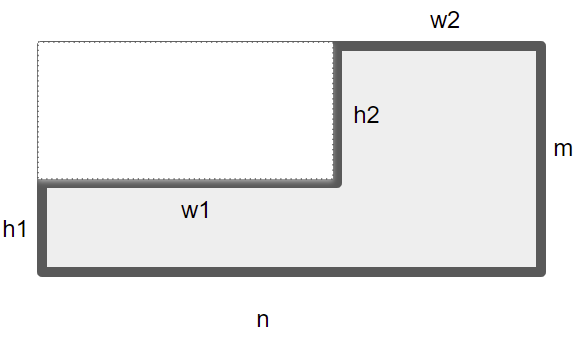
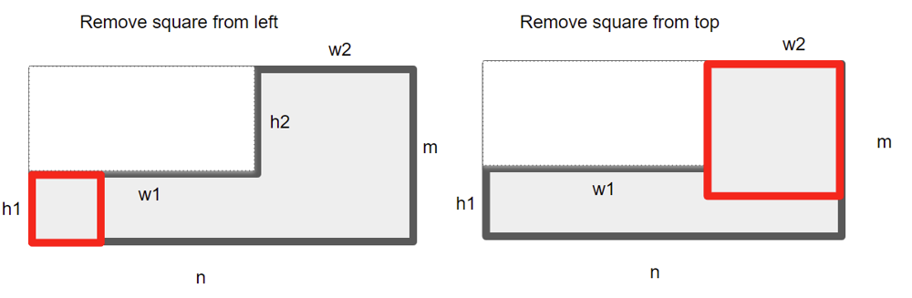
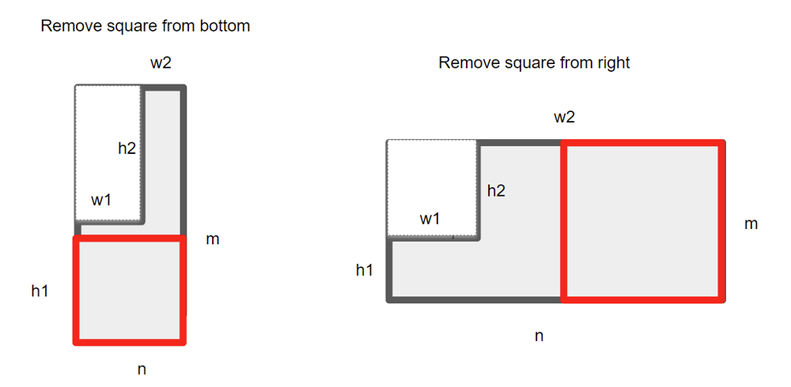

# [Python] Memorization with a L shape (two rectangles)

**Author:** earthsea
**Votes:** 4
**Link:** [https://leetcode.com/problems/tiling-a-rectangle-with-the-fewest-squares/solutions/2238518/](https://leetcode.com/problems/tiling-a-rectangle-with-the-fewest-squares/solutions/2238518/)

---

A rectangle can be considered an L shape + a small rectangle.
This small rectangle could be a square or zero sizes.

Define rectangle size as (m, n), small retangle size as (h, w).



L shape could be dicribe as (m, n, h, w). A rectangle could be dicribe by L shape as (m, n, 0, 0)
L shape is defined as below picture


        h1, h2 = m - h, h
        w1, w2 = w, n - w


Solution:
1. If the current shape is visited, return memorization the value 
2. If the current shape is a rectangle, we remove a square from the top-left corner.
3. If the current shape is an L shape, we remove a square from 4 directions (top, bottom, left, right) if possible.






```
class Solution(object):
    def tilingRectangle(self, n, m):
        """
        :type n: int
        :type m: int
        :rtype: int
        """

        self.memo = {}
        self.dp(m, n, 0, 0)

        return self.memo[(m, n, 0, 0)]

    def dp(self, m, n, h, w):

        key = (m, n, h, w)        
        key_rev = (n, m, w, h)

        if key in self.memo:
            return self.memo[key]

        if key_rev in self.memo:
            return self.memo[key_rev]

        if m == n and h == 0 and w == 0:
            self.memo[key] = 1
            return 1

        if m == 0 or n == 0:
            self.memo[key] = 0
            return 0

        res = m * n
        if h == 0 and w == 0:
            #  the current shape is a rectangle, we remove a square from the top-left corner.
            s = min(m, n)
            for d in range(1, s + 1):
                curr = 1 + self.dp(m, n, d, d)
                res = min(res, curr)

            self.memo[key] = res
            self.memo[key_rev] = res
            return res

        if m == 1:
            self.memo[key] = n
            return self.memo[key]

        if n == 1:
            self.memo[key] = m
            return self.memo[key]

        if m == h:
            self.memo[key] = self.dp(m, n - w, 0, 0)
            return self.memo[key]

        if n == w:
            self.memo[key] = self.dp(m - h, n, 0, 0)
            return self.memo[key]

        # the current shape is an L shape, we remove a square from 4 directions (top, bottom, left, right) if possible.
        h1, h2 = m - h, h
        w1, w2 = w, n - w

        # Remove square from left
        if h1 <= n:
            if w1 == h1:
                cnt = 1 + self.dp(m, w2, 0, 0)
                res = min(res, cnt)

            elif w1 > h1:
                cnt = 1 + self.dp(m, n - h1, h2, w1 - h1)
                res = min(res, cnt)

            else:
			# Rotate the L shape to keep the small rectangle at top-left corner
                cnt = 1 + self.dp(w2, m, h1 - w1, h1)
                res = min(res, cnt)

        # Remove square from top
        if w2 <= m:
            if h2 == w2:
                cnt = 1 + self.dp(h1, n, 0, 0)
                res = min(res, cnt)

            elif h2 > w2:
                cnt = 1 + self.dp(m - w2, n, h2 - w2, w1)
                res = min(res, cnt)

            else:
			# Flip the L shape to keep the small rectangle at the top-left corner
                cnt = 1 +self.dp(h1, n, w2 - h2, w2)
                res = min(res, cnt)

        # Remove square from right
        if w2 > m:
            cnt = 1 + self.dp(m, n - m, h, w)
            res = min(res, cnt)

        # Remove square from bottom
        if h1 > n:
            cnt = 1 + self.dp(m - n, n, h, w)
            res = min(res, cnt)

        self.memo[key] = res
        self.memo[key_rev] = res

        return res

```


