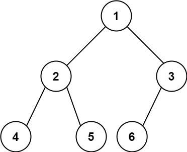

# [222. Count Complete Tree Nodes](https://leetcode.com/problems/count-complete-tree-nodes/)

| Category | Difficulty | Likes | Dislikes |
| :------: | :--------: | :---: | :------: |
| Algorithms | Easy | 9359 | 601 |

**Tags:** [`binary-search`](https://leetcode.com/tag/binary-search), [`bit-manipulation`](https://leetcode.com/tag/bit-manipulation), [`tree`](https://leetcode.com/tag/tree), [`binary-tree`](https://leetcode.com/tag/binary-tree)

**Companies:** `google`, `facebook`, `microsoft`, `amazon`, `adobe`, `apple`

## Description

Given the `root` of a **complete** binary tree, return the number of the nodes in the tree.

According to **Wikipedia**, every level, except possibly the last, is completely filled in a complete binary tree, and all nodes in the last level are as far left as possible. It can have between `1` and `2^h` nodes inclusive at the last level `h`.

Design an algorithm that runs in less than O(n) time complexity.

 

**Example 1:**


```

Input: root = [1,2,3,4,5,6]
Output: 6

```

**Example 2:**

```

Input: root = []
Output: 0

```

**Example 3:**

```

Input: root = [1]
Output: 1

```

 

**Constraints:**

	- The number of nodes in the tree is in the range `[0, 5 * 10^4]`.

	- `0 <= Node.val <= 5 * 10^4`

	- The tree is guaranteed to be **complete**.

---

**Links:** [Submissions](https://leetcode.com/problems/count-complete-tree-nodes/) | [Solutions](https://leetcode.com/problems/count-complete-tree-nodes/)
