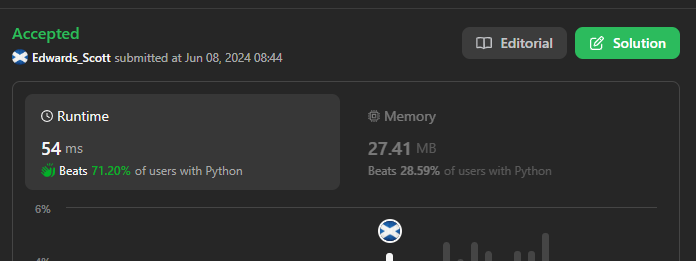
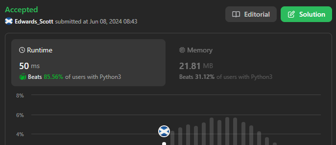

# 💢☠💫Easiest👾Faster✅💯 Lesser🧠 🎯 C++✅Python3🐍✅Java✅C✅Python🐍✅💥🔥💫Explained☠💥🔥 Beats 💯

**Author:** Edwards310
**Votes:** 6
**Link:** [https://leetcode.com/problems/count-complete-tree-nodes/solutions/5277260/](https://leetcode.com/problems/count-complete-tree-nodes/solutions/5277260/)

---

# Intuition






```C++ []
/**
 * Definition for a binary tree node.
 * struct TreeNode {
 *     int val;
 *     TreeNode *left;
 *     TreeNode *right;
 *     TreeNode() : val(0), left(nullptr), right(nullptr) {}
 *     TreeNode(int x) : val(x), left(nullptr), right(nullptr) {}
 *     TreeNode(int x, TreeNode *left, TreeNode *right) : val(x), left(left),
 * right(right) {}
 * };
 */
class Solution {
private:
    int helper(TreeNode* root, int count) {
        if (root == NULL)
            return count;
        count = helper(root->left, count + 1);
        count = helper(root->right, count);
        return count;
    }

public:
    int countNodes(TreeNode* root) { 
        return helper(root, 0);
        }
};
```
```python3 []
# Definition for a binary tree node.
# class TreeNode:
#     def __init__(self, val=0, left=None, right=None):
#         self.val = val
#         self.left = left
#         self.right = right
class Solution:
    def countNodes(self, root: Optional[TreeNode]) -> int:
        if not root:
            return 0
        return self.countNodes(root.left) + self.countNodes(root.right) + 1
```
```Java []
/**
 * Definition for a binary tree node.
 * public class TreeNode {
 * int val;
 * TreeNode left;
 * TreeNode right;
 * TreeNode() {}
 * TreeNode(int val) { this.val = val; }
 * TreeNode(int val, TreeNode left, TreeNode right) {
 * this.val = val;
 * this.left = left;
 * this.right = right;
 * }
 * }
 */
class Solution {
    public int countNodes(TreeNode root) {
        if (root == null)
            return 0;
        return countNodes(root.left) + countNodes(root.right) + 1;
    }
}
```
```C []
/**
 * Definition for a binary tree node.
 * struct TreeNode {
 *     int val;
 *     struct TreeNode *left;
 *     struct TreeNode *right;
 * };
 */
int countNodes(struct TreeNode* root) {
    if (root == NULL) {
        return 0;
    }
    int a = countNodes(root->left);
    int b = countNodes(root->right);
    return a + b + 1;
}
```
```python []
# Definition for a binary tree node.
# class TreeNode(object):
#     def __init__(self, val=0, left=None, right=None):
#         self.val = val
#         self.left = left
#         self.right = right
class Solution(object):
    def countNodes(self, root):
        """
        :type root: TreeNode
        :rtype: int
        """
        if not root:
            return 0
        if root.left is None and root.right is None:
            return 1
        elif root.right is None:
            return 2
        
        def level(root):
            height = 0
            while root:
                height += 1
                root = root.left
            return height

        left = level(root.left)
        right = level(root.right)


        if left == right:
            return 2 ** left + self.countNodes(root.right)
        else:
            return self.countNodes(root.left) + 2**right
```
```C# []
/**
 * Definition for a binary tree node.
 * public class TreeNode {
 *     public int val;
 *     public TreeNode left;
 *     public TreeNode right;
 *     public TreeNode(int val=0, TreeNode left=null, TreeNode right=null) {
 *         this.val = val;
 *         this.left = left;
 *         this.right = right;
 *     }
 * }
 */
public class Solution {
    public int CountNodes(TreeNode root) {
        if(root == null)
            return 0;
        return CountNodes(root.left) + CountNodes(root.right) + 1;
    }
}
```
<!-- Describe your first thoughts on how to solve this problem. -->

# Approach
<!-- Describe your approach to solving the problem. -->

# Complexity
- Time complexity:
<!-- Add your time complexity here, e.g. $$O(n)$$ -->
     O(n)
- Space complexity:
<!-- Add your space complexity here, e.g. $$O(n)$$ -->
     O(1)
# Code
```
/**
 * Definition for a binary tree node.
 * public class TreeNode {
 * int val;
 * TreeNode left;
 * TreeNode right;
 * TreeNode() {}
 * TreeNode(int val) { this.val = val; }
 * TreeNode(int val, TreeNode left, TreeNode right) {
 * this.val = val;
 * this.left = left;
 * this.right = right;
 * }
 * }
 */
class Solution {
    public int countNodes(TreeNode root) {
        if (root == null)
            return 0;
        return countNodes(root.left) + countNodes(root.right) + 1;
    }
}
```

