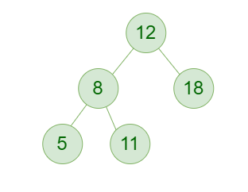
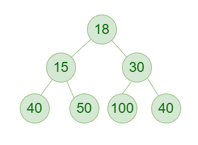
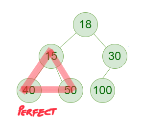
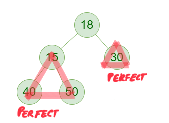
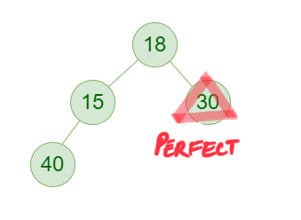

# 3 solutions with Diagrams 📊 & detailed explanation 🔥 (Beats 100%) TC: O(logn) & SC: O(1)

**Author:** mayankagarwal2402
**Votes:** 9
**Link:** [https://leetcode.com/problems/count-complete-tree-nodes/solutions/4614037/](https://leetcode.com/problems/count-complete-tree-nodes/solutions/4614037/)

---

# Approach 1: Simple DFS (Brute Force)

## Complexity
- Time complexity:
$$O(n)$$

- Space complexity:
$$O(logn)$$ for recursion stack as max depth = height = logn

## Intuition
recursively calculate size of both the child trees and return their sum

## Code
```go
func countNodes(root *TreeNode) int {
    if root != nil {
        return 1 + countNodes(root.Left) + countNodes(root.Right)
    }
    return 0
}
```

# Approach 2: Binary Search DFS (Compute Optimized)

## Complexity
- Time complexity:
$$O(logn)$$

- Space complexity:
$$O(logn)$$ for recursion stack

## Intuition
1. We know what complete and perfect binary trees are.
Complete Binary Tree:

Perfect Binary Tree:

2. We know that, the **Number of nodes** in a **Perfect Binary Tree** of **height `h`** is `2^h - 1` and can be calculated in constant time if height is known.
3. We can try to reduce our problem set **by half** on each iteration/recursion.
4. Atleast 1 of the left or right subtrees of a **Complete Binary Tree** is a **Perfect Binary Tree**




5. By the following logic, we can determine which one of left or right subtree is a **Perfect Binary Tree** for sure, by the following logic:
    - **if**, bottom right most node of left subtree is missing, then **right subtree is perfect** and we need to recurse into left subtree.
    - **else if**, bottom right most node of left subtree is present, then **left subtree is perfect** and we need to recurse into right subtree.
4. This way we need to count nodes in only one of the two subtrees which is not certain to be a Perfect Binary Tree. For the other half we can use the formula `2^h - 1`

## Code
```go
func countNodes(root *TreeNode) int {
    height := leftLegLen(root)

    return countNodesHelper(root, height)
}

func leftLegLen(root *TreeNode) int {
    if root == nil {
        return 0
    }

    return 1 + leftLegLen(root.Left)
}

func rightLegLen(root *TreeNode) int {
    if root == nil {
        return 0
    }

    return 1 + rightLegLen(root.Right)
}

func countNodesHelper(root *TreeNode, h int) int {
    if root == nil {
        return 0
    }

    leftSubtreeRightLegLen := rightLegLen(root.Left)
    leftSubtreeLeftLegLen := h-1

    leftSubtreeSize, rightSubtreeSize := 0, 0
    if leftSubtreeRightLegLen < leftSubtreeLeftLegLen {
        leftSubtreeSize = countNodesHelper(root.Left, h-1)
        rightSubtreeSize = int(math.Pow(2.0, float64(h-2))) - 1
    } else {
        leftSubtreeSize = int(math.Pow(2.0, float64(h-1))) - 1
        rightSubtreeSize = countNodesHelper(root.Right, h-1)
    }
    return 1 + leftSubtreeSize + rightSubtreeSize
}
```

# Approach 3: Binary Search DFS Iterative (Compute & Memory Optimized)

## Complexity
- Time complexity:
$$O(logn)$$

- Space complexity:
$$O(1)$$

## Intuition
We can convert our recursion into iteration to avoid extra O(logn) space needed by recursion stack.

# Code
```go

func countNodes(root *TreeNode) int {
    h := leftLegLen(root)
    fmt.Println("h:", h)
    return countNodesHelper(root, h)
}

func countNodesHelper(root *TreeNode, h int) int {
    count := 0
    for root != nil {
        count += 1 // +1 for root
        leftSubtreeLeftLegLen, leftSubtreeRightLegLen := h-1, rightLegLen(root.Left)

        if leftSubtreeRightLegLen < leftSubtreeLeftLegLen {
            rightSubtreeSize := int(math.Pow(2.0, float64(h-2))) - 1
            count += rightSubtreeSize
            h -= 1
            root = root.Left
        } else {
            leftSubtreeSize := int(math.Pow(2.0, float64(h-1))) - 1
            count += leftSubtreeSize
            h -= 1
            root = root.Right
        }
    }

    return count
}

func leftLegLen(root *TreeNode) int {
    l := 0
    for root != nil {
        l++
        root = root.Left
    }
    return l
}

func rightLegLen(root *TreeNode) int {
    l := 0
    for root != nil {
        l++
        root = root.Right
    }
    return l
}
```


> PS: Please upvote if you liked the explanatoin and appreciate my effort, helps it reaching others who need it. Thanks :)
Stay motivated.


