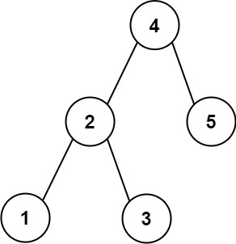

# [270. Closest Binary Search Tree Value](https://leetcode.com/problems/closest-binary-search-tree-value/)

| Category | Difficulty | Likes | Dislikes |
| :------: | :--------: | :---: | :------: |
| Algorithms | Easy | 1892 | 164 |

**Tags:** [`binary-search`](https://leetcode.com/tag/binary-search), [`tree`](https://leetcode.com/tag/tree), [`depth-first-search`](https://leetcode.com/tag/depth-first-search), [`binary-search-tree`](https://leetcode.com/tag/binary-search-tree), [`binary-tree`](https://leetcode.com/tag/binary-tree)

**Companies:** `facebook`, `uber`, `oracle`, `amazon`, `bloomberg`, `microsoft`, `google`, `snapchat`

## Description

Given the `root` of a binary search tree and a `target` value, return *the value in the BST that is closest to the* `target`. If there are multiple answers, print the smallest.

 

**Example 1:**


```

Input: root = [4,2,5,1,3], target = 3.714286
Output: 4

```

**Example 2:**

```

Input: root = [1], target = 4.428571
Output: 1

```

 

**Constraints:**

	- The number of nodes in the tree is in the range `[1, 10^4]`.

	- `0 <= Node.val <= 10^9`

	- `-10^9 <= target <= 10^9`

---

**Links:** [Submissions](https://leetcode.com/problems/closest-binary-search-tree-value/) | [Solutions](https://leetcode.com/problems/closest-binary-search-tree-value/)
