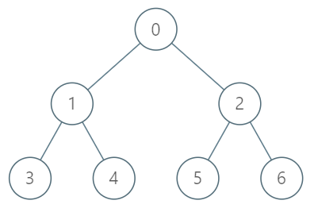

# C++ | Binary Lifting with explanation | O(h) Search

**Author:** di_b
**Votes:** 8
**Link:** [https://leetcode.com/problems/kth-ancestor-of-a-tree-node/solutions/686535/](https://leetcode.com/problems/kth-ancestor-of-a-tree-node/solutions/686535/)

---

Idea is to build an ancestor array for each node which store 1st, 2nd, 4th ancestors and so on.
In the given example:



Array : [-1,0,0,1,1,2,2]
height = 3

In the first iteration, we fill the 1st ancestor i.e the parent
In the second iteration, we fill the 2nd ancestor for all the nodes and so on..
At the end, Our ancestor array will look like this:
0 : -1 -1 -1
1 : 0  -1 -1
2 : 0  -1 -1
3 : 1   0 -1
4 : 1   0 -1
5 : 2   0 -1
6 : 2   0 -1

For getting the kth node, we jump to 2^i parent and find its ancestor.

```
    vector<vector<int>> dp;
    int height;
	
    TreeAncestor(int n, vector<int>& parent) {

        height = (int)ceil(log2(n)); 

        dp = vector<vector<int>>(n, vector<int>(height, -1));
 
        for(int i = 0; i < n; i++)
            dp[i][0] = parent[i];

        for(int h = 1; h < height; h++)
            for(int i = 0; i < n; i++)
                if( dp[i][h-1] != -1)
                    dp[i][h] = dp[dp[i][h-1]][h-1];
    }
	
	// O(h) - h = height of tree
    int getKthAncestor(int node, int k) {
        for (int i = 0; i <= height; i++) 
        { 
            if (k & (1 << i)) 
            { 
                node = dp[node][i]; 
                if (node == -1) 
                    break; 
            } 
        }
        return node;
    }
```