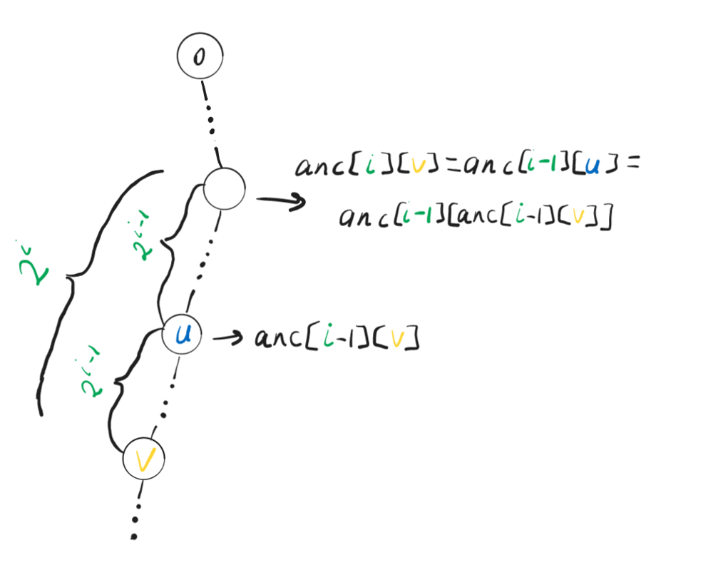
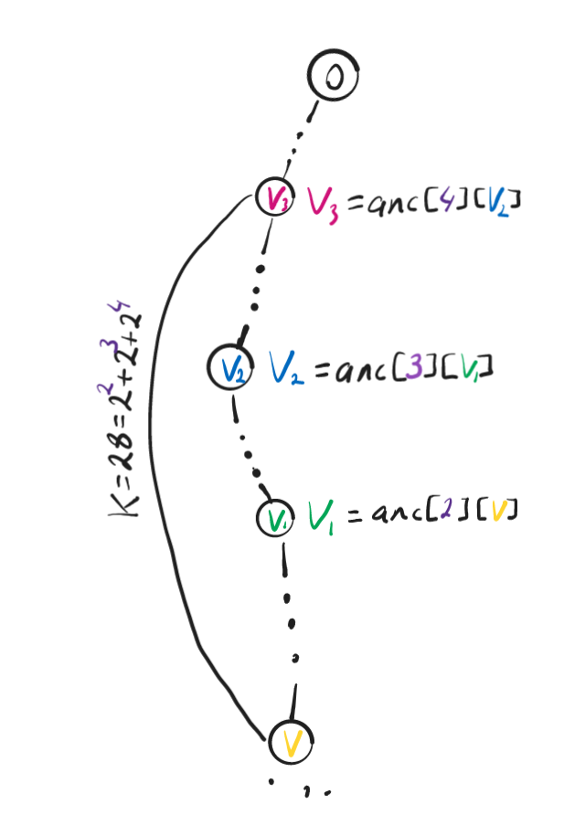

# Elegant solution, detailed explanation with illustrations!! C++, python3, python

**Author:** arayi
**Votes:** 17
**Link:** [https://leetcode.com/problems/kth-ancestor-of-a-tree-node/solutions/3372580/](https://leetcode.com/problems/kth-ancestor-of-a-tree-node/solutions/3372580/)

---

# Intuition
<!-- Describe your first thoughts on how to solve this problem. -->
The first thing that comes to mind is to just go up $k$ times for each $getKthAncestor$ query. But the time complexity of that approach would be $O(q*k)$ where $q$ is the number of queries. So going up 1 step at a time is too slow. So think of how can we go up with bigger steps.

<b>Hint 1:</b> Consider the option of precomputing a set of ancestors for each node and then utilizing that set to ascend by more than one step at a time while responding to the queries.

<b>Hint 2:</b> Those sets should consist of ancestors that are a power of two edges away, namely the $2^i$th ancestors ($i\\geq0$) of each node.
# Approach
<!-- Describe your approach to solving the problem. -->
First, we need to calculate $2^i$th ($0\\leq i\\leq log_{2}n$) ancesstors for each node $v$.
To do that we can use dynamic programing approach.
Let $anc[i][v]$ denote the $2^i$th ancestor of $v$
if $i=0$: 
$\\quad$ $2^0=1$, $1$st  ancestor of $v$ is just $parent[v]$, thus, $anc[0][v]=parent[v]$
if $i\\gt0$: 
$\\quad$ Assume that we calculated the $2^{i-1}$th ancestor of each node and now we want to calculate the $2^i$th ancestor of node $v$. Notice that going up $2^i$ times is the same as going up $2^{i-1}$ times twice as $2*2^{i-1}=2^i$
$\\quad$ Let $u$ be the $2^{i-1}$th ancestor of $v$. We have already stored the value of $u$ in $anc[i-1][v]$ and can access that value in $O(1)$. If $u=-1$, meaning that $v$ doesn't have a $2^{i-1}$th ancestor, then $v$ doesn't have a $2^i$th ancestor either, and we set $anc[i][v]=-1$. However, if $u$ isn't $-1$, then we can find the $2^{i-1}$th ancestor of $u$, which we have already calculated and stored in $anc[i-1][u]$. Therefore, we can set $anc[i][v]=anc[i-1][u]=anc[i-1][anc[i-1][v]]$, and this computation also takes $O(1)$ time.
Notice that we calculate $log_{2}n$*$n$ values each in $O(1)$. Therefore, the complexity of calculating the array $anc$ is $O(nlog_2n)$



After creating the $anc$ array, now we need to answer the queries. For instance, consider the query where $k=28$. Instead of going up $28$ times using the $parent$ array, we can utilize the $anc$ array. Notice that $28$ can be represented as the sum of powers of $2$: $28=2^2+2^3+2^4$. Thus, we can find the $28$th ancestor of a given node in just $3$ steps instead of $28$! First, we find the $2^2$nd ancestor of the initial node. Then we find the $2^3$rd ancestor of that ancestor. Finally, we find the $2^4$th ancestor of that second ancestor.



The general case:
We need to iterate through the bits of $k$ and update $v$ accordingly. That is if $i$th bit of $k$ is $1$ we need to update $v:=anc[i][v]$. And if $v$ becomes $-1$ at some point we can return $-1$ instantly. The implementation of it would look like this:
```cpp []
    for (int i = 0; i <= log(k); i++) {
        if (node == -1)
            return -1;
        if ((1 << i) & k)
            node = anc[i][node];
    }
```
```python3 []
    for i in range(log(k)):
      if node == -1:
          return -1
      if (1 << i) & k:
          node = anc[i][node]
```
```python []
    for i in range(log(k)):
      if node == -1:
          return -1
      if (1 << i) & k:
          node = anc[i][node]
```
We answer each query in $O(log_2{k})$.
# Complexity
- Time complexity:
<!-- Add your time complexity here, e.g. $$O(n)$$ -->
$\\quad$ The complexity of calculating the $anc$ array - $O(nlog_2{n})$
$\\quad$ The worst case complexity of answering each query is $O(log_2n)$ as $k\\leq n$. So the overall complextity of answering questions will be $O(qlog_2n)$, where $q$ is the number of queries.
$\\quad$ Therefore, the time complexity of this solution is $O(nlog_2n+qlog_2n)$
- Space complexity:
<!-- Add your space complexity here, e.g. $$O(n)$$ -->
$\\quad$ The only space used is the array $anc$, which has $O(nlog_2n)$ space somplexity. That is storing $log_2n$ ancestors for each node and the number of nodes is $n$.

Please upvote if you found it helpful, thank you!!
# Code
```cpp []
class TreeAncestor {
   public:
    vector<int> anc[16]; //16 == max(log(n))
    TreeAncestor(int n, vector<int> &parent) {
        anc[0] = parent;
        for (int i = 1; i < 16; i++) {
            anc[i].resize(n);
            for (int v = 0; v < n; v++) {
                if (anc[i - 1][v] == -1)
                    anc[i][v] = -1;
                else
                    anc[i][v] = anc[i - 1][anc[i - 1][v]];
            }
        }
    }

    int getKthAncestor(int node, int k) {
        for (int i = 0; i < 16; i++) {
            if (node == -1)
                return -1;
            if ((1 << i) & k)
                node = anc[i][node];
        }
        return node;
    }
};

/**
 * Your TreeAncestor object will be instantiated and called as such:
 * TreeAncestor* obj = new TreeAncestor(n, parent);
 * int param_1 = obj->getKthAncestor(node,k);
 */
```
```python3 []
class TreeAncestor:

    def __init__(self, n: int, parent: List[int]):
        self.anc = [[parent[i] for i in range(n)]]
        for i in range(1, 16): # 16 == max(log(n))
            self.anc.append([])
            for v in range(n):
                if self.anc[i-1][v]==-1:
                    self.anc[i].append(-1)
                else:
                    self.anc[i].append(self.anc[i-1][self.anc[i-1][v]])

    def getKthAncestor(self, node: int, k: int) -> int:
        for i in range(16):
            if node == -1:
                return -1
            if (1<<i)&k:
                node=self.anc[i][node]
        return node


# Your TreeAncestor object will be instantiated and called as such:
# obj = TreeAncestor(n, parent)
# param_1 = obj.getKthAncestor(node,k)
```
``` python []
class TreeAncestor(object):

    def __init__(self, n, parent):
        """
        :type n: int
        :type parent: List[int]
        """
        self.anc = [[parent[i] for i in range(n)]]
        for i in range(1, 16):
            self.anc.append([])
            for v in range(n):
                if self.anc[i-1][v]==-1:
                    self.anc[i].append(-1)
                else:
                    self.anc[i].append(self.anc[i-1][self.anc[i-1][v]])
        

    def getKthAncestor(self, node, k):
        """
        :type node: int
        :type k: int
        :rtype: int
        """
        for i in range(16):
            if node == -1:
                return -1
            if (1<<i)&k:
                node=self.anc[i][node]
        return node


# Your TreeAncestor object will be instantiated and called as such:
# obj = TreeAncestor(n, parent)
# param_1 = obj.getKthAncestor(node,k)
```

