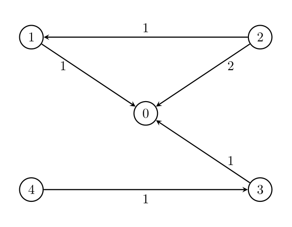
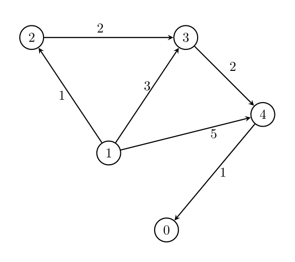

# [3419. Minimize the Maximum Edge Weight of Graph](https://leetcode.com/problems/minimize-the-maximum-edge-weight-of-graph/)

| Category | Difficulty | Likes | Dislikes |
| :------: | :--------: | :---: | :------: |
| Algorithms | Medium | 234 | 19 |

**Tags:** [`binary-search`](https://leetcode.com/tag/binary-search), [`depth-first-search`](https://leetcode.com/tag/depth-first-search), [`breadth-first-search`](https://leetcode.com/tag/breadth-first-search), [`graph`](https://leetcode.com/tag/graph), [`shortest-path`](https://leetcode.com/tag/shortest-path)

**Companies:** `google`

## Description

You are given two integers, `n` and `threshold`, as well as a **directed** weighted graph of `n` nodes numbered from 0 to `n - 1`. The graph is represented by a **2D** integer array `edges`, where `edges[i] = [A_i, B_i, W_i]` indicates that there is an edge going from node `A_i` to node `B_i` with weight `W_i`.

You have to remove some edges from this graph (possibly **none**), so that it satisfies the following conditions:

	- Node 0 must be reachable from all other nodes.

	- The **maximum** edge weight in the resulting graph is **minimized**.

	- Each node has **at most** `threshold` outgoing edges.

Return the **minimum** possible value of the **maximum** edge weight after removing the necessary edges. If it is impossible for all conditions to be satisfied, return -1.

 

**Example 1:**

**Input:** n = 5, edges = [[1,0,1],[2,0,2],[3,0,1],[4,3,1],[2,1,1]], threshold = 2

**Output:** 1

**Explanation:**

Remove the edge `2 -> 0`. The maximum weight among the remaining edges is 1.

**Example 2:**

**Input:** n = 5, edges = [[0,1,1],[0,2,2],[0,3,1],[0,4,1],[1,2,1],[1,4,1]], threshold = 1

**Output:** -1

**Explanation:** 

It is impossible to reach node 0 from node 2.

**Example 3:**

**Input:** n = 5, edges = [[1,2,1],[1,3,3],[1,4,5],[2,3,2],[3,4,2],[4,0,1]], threshold = 1

**Output:** 2

**Explanation:** 

Remove the edges `1 -> 3` and `1 -> 4`. The maximum weight among the remaining edges is 2.

**Example 4:**

**Input:** n = 5, edges = [[1,2,1],[1,3,3],[1,4,5],[2,3,2],[4,0,1]], threshold = 1

**Output:** -1

 

**Constraints:**

	- `2 <= n <= 10^5`

	- `1 <= threshold <= n - 1`

	- `1 <= edges.length <= min(10^5, n * (n - 1) / 2).`

	- `edges[i].length == 3`

	- `0 <= A_i, B_i < n`

	- `A_i != B_i`

	- `1 <= W_i <= 10^6`

	- There **may be** multiple edges between a pair of nodes, but they must have unique weights.

---

**Links:** [Submissions](https://leetcode.com/problems/minimize-the-maximum-edge-weight-of-graph/) | [Solutions](https://leetcode.com/problems/minimize-the-maximum-edge-weight-of-graph/)
